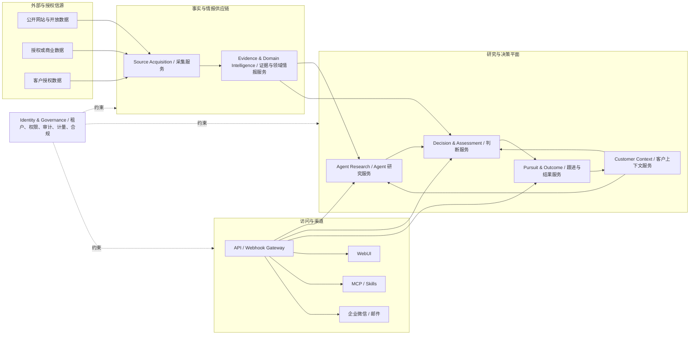

# 妙洽 MiaoQia

> 懂你业务、会取证、能推理、可协作的 AI 商业机会研究与决策系统。

妙洽面向需要持续发现、调查、判断和推进商业机会的企业。它通过多源数据服务获取并治理外部信号，结合每个客户自己的产品、能力、资质、区域和经营策略，由 AI Agent 调用受控的数据与分析工具完成取证、交叉验证和研究，再辅助客户完成决策、行动和复盘。

妙洽不是单纯的信息聚合网站、关键词订阅工具或 AI 内容生成工具。采集和入库只是可靠上下文供应链，真正的产品价值发生在围绕用户目标完成调查、研判和行动：

```text
外部与授权信息
  → 来源观察与证据
  → 领域事实、事件与关系
  → 研究任务与证据调查
  → 客户相关性、可信度与风险判断
  → 决策、行动与协作
  → 结果反馈与策略学习
```

## 项目定位

**正式定位：** AI 商业机会研究与决策系统  
**简化表达：** AI 商业机会决策系统  
**品牌主张：** 懂你业务、会取证、能推理、可协作的 AI 商业机会研究与决策系统。

妙洽的长期定位不限定特定行业。行业只影响首批试点、领域数据模型、客户能力模板和市场进入顺序，不定义产品本身。招投标不是产品边界，而是第一个领域适配器，也是具有真实数据、判断问题和客户经验的首个验证场景。

- 首个信息领域：招投标、采购意向及项目前置信号；
- 首批试点优先选择已有数据、规则和客户经验的建材、管材及工程配套场景；
- 后续可以扩展企业动态、知识产权、政策规划、司法信用、产业链等信息领域；
- 不同领域共享证据、版本、质量、实体、关系和权限等基础能力，但保留各自的数据结构、事件和生命周期。

行业无关不等于同时覆盖所有行业。妙洽将通过有限的信息领域和真实客户旅程验证通用架构，再逐步扩展数据覆盖和业务场景。

## 项目状态

当前处于正式立项前的用户旅程、业务流程、领域契约和服务边界设计阶段。

现阶段需要优先明确：

- 不同角色的用户目标、用户旅程和决策产物；
- 数据采集、证据治理、Agent 研究、客户判断和行动协作之间的职责；
- 通用平台内核与招投标等领域模型的边界；
- 来源授权、证据质量、个人信息处理和模型数据使用边界；
- 首批试点的研究任务、数据范围、客户问题和验收方法。

正式立项的最小条件是：至少一个垂直场景拥有真实客户样本和付费验证意愿，核心来源权利可解释，且一条从信号发现到研究、判断、行动和反馈的完整用户旅程可以被清楚描述和验收。


## 用户目标与业务旅程

妙洽的业务流程从用户目标开始，而不是从采集任务或数据库表开始。不同角色最终都在完成以下连续旅程：

```text
业务建模
  → 机会发现
  → 背景调查与取证
  → 相关性、可信度与风险评估
  → 决策与资源投入
  → 跟进协作
  → 结果复盘与策略学习
```

| 旅程阶段 | 用户目标 | 主要产物 | 负责能力 |
|---|---|---|---|
| 业务建模 | 让系统理解客户能做什么、不能做什么 | 客户上下文、能力、资质、区域、风险偏好 | 客户上下文服务 |
| 机会发现 | 不漏掉值得关注的外部变化 | 领域信号、来源、时间、质量和关联实体 | 采集与情报服务 |
| 背景调查 | 弄清项目、组织和竞争关系 | 研究任务、证据集合、历史与关系分析 | Agent 研究服务 |
| 机会评估 | 判断是否真实、相关、可赢、值得投入 | 事实、推断、未知项、风险、建议 | 判断服务 |
| 决策与行动 | 决定跟进、观察、放弃或投入资源 | 决策、审批、负责人、任务和时限 | 决策与跟进服务 |
| 结果复盘 | 让下一次判断更准确 | 结果、误判原因、策略调整和评估样本 | 结果与学习能力 |

例如，判断“是否存在定向招标倾向”需要 Agent 调用采购方历史、历史中标方、关联项目、技术参数变化和来源质量工具，形成带证据的研究报告，再由负责人决定是否跟进。抓取和入库只提供可靠上下文，不直接等同于产品价值。

## 核心业务语义

### 信息、研究和决策分离

公开公告、专利、企业变更或政策文件首先是来源观察。经过采集和处理后，它们成为带证据的领域事实、事件、关系或商业信号；用户或 Agent 围绕这些信号发起研究，结合客户上下文形成判断，最后形成决策和行动。

妙洽必须始终区分：

- 来源发布或系统观察到的内容；
- 从证据解析出的领域事实与事件；
- Agent 通过工具调查后形成的事实、推断和未知项；
- 某个客户的相关性、可信度、风险和优先级判断；
- 客户批准的决策、任务、跟进和结果。

“商机”是面向用户的业务统称或聚合视图，不是所有信息领域共享的核心实体。招投标领域可以有 `TenderNotice`、`ProcurementPlan` 和 `AwardRecord`，其他领域保留自己的对象、字段和生命周期。

### 信息生命周期与客户生命周期分离

不同信息领域拥有自己的生命周期。例如：

- 招投标信息可能经历意向、计划、公告、更正、开标、中标、合同和履约；
- 知识产权信息可能经历申请、公开、审查、授权、转让和失效；
- 企业信息可能经历设立、变更、融资、诉讼、处罚和注销。

这些领域生命周期不应被强行压入一个统一的商机阶段枚举。妙洽只统一来源、证据、版本、时间、实体、关系、质量和访问契约，再由领域模型表达各自事实和状态。

客户侧则拥有独立生命周期：

```text
待评估 → 调查中 → 待复核 / 观察 / 排除
      → 跟进 → 决策 → 执行 → 结果 → 复盘
```

两类生命周期通过版本化引用关联，但不能相互覆盖。

## 面向业务能力的服务架构

妙洽采用面向业务能力的微服务架构。服务拥有独立数据和故障边界，通过版本化 API 和领域事件协作；渠道只调用服务，不复制业务规则。



### 1. Source Acquisition Service

负责来源目录、访问契约、采集计划、限速、抓取尝试、来源健康和原始响应。它不负责客户匹配和业务判断，采集结果通过版本化事件交给证据与领域情报服务。

### 2. Evidence & Domain Intelligence Service

负责不可变证据、解析修订、字段 provenance、实体、关系、领域事实、领域事件、历史查询和质量评估。它为 Agent 和判断服务提供受控工具，不把所有领域强行压成统一对象。

通用内核只统一来源、请求、证据、观察时间、版本、解析任务、质量、实体引用和访问控制。招投标、知识产权、企业动态等领域分别表达自己的字段、事件和生命周期。

### 3. Customer Context Service

负责客户产品、能力、资质、业绩、区域、战略、风险偏好、知识资产和策略版本。客户上下文属于租户私有域，不能进入其他租户的检索、模型上下文或共享分析。

### 4. Agent Research Service

负责研究计划、工具选择、上下文组装、交叉验证、研究运行状态、预算和结果报告。Agent 只能调用受控 API 和工具，不能直接读写其他服务数据库，也不能自行执行高影响副作用。

研究结果必须区分事实、推断、建议和未知项，并保留工具调用、证据引用、模型版本、提示版本和数据范围。

### 5. Decision & Assessment Service

负责把领域事实、研究结果和客户上下文转化为租户私有判断，包括相关性、可信度、资格、风险、竞争态势、优先级和 bid/no-bid 草案。确定性硬门槛、检索特征、模型判断和 LLM 归纳必须分别记录，不能压缩成无法审计的单一分数。

### 6. Pursuit & Outcome Service

负责用户批准后的决策、负责人、任务、跟进、通知、审批、结果和复盘。高影响动作必须经过明确授权，结果反馈用于改进客户策略和评估集，但不能改写公共事实。

### 7. Identity & Governance Service

以下能力横跨所有业务服务：

- 租户、组织、成员和服务账号；
- 身份认证、角色、数据权限和动作授权；
- 任务、事件、幂等、重放和审批；
- 审计、日志、指标、追踪和质量评估；
- 套餐、配额、计量和成本归属；
- 数据分类、保留、删除、加密和模型使用策略；
- 来源权利、个人信息、生成内容和跨境处理合规。

这些能力是业务服务的约束与支撑，不应反过来主导项目定位。

### 8. Access & Channel Gateway

负责 REST/OpenAPI、Webhook、WebUI、MCP、Skills、企业微信和邮件的协议适配。所有渠道使用统一的领域服务、权限和审计边界，租户身份从可信授权上下文派生，不能由调用方任意指定。

WebUI 适合配置、批量审查、复杂研究和审批；企业微信与邮件适合摘要、通知、快捷反馈和提醒；MCP 与 Skills 适合在授权边界内调用研究和决策工具。

## 数据边界

系统至少区分以下八类数据和业务产物：

| 数据类型 | 含义 | 典型可见性 |
|---|---|---|
| `source_observation` | 来源实际发布或系统观察到的网页、响应、附件和采集事实 | 公共、授权或受保护 |
| `evidence` | 可定位、不可变、可复核的原始证据及其版本 | 按来源权利控制 |
| `domain_fact` / `domain_event` | 从证据解析出的领域事实、事件、实体、关系和生命周期状态 | 按来源权利控制 |
| `customer_context` | 客户产品、能力、资质、知识、区域和经营策略 | 租户私有 |
| `research_case` | 用户或 Agent 围绕某个问题发起的调查、工具调用和证据集合 | 租户私有 |
| `assessment` | 某客户对事实和研究结果的相关性、可信度、优先级、风险和建议 | 租户私有 |
| `decision_workflow` | 经批准的决策、负责人、任务、材料、行动和审批 | 租户私有 |
| `outcome` | 跟进结果、误判原因、复盘记录和策略改进依据 | 租户私有 |

公共事实可以在权利允许的范围内复用。客户上下文、研究任务、判断、业务知识、工作状态和结果必须保持租户私有，不得进入其他客户的检索、模型上下文、缓存、日志或分析结果。

## 版本与证据原则

- 原始证据不可因解析器升级或客户反馈而改变；
- 来源实际发生变化与系统重新解释旧证据是两类版本；
- 领域事实必须能够定位到具体来源证据；
- 研究任务必须固定引用当时的数据版本、工具版本和客户上下文；
- 判断和决策必须固定引用研究结果、策略版本、特征快照和模型版本；
- AI 运行必须记录所用证据、模型、提示、工具、数据范围和结果版本；
- 信息不足或版本无法验证时应明确显示不可用或需要复核，不能静默替换证据；
- 客户结果反馈可以改进其策略、工具和评估集，但不能改写公共事实。

## Tender Intel 的角色

[Tender Intel](https://github.com/lansespirit/tender-intel) 是妙洽的参考项目和首个招投标领域适配器基础，不是妙洽的产品边界或通用领域模型。

它目前已经实现：

- 公共信源的一次采集、多客户复用；
- 请求资源、抓取尝试和原始 Blob 归档；
- 稳定公告身份、不可变来源版本和可重放解析修订；
- 标量字段、联系人、链接、采购项、质量和 provenance；
- 客户规则、证据化候选评估、匹配反馈和增量交付；
- 共享事实仓库与客户业务状态的物理隔离。

妙洽应复用和提升 Tender Intel 已验证的原则：证据不可变、来源版本与解析版本分离、召回优先、客户隔离、双版本固定、增量处理和可重放。

Tender Intel 不是妙洽的完整上层架构，也不能被原样视为通用数据平台：

- 当前核心对象和字段仍以招投标公告为中心；
- 当前客户模板和部分匹配语义仍带有具体试点行业特征；
- 当前运行形态以 Python CLI、SQLite、本地文件和导出为主；
- 尚未覆盖通用多领域模型、完整 AI 决策服务和正式多渠道服务。

后续需要在保持现有正确边界的前提下，明确哪些代码直接复用、哪些能力拆入采集与证据服务、哪些继续留在招投标领域适配器，以及如何通过 API 和事件供 Agent 研究服务调用。

## 核心设计原则

### 数据服务与客户业务解耦

公共或授权信源按自身计划采集和维护，不绑定某个客户的关键词或任务。同一份合法数据可以被多个客户的独立策略使用，客户规则和反馈不能进入共享数据域。

### 证据优先于结论

系统交付的不只是摘要或分数。关键事实、匹配理由、风险和 AI 建议必须能够回到具体来源、版本和证据。

### 客户理解是持续演进的模型

客户业务不是一组静态关键词。产品、资质、区域、战略、风险偏好和实际反馈共同构成客户上下文，并通过版本化策略持续演进。

### 用户旅程优先于技术模块

每个服务和领域对象都必须能够说明它支持哪个用户目标、产生什么决策产物以及如何进入下一步行动。采集、解析、Agent、判断和工作流按旅程协作，不以技术层次代替业务流程。

### Agent 研究必须可取证

Agent 负责规划调查、调用工具、交叉验证和组织结论，不直接创造事实。每个重要判断都必须区分事实、推断、未知项和建议，并保留证据、工具、模型和审批记录。

### AI 有边界

外部网页、附件和客户文档均视为不可信输入。AI 不能因文档中的指令扩大权限，不能绕过客户数据边界，也不能擅自执行高影响动作。

### 渠道不复制业务逻辑

Web、API、MCP、Skills、企业微信和邮件使用相同的领域服务、权限和审计边界。更换入口不应改变事实、匹配结果或业务规则。

### 通用架构不抹平领域差异

系统统一技术和治理契约，但保留招投标、知识产权、企业动态等领域各自的字段、事件和生命周期。扩展性来自清晰的领域边界，而不是无限扩张的通用表。

## 当前非目标

- 不把妙洽限定为某个行业的专用产品；
- 不在立项阶段承诺同时覆盖所有行业和信息领域；
- 不把所有外部信息直接称为客户商机；
- 不用一个巨型通用 Schema 抹平不同领域；
- 不让 AI 替客户作出不可解释或未经批准的最终决定；
- 不抓取或出售来源不明的私人信息；
- 不依赖个人账号或规避访问控制的非官方自动化；
- 不让不同渠道各自形成独立的数据、匹配和权限实现；
- 不把招投标领域适配器误写成产品边界；
- 不在用户旅程、服务边界和数据契约稳定前扩展全部领域、渠道和高影响工作流。

## 品牌

**中文名称：** 妙洽  
**英文名称：** MiaoQia  
**域名：** [miaoqia.com](https://miaoqia.com)  
**正式定位：** AI 商业机会研究与决策系统  
**简化表达：** AI 商业机会决策系统  
**品牌主张：** 懂你业务、会取证、能推理、可协作的 AI 商业机会研究与决策系统。
