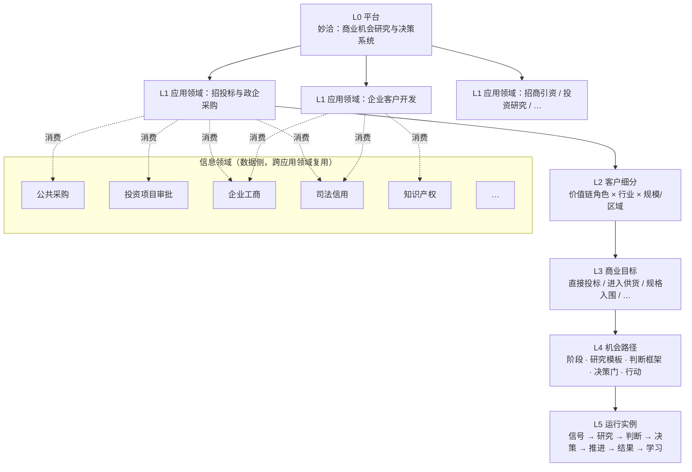

# 业务架构

> 状态：评审中 · 版本：1.0 · 更新：2026-10-12 · 负责人：产品负责人

本文定义妙洽的业务层级、通用业务旅程、目标对象、角色、决策产物和业务不变量。它是所有应用领域、子系统和数据模型的业务基准。

## 1. 业务层级模型



### 1.1 各层定义与归属

| 层级 | 定义在哪里 | 由谁扩展 | 在系统中的载体 |
|---|---|---|---|
| L0 平台 | 平台核心 | 平台团队 | 全部子系统 |
| L1 应用领域 | 应用领域包 | 领域团队 | `ApplicationDomain` 注册项 |
| 信息领域 | 信息领域包 | 数据团队 | 领域 Schema、来源处理器、解析器 |
| L2 客户细分 | 应用领域包 + 行业包 | 领域团队、行业专家 | `SegmentProfile` 模板 |
| L3 商业目标 | 平台定义类型，应用领域实例化 | 平台团队定义，领域团队实例化 | `ObjectiveType` / `Objective` |
| L4 机会路径 | 应用领域包 | 领域团队、客户定制 | `PlaybookDefinition` |
| L5 运行实例 | 租户运行时 | 客户与系统 | `Signal`、`ResearchCase`、`Assessment`、`Decision`、`Pursuit`、`Outcome` |

### 1.2 客户细分的维度

客户细分不是一个行业标签，而是多维组合：

| 维度 | 含义 | 示例（招投标应用领域） |
|---|---|---|
| 价值链角色 | 在交易链条中的位置 | 直接投标人、总承包商、专业分包、材料设备厂商、经销代理商、设计咨询、金融机构 |
| 行业 | 提供的产品或服务门类 | 建材管材、信息化、医疗器械、环保设备、电力设备、物业服务 |
| 采购类别 | 参与的交易类别 | 货物、工程、服务 |
| 主体偏好 | 主要面对的采购主体 | 政府机关、国企央企、医院、学校、军队 |
| 规模与区域 | 经营规模与服务范围 | 区域型中小企业、全国性企业 |

同一个客户可以同时属于多个价值链角色，因而同时追求多个商业目标。例如一家管材厂商：

```text
行业 = 建材管材
  ├─ 价值链角色 = 直接投标人     → 目标：水务集团管材集采投标
  ├─ 价值链角色 = 材料供货商     → 目标：向中标总包供货
  ├─ 价值链角色 = 品牌厂商       → 目标：进入设计院选型与业主品牌库
  └─ 价值链角色 = 渠道授权方     → 目标：管理经销商的授权投标
```

因此，平台的客户上下文必须支持**一个租户配置多个商业目标，每个目标有独立的策略、判断框架和机会路径**。

## 2. 通用业务旅程

所有应用领域和商业目标共享同一条通用旅程。机会路径是这条旅程在具体目标上的实例化。

```text
① 目标与业务建模 → ② 监测与发现 → ③ 研究与取证 → ④ 判断
       → ⑤ 决策 → ⑥ 推进与协作 → ⑦ 结果与学习 ─┐
       ↑                                             │
       └─────────────── 策略与客户上下文演进 ←───────┘
```

| 阶段 | 用户问题 | 系统动作 | 决策产物 | 主责子系统 |
|---|---|---|---|---|
| ① 目标与业务建模 | 我们要达成什么？我们能做什么、不能做什么？ | 维护客户档案，启用商业目标，配置策略 | `CustomerContext`、`Objective`、`PolicyVersion` | `customer-context` |
| ② 监测与发现 | 外部发生了什么与我们目标相关的变化？ | 采集、解析、实体关联、事件检测、策略匹配 | `DomainFact`、`DomainEvent`、`Signal` | 数据供应平面、`detection` |
| ③ 研究与取证 | 这件事是真的吗？谁参与？背景如何？还缺什么？ | 按研究模板调用受控工具，交叉验证 | `ResearchCase`、`EvidenceBundle`、`ResearchReport` | `research` |
| ④ 判断 | 与我们的目标是否相关、可信、可行、值得？ | 按判断框架执行硬门槛、评分和归纳 | `Assessment` | `assessment` |
| ⑤ 决策 | 是否投入？投入什么？谁负责？ | 生成决策草案，执行审批 | `Decision` | `assessment`、`identity` |
| ⑥ 推进与协作 | 下一步做什么？进展如何？ | 按机会路径推进阶段、任务、提醒 | `Pursuit`、`Task` | `pursuit`、`channels` |
| ⑦ 结果与学习 | 结果如何？哪里判断对了、哪里错了？ | 记录结果与原因，更新评估集，提出策略调整 | `Outcome`、`Feedback`、`PolicyProposal` | `pursuit`、`learning` |

旅程不是严格线性的：

- 监测可以跳过研究直接进入判断（低价值、规则明确的信号）；
- 研究可以独立发起，不依赖信号（例如“研究某个采购人过去三年的采购规律”）；
- 推进过程中会发起新的研究（例如中标公示后研究中标人）；
- 一个信号可以触发多个商业目标下的不同推进。

## 3. 目标对象

研究、判断和推进针对的对象不只是“一条公告”。平台支持以下目标对象类型：

| 类型 | 标识 | 含义 | 典型商业目标 |
|---|---|---|---|
| 项目 | `project` | 一个跨多个公告和阶段的业务项目 | 直接投标、进入供货、规格入围、分包 |
| 交易事件 | `domain_fact` | 一个具体的领域事实，如某条公告、某个中标结果 | 快速判断、竞争情报 |
| 组织 | `organization` | 采购人、竞争对手、总包、合作伙伴等 | 客户经营、竞争情报、交易对手风险、合作组队 |
| 市场 | `market` | 区域 × 品类 × 时间窗口 × 主体类型的组合 | 市场研究与布局、价格基准 |
| 关系 | `relationship` | 两个实体间的关系，如采购人与供应商 | 渠道、合作伙伴、竞争格局 |
| 计划与资金 | `program` | 政策、规划、预算、专项资金 | 前置布局、资金申报 |

目标对象以 `subject_ref = {type, id, version}` 引用，所有租户侧对象都通过它关联到公共域，绝不复制公共数据。结构见 [`intelligence/defs.schema.json`](../../contracts/schemas/intelligence/defs.schema.json)（草案）：`project` 指实体图谱的跨领域项目 `prj_`，采购项目 `pp_`、公告等领域事实一律以 `domain_fact` 引用；`market`、`program` 分别使用 `mkt_`、`prg_`；需要指向对象内部求值单位（如标包）时用 `part_id`。

## 4. 两类生命周期

### 4.1 领域生命周期（公共域）

由信息领域定义，描述外部对象自身的演进。例如招投标项目：

```text
立项/规划 → 采购意向 → 招标公告 → 更正澄清 → 开标 → 候选人公示
        → 中标/成交 → 合同 → 履约/验收 → 完成 / 终止
```

不同信息领域的生命周期各不相同，平台不强行统一。

### 4.2 客户生命周期（租户域）

由机会路径定义，描述客户自己的工作状态。所有机会路径共享以下顶层状态，各路径可细化阶段：

```text
待评估 → 研究中 → 待决策 ─┬→ 推进中 → 已结束（成功 / 失败 / 放弃）
                           ├→ 观察
                           └→ 排除
```

### 4.3 两者的关系

- 租户侧对象**引用**领域对象的特定版本，不复制、不覆盖；
- 领域状态变化以事件通知租户侧，由策略或机会路径决定是否触发重新判断、提醒或阶段变化；
- 客户的结果反馈只改变租户域，绝不改写公共事实。

## 5. 角色

### 5.1 客户角色

| 角色 | 职责 | 主要界面 |
|---|---|---|
| 决策者 | 设定目标与资源投向，批准关键决策 | 推进工作台、企业微信审批、邮件摘要 |
| 业务开拓者 | 发现并初筛机会，发起研究，分派跟进 | 研究工作台、企业微信 |
| 项目推进者 | 组织投标、供货或入围等具体推进工作 | 推进工作台 |
| 研究分析者 | 深度研究市场、客户、竞争 | 研究工作台、市场与实体视图、MCP |
| 业务专家 | 维护产品、资质、业绩与知识资产 | 客户能力中心 |
| 租户管理员 | 成员、权限、策略审批、数据政策 | 管理控制台、策略实验室 |
| 外部协作者 | 受邀参与特定推进的合作方 | 受限的推进视图、邮件 |

角色是权限模板，不是固定岗位。一个人可以兼任多个角色。

### 5.2 妙洽内部角色

| 角色 | 职责 |
|---|---|
| 数据运营 | 来源维护、质量审核、解析异常处理 |
| 研究分析师 | 托管研究服务、研究模板优化、人工复核 |
| 客户成功 | 实施、策略调优、续费与扩展 |
| 领域专家 | 应用领域包和行业包的业务设计与验收 |

内部角色访问租户数据必须经过授权、限时并全程审计，见 [安全与租户](../03-architecture/06-security-and-tenancy.md)。

## 6. 决策产物目录

| 产物 | 归属 | 可变性 | 关键引用 |
|---|---|---|---|
| `SourceObservation` / `Evidence` | 公共域或租户授权域 | 不可变 | 来源、快照、哈希 |
| `DomainFact` / `DomainEvent` | 公共域 | 版本化 | 证据、解析修订 |
| `Entity` / `Relationship` | 公共域 | 版本化，保留合并历史 | 证据、领域事实 |
| `CustomerContext` / `Objective` / `PolicyVersion` | 租户域 | 版本化 | — |
| `Signal` | 租户域 | 追加式（状态可变） | 领域事实版本、策略版本 |
| `ResearchCase` / `ResearchReport` | 租户域 | 报告不可变 | 数据版本、工具版本、模型版本、客户上下文版本 |
| `Assessment` | 租户域 | 不可变，新判断产生新版本 | 研究报告、策略版本、特征快照、模型版本 |
| `Decision` | 租户域 | 不可变 | 判断、审批人 |
| `Pursuit` / `Task` | 租户域 | 状态可变，变更有审计 | 目标对象、机会路径版本、决策 |
| `Outcome` / `Feedback` | 租户域 | 追加式 | 推进、判断、信号 |

## 7. 业务不变量

以下规则在任何应用领域、任何子系统中都必须成立，违反即为缺陷：

1. 原始证据不因解析器升级、客户反馈或人工修正而改变。
2. 来源内容变化与系统重新解释是两种不同的版本，分别记录。
3. 每个领域事实的关键字段都能定位到证据。
4. 租户侧对象只引用公共域对象，不复制、不修改。
5. 研究报告和判断固定引用当时的数据版本、策略版本、模型版本和客户上下文版本，可重放。
6. 研究结论必须区分事实、推断、未知项和建议。
7. 判断中的硬门槛、规则特征、模型评分和 AI 归纳分别记录，不合成单一不可解释分数。
8. 排序分只用于同一策略内的排序，不表示事实正确率、可信度或成交概率。
9. 高影响动作（策略激活、对外发送、批量导出、联系人使用、自动提交）必须经过有权限的人批准。
10. 一个租户的上下文、研究、判断、决策和结果不出现在其他租户的任何检索、模型上下文、缓存、日志或分析中。
11. 信息不足或版本无法验证时，系统明确显示“不可用”或“需复核”，不静默替换。
12. 客户结果反馈可以改进该客户的策略和评估集，不能改写公共事实。
