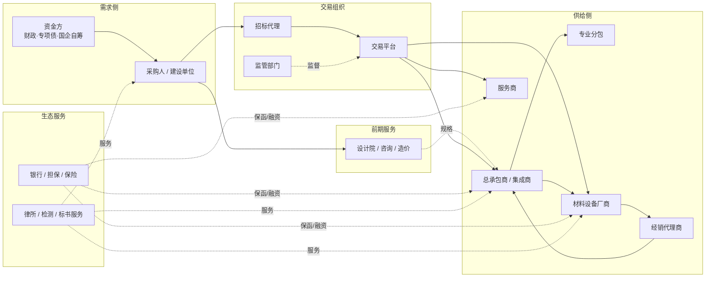

# 价值链角色与客户细分

> 状态：评审中 · 版本：1.0 · 更新：2026-10-12 · 负责人：招投标领域负责人

## 1. 交易参与方

## 2. 价值链角色

| 角色代码 | 价值链角色 | 在交易中的位置 | 主要商业目标 |
|---|---|---|---|
| `ROLE-BIDDER` | 直接投标人 | 直接参与货物、服务或工程投标 | A01、A05、B03、B04、C01、C02 |
| `ROLE-PRIME` | 总承包商 / 系统集成商 | 承接工程或集成项目，向下采购和分包 | A01、A05、B01、B03、C01、E01 |
| `ROLE-SUBCON` | 专业分包 | 从总包承接专业工程 | A03、A02、C01 |
| `ROLE-MFR` | 材料设备厂商 | 直接投标、向总包供货、影响规格 | A01、A02、A04、A06、B02、B03 |
| `ROLE-DEALER` | 经销代理商 | 凭授权投标或向总包供货 | A01、A02、A06 |
| `ROLE-SERVICE` | 服务商 | 提供运维、物业、IT 服务、咨询等 | A01、B01、C03 |
| `ROLE-DESIGN` | 设计咨询 | 承接设计、可研、造价等前期服务 | A01、D02、B02 |
| `ROLE-AGENCY` | 招标代理 | 承接采购人委托的代理业务 | D02、B01 |
| `ROLE-FIN` | 金融机构 | 提供保函、贷款、保险、供应链金融 | D01、C01 |
| `ROLE-PRO` | 专业服务机构 | 律所、检测认证、标书服务 | D02 |
| `ROLE-BUYER` | 采购人 | 发起采购（作为客户使用寻源与调研能力） | E01、B04 |

角色由租户在客户上下文中声明，**一个租户可以声明多个角色**。

## 3. 客户细分维度

客户细分 = 价值链角色 × 行业 × 采购类别 × 主体偏好 × 规模区域。

### 3.1 行业维度（示例，由行业包定义）

| 行业包 | 典型产品或服务 | 常见角色组合 |
|---|---|---|
| 建材管材 | 给排水管、燃气管、管件、阀门 | 厂商（直接投标 + 供货 + 规格入围 + 渠道） |
| 电力设备 | 变压器、开关柜、电缆 | 厂商、集成商 |
| 信息化 | 软硬件、系统集成、云服务 | 直接投标人、集成商、服务商 |
| 医疗器械 | 设备、耗材、信息化 | 厂商、经销商 |
| 环保水务 | 处理设备、运营服务 | 厂商、总包、服务商 |
| 市政园林 | 施工、养护 | 总包、分包、服务商 |
| 物业后勤 | 物业、保洁、餐饮 | 服务商 |

行业包提供：品类分类映射、产品与规格词表、资质模板、常见排除规则和默认策略。

### 3.2 采购类别与主体偏好

| 维度 | 取值 |
|---|---|
| 采购类别 | 货物、工程、服务 |
| 主体类型 | 政府机关、事业单位（医院、学校）、国企央企、军队、社会资本项目 |
| 交易制度 | 政府采购、依法必须招标的工程建设项目、国企自主采购 |

## 4. 角色 × 生命周期阶段的机会价值

“●”表示该阶段的信号对该角色具有核心价值，“○”表示辅助价值。

| 阶段 \ 角色 | 投标人 | 总包 | 分包 | 厂商 | 经销 | 服务商 | 设计咨询 | 代理 | 金融 |
|---|:-:|:-:|:-:|:-:|:-:|:-:|:-:|:-:|:-:|
| 规划与立项 | ○ | ● | | ● | | ○ | ● | ● | |
| 可研与设计 | ○ | ● | | ● | ○ | | ● | | |
| 采购意向与计划 | ● | ● | ○ | ● | ● | ● | ○ | ○ | |
| 招标公告与更正 | ● | ● | ○ | ● | ● | ● | ● | | ● |
| 开标与候选人公示 | ● | ● | ● | ● | ○ | ● | | | ○ |
| 中标与成交结果 | ● | ● | ● | ● | ● | ● | ○ | ○ | ● |
| 合同公告 | ○ | ○ | ● | ● | ○ | ○ | | | ● |
| 施工与交付 | | ○ | ● | ● | ● | | | | ○ |
| 验收与付款 | ● | ● | ○ | ○ | | ● | | | ○ |
| 运维与续约 | ● | | | ○ | | ● | | | |

这张表是机会路径设计的依据：每个角色的默认监测范围不是“招标公告”，而是表中标记的阶段集合。

## 5. 细分示例

| 细分示例 | 角色 | 行业 | 默认启用目标 | 首要信号 |
|---|---|---|---|---|
| 区域管材厂商 | 厂商 + 投标人 + 渠道 | 建材管材 | A01、A02、A04、A06、B03 | 中标结果、施工许可、管材集采公告、设计中标 |
| 信息化集成商 | 投标人 + 总包 | 信息化 | A01、A05、B01、B03、C01 | 采购意向、招标公告、预算 |
| 市政总包 | 总包 | 市政园林 | A01、A05、B01、C01、E01 | 项目审批、招标公告、专项债 |
| 物业服务商 | 服务商 | 物业后勤 | A01、B01、C03 | 采购意向、合同到期、续约 |
| 城商行公司金融部 | 金融 | 不适用 | D01、C01 | 招标公告保证金要求、中标结果、合同金额 |

细分示例用于实施时选择默认模板，租户可在此基础上调整。
