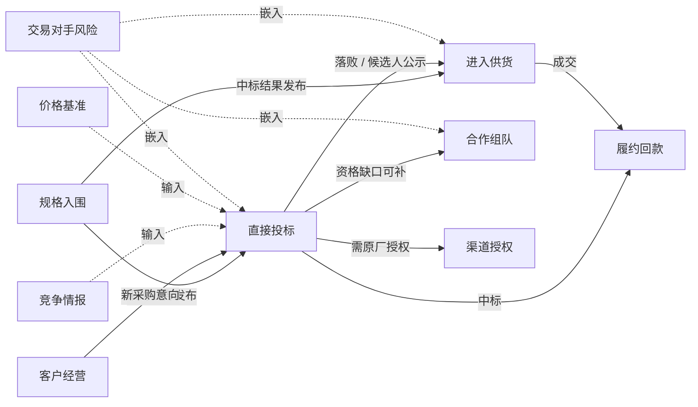

# 业务流程与机会路径

> 状态：评审中 · 版本：1.0 · 更新：2026-10-12 · 负责人：招投标领域负责人

本文把 [商业目标目录](../../02-commercial-objectives.md) 中适用于招投标领域的目标，落地为可执行的**机会路径**（Playbook）。每条路径是 [通用业务旅程](../../01-business-architecture.md#2-通用业务旅程) 在具体目标上的实例。

## 1. 机会路径的统一结构

```text
PlaybookDefinition
├── objective            对应的商业目标
├── subject_type         目标对象类型
├── entry_triggers       进入条件：哪些信号或用户动作创建推进
├── stages[]             阶段
│   ├── research         该阶段默认触发的研究模板
│   ├── assessment       该阶段使用的判断框架
│   ├── decision_gate    决策门：需要谁批准什么
│   ├── actions          可执行的行动与任务模板
│   └── exit_criteria    离开阶段的条件
├── domain_event_hooks   领域事件如何影响推进（更正、延期、结果发布等）
└── outcome_schema       结果与原因的结构
```

下文每条路径按“阶段 → 研究问题 → 决策门 → 行动 → 结果”描述。

---

## 2. 获取交易类

### 2.1 PB-TENDER-A01 直接投标

**进入条件**：采购意向、招标公告、谈判磋商公告等匹配租户策略；或用户手动创建。

| 阶段 | 研究问题 | 判断与决策门 | 行动 |
|---|---|---|---|
| 1. 初筛 | 标的是否属于我们的产品范围？是否在可服务区域？截止时间是否来得及？ | 硬门槛：品类、区域、时限、明确排除项 → 处置分层 | 进入研究或排除 |
| 2. 资格研究 | 资质、业绩、人员、信用要求是否满足？是否允许联合体？是否要求原厂授权？ | 资格符合性判断：满足 / 缺口可补 / 不满足 | 缺口可补时触发合作组队或授权路径 |
| 3. 竞争与背景研究 | 采购人历史采购与偏好？历史中标人？预算与最高限价的合理性？是否为续约或既有供应商延续？技术参数是否与特定产品高度一致？ | 竞争态势评估（客观证据对比，不作指控性结论） | 补充情报 |
| 4. 投标决策 | 综合资格、竞争、价值、资源占用、风险 | **决策门：bid / no-bid**，由授权人批准 | 指定负责人，创建投标任务清单 |
| 5. 投标准备 | 文件要求、材料清单、保证金、截止节点 | 合规清单完成度 | 任务分派、截止提醒、更正澄清自动提醒 |
| 6. 结果跟踪 | 开标记录、候选人公示、结果 | — | 自动关联结果公告 |
| 7. 复盘 | 赢或输的原因？对手报价与方案？ | 结果与原因记录 | 更新评估集，提出策略调整 |

**领域事件挂钩**：更正、澄清、延期 → 通知负责人并重新校验截止时间；终止或流标 → 推进进入“已结束（外部终止）”；候选人公示 → 提前触发复盘或供货路径。

### 2.2 PB-TENDER-A02 进入供货

**进入条件**：中标结果、候选人公示、合同公告、施工许可等匹配“项目包含我方产品”的策略；或从直接投标路径落败后转入。

| 阶段 | 研究问题 | 判断与决策门 | 行动 |
|---|---|---|---|
| 1. 项目识别 | 项目是否包含我方产品的需求？数量与规格大致如何？项目规模？ | 需求相关性判断 | 进入研究或排除 |
| 2. 中标方研究 | 中标方是谁？是总包还是集成商？其历史项目、常用供应商、付款信用如何？ | 中标方价值与风险评估 | 记录目标组织 |
| 3. 时机判断 | 合同是否签订？施工许可是否发放？材料采购大致在什么时候？ | 接触窗口评估 | 设定接触时间提醒 |
| 4. 跟进决策 | 综合需求、关系、风险、竞争 | **决策门：是否跟进、由谁跟进** | 指派销售，创建接触任务 |
| 5. 接触与报价 | — | 进展记录 | 任务、提醒、协作 |
| 6. 结果 | 是否成交？成交额？原因？ | 结果记录 | 更新评估集与该总包的经营档案 |

**数据关键点**：中标结果的主体识别准确率、与施工许可等履约信号的关联能力、总包历史项目图谱。

### 2.3 PB-TENDER-A03 分包承接

结构与“进入供货”相同，差异在于：研究重点为项目包含的专业工程、总包的资质结构和既有分包体系；判断框架包含我方专业资质与总包要求的匹配。

### 2.4 PB-TENDER-A04 规格与品牌入围

**进入条件**：项目备案、可研批复、设计招标中标、品牌库征集、框架协议征集等前置信号。

| 阶段 | 研究问题 | 判断与决策门 | 行动 |
|---|---|---|---|
| 1. 前置识别 | 项目规模、类型、所需产品门类？处于哪个阶段？ | 前期价值判断 | 进入研究或观察 |
| 2. 关键方研究 | 业主、设计单位、咨询单位是谁？设计单位过往项目中使用哪些品牌？业主是否有品牌库？ | 影响路径评估 | 识别关键组织 |
| 3. 入围决策 | 是否投入技术交流、样品、资料 | **决策门：是否投入前期资源** | 指派技术与销售 |
| 4. 影响与跟踪 | 设计进展、采购计划何时出现 | — | 设置后续信号监测，自动衔接直接投标或供货路径 |
| 5. 结果 | 是否进入规格或品牌库？后续是否成交？ | 结果记录 | 更新设计单位与业主档案 |

### 2.5 PB-TENDER-A05 合作组队

**进入条件**：直接投标路径中资格研究发现缺口可补；或用户发起。

| 阶段 | 研究问题 | 决策门 | 行动 |
|---|---|---|---|
| 1. 缺口确认 | 缺少哪些资质、业绩、人员或产能？ | — | 结构化缺口清单 |
| 2. 伙伴检索 | 谁具备缺口能力？在本区域的业绩？与我方是否有过合作或竞争？信用如何？ | 伙伴候选评估 | 生成候选清单 |
| 3. 组队决策 | 伙伴选择、分工与份额 | **决策门：组队方案批准** | 接触任务 |
| 4. 结果 | 组队是否成功？投标结果？ | 结果记录 | 更新伙伴关系档案 |

### 2.6 PB-TENDER-A06 渠道与授权

**进入条件**：要求原厂授权的公告涉及本品牌；中标结果中出现本品牌产品；经销商提出授权申请。

| 阶段 | 研究问题 | 决策门 | 行动 |
|---|---|---|---|
| 1. 识别 | 项目是否涉及本品牌？哪些经销商可能参与？ | — | 关联渠道档案 |
| 2. 冲突检查 | 是否有多个经销商争抢？是否存在跨区域投标？ | 渠道冲突评估 | 标记冲突 |
| 3. 授权决策 | 授权给谁？是否厂家直接参与？ | **决策门：授权批准** | 授权记录与通知 |
| 4. 结果 | 中标情况、品牌型号是否中标 | 结果记录 | 更新渠道业绩统计 |

---

## 3. 经营与布局类

### 3.1 PB-TENDER-B01 重点客户经营

目标对象为**组织**（采购人或总包）。这是持续型路径，没有单一终点。

| 环节 | 内容 |
|---|---|
| 建档 | 选择重点客户，系统汇集其历史采购、预算、项目储备、组织变化 |
| 持续监测 | 新的采购意向、预算、项目审批、人事公开信息、处罚与诉讼 |
| 周期研究 | 按季度或按需生成客户经营简报：采购规律、品类分布、供应商份额、近期动向 |
| 计划与行动 | 客户经营计划、接触任务、关联的推进 |
| 评估 | 份额变化、提前介入率 |

### 3.2 PB-TENDER-B02 市场研究与布局

目标对象为**市场**（区域 × 品类 × 时间 × 主体类型）。以研究报告为主要产物：市场规模与趋势、集中度、主要采购人与供应商、价格水平、预算与项目储备。决策门为“布局方案”的批准，结果度量为布局后业绩变化。

### 3.3 PB-TENDER-B03 竞争情报

目标对象为**竞争对手组织**。持续监测竞争对手的中标、候选人排名、价格、资质变更、诉讼处罚、合作伙伴；按需生成竞争对比研究。与直接投标路径的竞争研究阶段共享研究工具。

### 3.4 PB-TENDER-B04 价格与报价基准

按品类、规格、区域、采购方式统计历史预算、最高限价、成交价格与下浮率，作为直接投标路径投标决策阶段的输入，也可独立查询。所有统计值都附带样本量、时间范围和样本清单。

### 3.5 PB-TENDER-B05 目标企业经营跟踪

目标对象为**被跟踪的企业**（可以是一组企业）。持续型路径，服务投资、并购、授信与合作判断。

| 环节 | 内容 |
|---|---|
| 建档 | 选择目标企业，系统汇集其历年中标、候选人排名、合同、在建项目、主要采购人、企业变更与司法信用 |
| 持续监测 | 新中标与合同、候选人排名变化、重大项目审批、处罚与诉讼、股权与高管公开变更 |
| 周期研究 | 订单与合同金额趋势、客户与区域集中度、与竞争对手的份额对比、在建项目阶段、风险事项 |
| 决策 | 投资、授信或合作判断（**决策门：由客户授权人批准**） |
| 评估 | 研究报告采纳、风险预警命中 |

研究模板：`RT-TENDER-WINNER`、`RT-TENDER-COMPETE`、`RT-TENDER-RISK`，以及新增的 `RT-TENDER-ORGTRACK`（企业经营跟踪）。

---

## 4. 风险与履约类

### 4.1 PB-TENDER-C01 交易对手风险评估

可嵌入任何推进，也可独立发起。研究内容：资金来源与落实情况、采购人或总包的被执行、失信、拖欠与诉讼记录、经营异常、历史付款与验收情况。输出风险等级、证据和未知项，供决策门使用。

### 4.2 PB-TENDER-C02 自身资格与合规维护

目标对象为租户自身。持续监测租户自身的资质有效期、行政处罚、信用评价和失信记录，在影响投标资格前预警。

### 4.3 PB-TENDER-C03 履约与回款跟踪

从“已中标”的推进自动衔接：跟踪合同公告、验收公告、付款信息、续约窗口和二期项目，按节点提醒。

---

## 5. 服务市场参与者类

### 5.1 PB-TENDER-D01 金融与保险服务获客

| 阶段 | 内容 |
|---|---|
| 识别 | 招标公告的保证金与保函要求、中标结果、合同金额 |
| 研究 | 目标企业的规模、信用、历史中标、既有合作银行（若公开） |
| 判断 | 目标企业价值与风险 |
| 行动 | 分派客户经理，记录接触 |
| 合规 | 获客用途声明、联系人信息使用限制、审计 |

### 5.2 PB-TENDER-D02 专业服务获客

面向招标代理、咨询、造价、律所等：基于项目审批、代理机构选聘、投诉与争议等信号识别潜在委托方。

---

## 6. 路径之间的衔接

机会路径不是孤立的。系统在以下条件下自动建议创建或切换路径：



衔接规则由应用领域包定义；自动创建的推进需要用户确认后才会分派负责人。

## 7. 判断框架清单

| 框架代码 | 用于 | 维度 |
|---|---|---|
| `AF-TENDER-ELIG` | 直接投标资格研究 | 资质、业绩、人员、信用、联合体、授权、时限 |
| `AF-TENDER-BID` | 投标决策 | 资格符合性、竞争态势、价值、资源占用、风险、战略匹配 |
| `AF-TENDER-SUPPLY` | 进入供货 | 需求相关性、规模、中标方价值、接触窗口、付款风险 |
| `AF-TENDER-SPECIN` | 规格入围 | 项目价值、阶段、影响路径、资源投入 |
| `AF-TENDER-PARTNER` | 合作组队 | 能力互补、区域业绩、信用、历史关系 |
| `AF-TENDER-RISK` | 交易对手风险 | 资金落实、司法信用、经营状态、付款历史 |

每个框架明确区分：确定性硬门槛、规则特征、模型评分、AI 归纳，分别记录。

## 8. 研究模板清单

| 模板代码 | 问题 | 主要工具 |
|---|---|---|
| `RT-TENDER-ELIG` | 资格要求与我方能力的逐条对照 | 公告要求提取、客户资质与业绩查询 |
| `RT-TENDER-BUYER` | 采购人历史采购、偏好与预算 | 采购人历史查询、预算查询、品类统计 |
| `RT-TENDER-COMPETE` | 历史中标人、竞争格局、技术参数特征比对 | 中标历史、候选人排名、参数比对 |
| `RT-TENDER-PROJECT` | 项目链：审批、设计、采购、结果、施工 | 项目链查询、实体图谱 |
| `RT-TENDER-WINNER` | 中标方画像、常用供应商、信用 | 组织画像、关系查询、信用查询 |
| `RT-TENDER-PARTNER` | 具备指定资质与业绩的潜在伙伴 | 资质检索、业绩检索、关系查询 |
| `RT-TENDER-PRICE` | 同类项目价格基准 | 价格统计、样本清单 |
| `RT-TENDER-RISK` | 交易对手风险 | 司法信用、财政资金、经营异常 |
| `RT-TENDER-MARKET` | 区域与品类市场研究 | 交易统计、预算、项目储备 |
| `RT-TENDER-ORGTRACK` | 目标企业订单趋势、客户结构、竞争地位与风险 | 中标与合同历史、组织画像、关系查询、信用查询 |

研究模板的运行机制见 [AI 与 Agent 架构](../../../03-architecture/05-ai-and-agent-architecture.md)。
