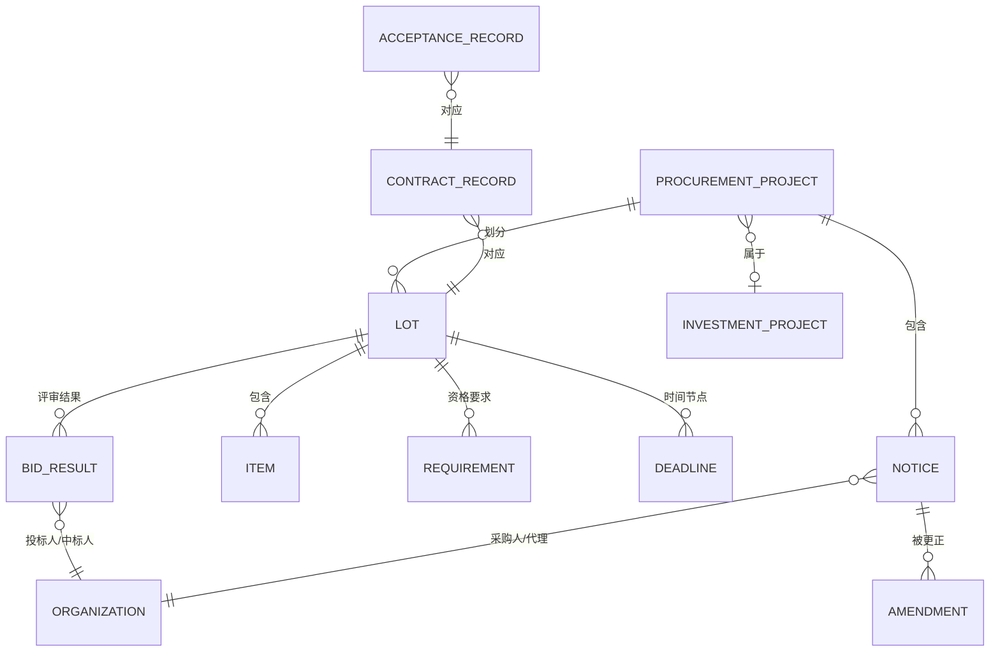

# 领域模型

> 状态：评审中 · 版本：3.0 · 更新：2026-10-14 · 负责人：招投标领域负责人、数据架构负责人

本文定义招投标应用领域涉及的领域对象及其业务含义。公共域对象由 `INF-PROC` 信息领域包提供，字段级定义以 [`contracts/schemas/domains/procurement/`](../../../../contracts/schemas/domains/procurement/notice.schema.json) 为准：公告（`Notice`）按原文表达一条公告，采购项目（`ProcurementProject`）是归并后的当前状态，标包、标的、要求、时间节点、投标结果、合同与验收是其中的嵌套对象。租户域对象由 `APP-TENDER` 应用领域包提供。通用字段与版本规则见 [数据架构](../../../03-architecture/02-data-architecture.md)。

## 1. 公共域：采购信息领域对象

| 对象 | 标识前缀 | 说明 |
|---|---|---|
| `ProcurementProject` | `pp_` | 领域项目聚合：同一采购项目的多条公告、标包与结果的归并对象。归并带置信度与历史。 |
| `Notice` | `ntc_` | 一条公告的领域表达，带 `notice_type`：意向、计划、资格预审、招标、谈判、磋商、询价、单一来源公示、更正、澄清、终止、候选人公示、结果、合同、验收等。 |
| `Amendment` | `amd_` | 更正与澄清对原公告字段的变更，记录变更前后值与证据。 |
| `Lot` | `lot_` | 标包或分包。 |
| `Item` | `itm_` | 采购标的（要求侧）：品目、名称、规格、数量、单位、公告指定的品牌型号、单价与计价单位。 |
| `Requirement` | `req_` | 资格与技术要求：类型、原文、结构化代码及其体系与版本、资质等级要求、证据。代码体系由平台登记（见 1.4），不跨体系比较。 |
| `Deadline` | `ddl_` | 时间节点：类型、时间、精度、时区、证据。 |
| `BidResult` | `bdr_` | 开标、候选人、中标或框架入围结果：投标人、联合体成员、排名、报价、得分、结果性质和是否实际中标；原文列出时附中标标的明细（`awarded_item`）。 |
| 中标标的明细 | （内嵌，无独立标识） | 结果或合同公告中实际中标/成交的产品：名称、规格、中标品牌与型号、原文载明的制造商、数量、单价与计价单位，能一一对应时引用要求侧 `Item`。与要求侧的指定品牌分开：指定品牌回答“业主要什么”，中标品牌回答“实际供了什么”，两者都进入统计但不互相代替。 |
| `ContractRecord` | `ctr_` | 合同公告：合同金额、期限、双方；原文列出时附合同标的明细（同中标标的明细结构）。 |
| `AcceptanceRecord` | `acc_` | 验收事实及其来源；包括验收公告和原始司法文书记载的历史验收，分别标明来源与语义。 |

### 1.1 字段要求

- 金额：十进制字符串、币种、单位归一、含税说明、原文与证据；费率限价/报价用 `rate` 表达，不能冒充项目总价；
- 结果：同一公告可多包中标和部分废标并存，公告汇总金额不得分摊给未知标包；结果明细不可得时显式记录质量缺口。
- 合同：编号/名称、最高限额与实际金额区分，网页与附件条件冲突保留两份证据。
- 供应商/结果：组织名称、信用代码及地址分别溯源；联合体成员单列，原文明示牵头人时才填consortium_lead。同包可有多个实际成交或入围记录，result_kind区分contract_award与framework_shortlist，入围is_winner=false，排名可并列；最高入围单价不当项目总成交价；报价用price_kind区别总额、单价、年单价合计和估算，含义带独立证据。原文不分包时使用内部unpartitioned键，不宣称来源包号。
- 验收：合同编号/名称、供应商、意见、结论证据和验收时间；同页多个对象分别表达，未知日期省略；通过、部分、失败与未知结果分别处理，公告出现不代表通过。原始司法文书保留当事人争议（dispute）和逐段裁判结论（judicial_outcome），分别附证据，技术失败不自动推断合同解除。
- 多项目合并招标：标包可分别记录项目名/编号/业主，不将公告级主体覆盖所有项目；
- 采购条件：公告与项目共用 `procurement_conditions`，保留文件获取、履约/交付/付款、联合体与中小企业政策的带证据原文；相对工期不强行转换为截止日期；
- 时间：时间值、精度（日/分钟）、时区、证据；
- 主体：名称原文、解析后的 `org_id`、解析置信度；
- 每个关键字段带 `prov`：证据引用、提取方法（规则/模型/人工）、置信度；
- 公开业务联系人可明文检索并进入模型，姓名/电话/邮箱分别附证据；租户提供的联系信息按租户数据分级处理，详见 [安全与租户](../../../03-architecture/06-security-and-tenancy.md)。

### 1.2 领域生命周期状态机

`ProcurementProject.stage` 经历意向、公告、更正、评审、候选人公示、中标、合同、验收等阶段，也可能流标、废标或终止后重新采购。状态转换由公告驱动，允许冷启动从结果、合同和验收阶段建档，不伪造前序公告；多包独立处置。更正修订原业务阶段的字段，不把已中标/签约/验收对象退回公告阶段；晚到前序公告只补历史。非法转换记为质量警告而不是强行修正。框架第一阶段入围进入shortlisted，供应商单列shortlisted_suppliers，不当成第二阶段成交。验收passed/failed/partial/未知分别进入accepted/acceptance_failed/partially_accepted/acceptance_pending，失败可复验，不当采购流标或自动解约；历史司法验收难例不自动更新当前阶段。when使用标准JSON Schema对完整公告求值。状态与转换的唯一定义是 [`packs/information_domains/procurement/lifecycle.yaml`](../../../../packs/information_domains/procurement/lifecycle.yaml)。

### 1.3 领域事件

公告发布、更正、截止时间变化、阶段变化、归并与撤销归并、结果发布、合同发布、流标与终止各有一个领域事件。事件类型与载荷的唯一定义是 [`contracts/events/tendering/events.asyncapi.yaml`](../../../../contracts/events/tendering/events.asyncapi.yaml)，信封规范见 [集成契约](../../../03-architecture/03-integration-contracts.md)。

### 1.4 分类体系

| 分类 | 用途 | 来源 |
|---|---|---|
| 政府采购品目分类 | 货物、工程、服务品目 | 官方目录，版本化 |
| 国民经济行业分类 | 组织行业 | 国家标准，版本化 |
| 行政区划 | 地点 | 国家标准（GB/T 2260），按代码表版本记录；地点区分角色：项目实施地（公告与项目的 `location`）、交付地（`delivery_region`）、采购人所在地（采购人登记信息）。统计按角色分别计算，历史结果保留原代码与版本，跨版本换算另存换算表版本与依据 |
| 资质代码体系 | 资格要求与客户资质的匹配 | 平台登记体系与版本（如住建部建筑业企业资质），行业包提供本行业资质模板与到登记体系的映射；平台只登记与映射，不自称拥有外部标准 |
| 行业包产品分类 | 客户产品与采购标的的匹配 | 行业包，版本化 |

分类之间的映射由领域包维护，映射本身也版本化。

## 2. 共享实体（由实体图谱子系统拥有）

招投标领域引用但不拥有以下实体：`Organization`、`Project`（跨信息领域的项目实体，如投资项目）、`Location`、`Category`、`Brand`。关系类型的权威定义在 [INF-PROC](../../../../packs/information_domains/procurement/relationships.yaml) 与 [INF-INVP](../../../../packs/information_domains/investment_projects/relationships.yaml) 的 `relationships.yaml`，端点、约束与版本语义见 [entity-graph 4.1](../../../03-architecture/subsystems/entity-graph.md#41-关系的端点约束与版本)。摘要：

| 关系 | 起点 → 终点 | 来源 |
|---|---|---|
| `procures` | 采购人 → 采购项目 | 公告 |
| `agent_of` | 代理机构 → 采购项目 | 公告 |
| `bid_on` | 组织 → 项目（约束：结果、标包） | 开标记录、候选人公示 |
| `won` | 组织 → 项目（约束：结果、标包） | 中标结果（框架入围不算） |
| `consortium_member` | 成员 → 牵头人（约束：结果、标包） | 结果公告（原文未明确牵头人时不建边） |
| `part_of` | 采购项目（可按标包）→ 投资项目；可归属多个项目 | 项目编号、审批编号直接建边；属性与语义匹配为候选边 |
| `designed_by` | 投资项目 → 设计单位 | 施工许可、设计中标结果 |
| `constructed_by` | 投资项目 → 施工单位 | 施工许可 |
| `specified_brand` | 项目 → 品牌（约束：标包） | 采购标的指定品牌 |
| `supplied_brand` | 供应商 → 品牌（约束：项目、结果、标包） | 中标或合同标的明细中的品牌 |
| `brand_owned_by` | 品牌 → 厂商 | 原文载明的制造商、行业包品牌词表、运营复核 |

## 3. 租户域：应用领域对象

| 对象 | 说明 |
|---|---|
| `TenderSignal` | `Signal` 的招投标特化视图，带 `objective`、匹配的策略规则、处置 |
| `EligibilityMatrix` | 资格要求与客户资质、业绩的逐条对照结果，属于研究产物 |
| `CompetitiveLandscape` | 竞争态势研究产物：历史中标人、份额、价格区间 |
| `BidDecision` | 直接投标路径的决策记录：bid / no-bid、理由、批准人 |
| `SupplyLead` | 进入供货路径的目标：项目、中标方、窗口、负责人 |
| `ComplianceChecklist` | 投标文件与材料清单 |
| `TenderOutcome` | `Outcome` 的特化：中标、未中标、流标、成交额、对手报价 |

这些对象都是平台通用对象（`Signal`、`ResearchReport`、`Assessment`、`Decision`、`Pursuit`、`Outcome`）的类型化扩展，通过应用领域包注册的 Schema 实现，不新建平行的存储体系。

## 4. 处置模型

采用以下处置分层，并按商业目标独立计算：

| 处置 | 含义 |
|---|---|
| `pursue_candidate` | 满足硬门槛且相关性高，建议进入推进 |
| `review_candidate` | 相关但存在缺失信息或不确定，需人工复核 |
| `watch_signal` | 前置信号或尚不具备行动条件，进入观察 |
| `excluded` | 命中明确排除规则，附排除原因 |
| `no_signal` | 与该目标无关 |

同一领域事实对不同目标可以有不同处置。例如一条中标结果对“直接投标”是 `no_signal`，对“进入供货”可能是 `pursue_candidate`。
