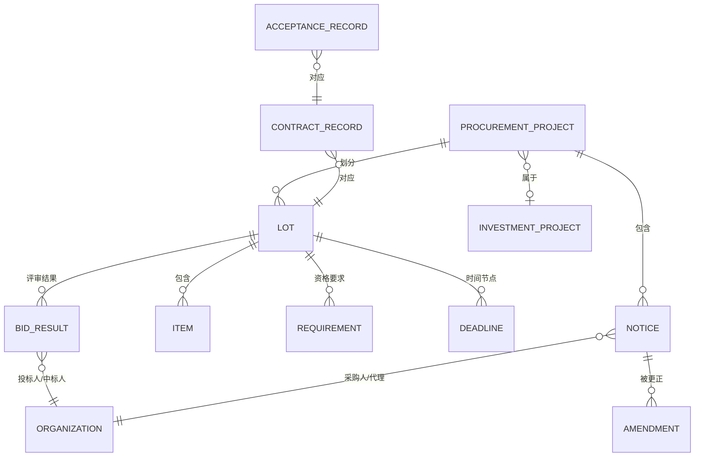
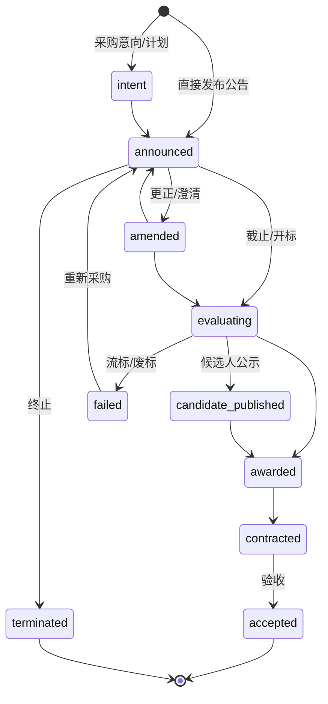

# 领域模型

> 状态：评审中 · 版本：1.0 · 更新：2026-10-12 · 负责人：招投标领域负责人、数据架构负责人

本文定义招投标应用领域涉及的领域对象。公共域对象由 `INF-PROC` 信息领域包提供，租户域对象由 `APP-TENDER` 应用领域包提供。通用字段与版本规则见 [数据架构](../../../03-architecture/02-data-architecture.md)。

## 1. 公共域：采购信息领域对象

| 对象 | 标识前缀 | 说明 |
|---|---|---|
| `ProcurementProject` | `pp_` | 领域项目聚合：同一采购项目的多条公告、标包与结果的归并对象。归并带置信度与历史。 |
| `Notice` | `ntc_` | 一条公告的领域表达，带 `notice_type`：意向、计划、资格预审、招标、谈判、磋商、询价、单一来源公示、更正、澄清、终止、候选人公示、结果、合同、验收等。 |
| `Amendment` | `amd_` | 更正与澄清对原公告字段的变更，记录变更前后值与证据。 |
| `Lot` | `lot_` | 标包或分包。 |
| `Item` | `itm_` | 采购标的：品目、名称、规格、数量、单位、品牌型号要求、单价。 |
| `Requirement` | `req_` | 资格与技术要求：类型、原文、结构化代码、证据。 |
| `Deadline` | `ddl_` | 时间节点：类型、时间、精度、时区、证据。 |
| `BidResult` | `bdr_` | 开标、候选人、中标结果：投标人、排名、报价、得分、是否中标。 |
| `ContractRecord` | `ctr_` | 合同公告：合同金额、期限、双方。 |
| `AcceptanceRecord` | `acc_` | 验收公告。 |

### 1.1 字段要求

- 金额：数值、币种、单位（元/万元归一）、含税说明、精度、证据；
- 时间：时间值、精度（日/分钟）、时区、证据；
- 主体：名称原文、解析后的 `organization_id`、解析置信度；
- 每个关键字段带 `field_provenance`：证据引用、提取方法（规则/模型/人工）、置信度；
- 联系人字段单独分级，详见 [安全与租户](../../../03-architecture/06-security-and-tenancy.md)。

### 1.2 领域生命周期状态机

`ProcurementProject.stage`：

状态转换由领域事件驱动，非法转换被记录为质量警告而不是强行修正。

### 1.3 领域事件

| 事件 | 触发 |
|---|---|
| `tendering.notice.published.v1` | 新公告被解析为领域事实 |
| `tendering.notice.amended.v1` | 更正、澄清导致字段变化 |
| `tendering.deadline.changed.v1` | 任一截止时间变化 |
| `tendering.project.stage_changed.v1` | 项目阶段变化 |
| `tendering.project.linked.v1` / `unlinked.v1` | 公告归并或撤销归并 |
| `tendering.result.published.v1` | 候选人公示或中标结果发布 |
| `tendering.contract.published.v1` | 合同公告发布 |
| `tendering.procurement.failed.v1` | 流标、废标、终止 |

事件规范见 [集成契约](../../../03-architecture/03-integration-contracts.md)。

### 1.4 分类体系

| 分类 | 用途 | 来源 |
|---|---|---|
| 政府采购品目分类 | 货物、工程、服务品目 | 官方目录，版本化 |
| 国民经济行业分类 | 组织行业 | 国家标准，版本化 |
| 行政区划 | 地点 | 国家标准，版本化 |
| 行业包产品分类 | 客户产品与采购标的的匹配 | 行业包，版本化 |

分类之间的映射由领域包维护，映射本身也版本化。

## 2. 共享实体（由实体图谱子系统拥有）

招投标领域引用但不拥有以下实体：`Organization`、`Project`（跨信息领域的项目实体，如投资项目）、`Location`、`Category`。关系类型示例：

| 关系 | 起点 → 终点 | 来源 |
|---|---|---|
| `procures` | 采购人 → 采购项目 | 公告 |
| `agent_of` | 代理机构 → 采购项目 | 公告 |
| `bid_on` | 组织 → 标包 | 开标记录、候选人公示 |
| `won` | 组织 → 标包 | 中标结果 |
| `consortium_member` | 组织 → 联合体 | 结果公告 |
| `part_of` | 采购项目 → 投资项目 | 项目编号、审批编号、匹配 |
| `designed_by` | 投资项目 → 设计单位 | 设计中标结果 |
| `supplied_brand` | 标包 → 品牌 | 结果公告中的品牌型号 |

## 3. 租户域：应用领域对象

| 对象 | 说明 |
|---|---|
| `TenderSignal` | `Signal` 的招投标特化视图，带 `objective`、匹配的策略规则、处置 |
| `EligibilityMatrix` | 资格要求与客户资质、业绩的逐条对照结果，属于研究产物 |
| `CompetitiveLandscape` | 竞争态势研究产物：历史中标人、份额、价格区间 |
| `BidDecision` | 直接投标路径的决策记录：bid / no-bid、理由、批准人 |
| `SupplyLead` | 进入供货路径的目标：项目、中标方、窗口、负责人 |
| `ComplianceChecklist` | 投标文件与材料清单 |
| `TenderOutcome` | `Outcome` 的特化：中标、未中标、流标、成交额、对手报价 |

这些对象都是平台通用对象（`Signal`、`ResearchReport`、`Assessment`、`Decision`、`Pursuit`、`Outcome`）的类型化扩展，通过应用领域包注册的 Schema 实现，不新建平行的存储体系。

## 4. 处置模型

沿用 Tender Intel 验证过的处置分层，并按商业目标独立计算：

| 处置 | 含义 |
|---|---|
| `pursue_candidate` | 满足硬门槛且相关性高，建议进入推进 |
| `review_candidate` | 相关但存在缺失信息或不确定，需人工复核 |
| `watch_signal` | 前置信号或尚不具备行动条件，进入观察 |
| `excluded` | 命中明确排除规则，附排除原因 |
| `no_signal` | 与该目标无关 |

同一领域事实对不同目标可以有不同处置。例如一条中标结果对“直接投标”是 `no_signal`，对“进入供货”可能是 `pursue_candidate`。
