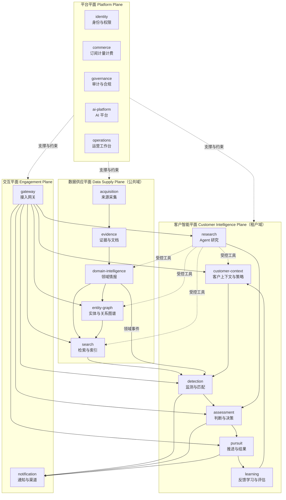
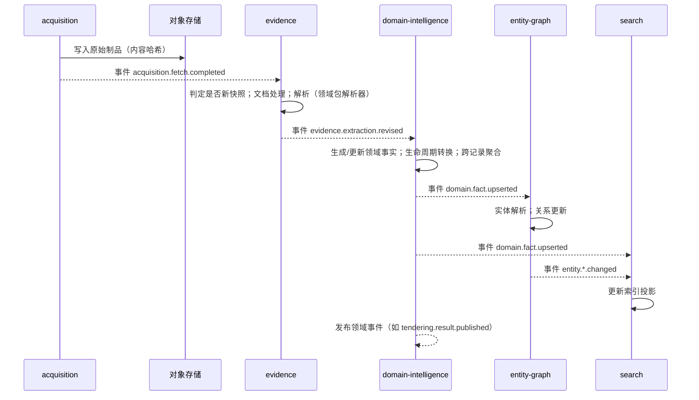
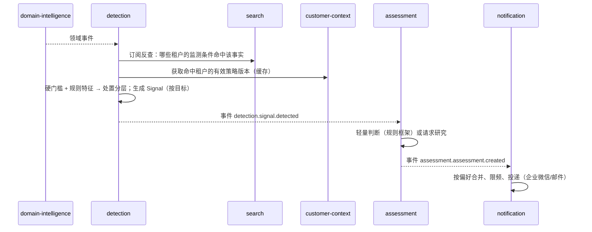
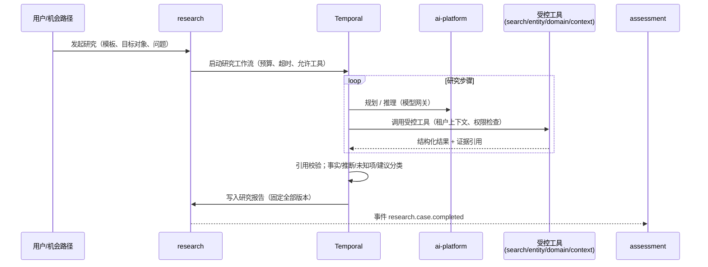

# 总体架构

> 状态：评审中 · 版本：1.0 · 更新：2026-10-12 · 负责人：首席架构师

## 1. 架构目标

妙洽是一个长期演进的大型平台。架构以**终态业务需求**为设计基准，一次性确定子系统边界、数据所有权、契约和扩展机制；部署形态从两个单元起步，并可通过配置演进到完全独立的服务部署，无需重新设计。

### 1.1 质量属性

| 质量属性 | 要求 | 主要手段 |
|---|---|---|
| **领域可扩展** | 新信息领域、应用领域、行业、商业目标的接入不修改平台核心 | 三类扩展包 + SPI，见 [可扩展性](04-extensibility.md) |
| **部署可演进** | 任一子系统可从共享进程拆为独立服务，代码与契约不变 | 可组合部署、子系统独立数据库、事件与接口契约，见 [部署拓扑](07-deployment-topology.md) |
| **租户隔离** | 跨租户数据暴露为零 | 认证派生租户、行级安全、隔离命名空间、租户单元，见 [安全与租户](06-security-and-tenancy.md) |
| **可追溯可重放** | 任一判断可回溯证据并按当时版本重放 | 不可变证据、双时态、版本固定，见 [数据架构](02-data-architecture.md) |
| **规模** | 支撑数千来源、亿级领域事实、万级租户、每日百万级信号匹配 | 分区、流式处理、倒排订阅匹配、租户单元 |
| **AI 可控** | 模型调用可路由、可审计、可评估、成本可控 | 模型网关、受控工具、研究模板、评估体系，见 [AI 与 Agent](05-ai-and-agent-architecture.md) |
| **合规** | 来源权利、个人信息、生成式 AI、数据境内处理可证明 | 权利标签随数据传递、数据分级、审计，见 [治理子系统](subsystems/governance.md) |
| **可运维** | 业务链路级可观测，故障可定位、可降级 | OpenTelemetry 贯通、业务 SLO、隔离的故障域 |

### 1.2 架构原则

1. **按业务能力划分子系统**：每个子系统对应 [能力地图](../01-product/03-capability-map.md) 中的一组能力，拥有独立数据与写权限。
2. **数据所有权唯一**：每类数据只有一个子系统可写；其他子系统通过接口查询或订阅事件获得副本（读模型）。
3. **契约先行**：子系统间只通过版本化接口与事件交互，契约文件是代码生成和测试的来源。
4. **公共域与租户域物理分离**：数据供应平面不读取任何租户数据。
5. **同步查询、异步传播**：命令与查询走接口；状态变化走事件；长流程走持久化工作流。
6. **跨子系统无分布式事务**：即使在同一进程内，跨子系统也不共享数据库事务，以事件和补偿保证最终一致。
7. **领域差异下沉到扩展包**：平台核心只认识通用契约，领域语义由扩展包提供。
8. **渠道是适配器**：所有接入方式共用同一套领域服务、权限和审计。
9. **AI 是受治理的能力**：所有模型调用经模型网关，Agent 只能调用受控工具。

## 2. 平面与子系统



### 2.1 子系统清单

| 平面 | 子系统 | 核心职责 | 拥有的核心数据 | 首期部署单元 |
|---|---|---|---|---|
| 数据供应 | [`acquisition`](subsystems/acquisition.md) | 来源注册与权利、调度、抓取、原始归档、来源健康 | 来源、访问契约、抓取记录、原始制品 | `acquisition` |
| 数据供应 | [`evidence`](subsystems/evidence.md) | 文档处理、快照、解析修订、字段溯源、质量 | 快照、文档、解析修订、证据 | `platform` |
| 数据供应 | [`domain-intelligence`](subsystems/domain-intelligence.md) | 领域事实与事件、生命周期、跨记录聚合 | 各信息领域的领域事实 | `platform` |
| 数据供应 | [`entity-graph`](subsystems/entity-graph.md) | 实体主数据、实体解析、关系图谱 | 组织、项目、地点、品类、关系、合并历史 | `platform` |
| 数据供应 | [`search`](subsystems/search.md) | 索引投影、全文/语义/混合检索、订阅反查 | 检索索引（派生） | `platform` |
| 客户智能 | [`customer-context`](subsystems/customer-context.md) | 客户档案、目标、策略、知识资产 | 租户档案、目标配置、策略版本、知识资产 | `platform` |
| 客户智能 | [`detection`](subsystems/detection.md) | 监测订阅、信号匹配、处置分层 | 监测订阅、信号 | `platform` |
| 客户智能 | [`research`](subsystems/research.md) | 研究模板执行、Agent 运行、研究报告 | 研究案例、研究运行、证据集合、报告 | `platform` |
| 客户智能 | [`assessment`](subsystems/assessment.md) | 判断框架执行、评估、决策与审批 | 判断、特征快照、决策 | `platform` |
| 客户智能 | [`pursuit`](subsystems/pursuit.md) | 机会路径实例、阶段、任务、结果 | 推进、任务、结果 | `platform` |
| 客户智能 | [`learning`](subsystems/learning.md) | 反馈、评估集、策略仿真、质量分析 | 反馈、评估集、评估运行、仿真结果 | `platform` |
| 交互 | [`gateway`](subsystems/gateway.md) | REST/OpenAPI、BFF、MCP、Webhook、限流 | 接入凭证、Webhook 订阅 | `platform` |
| 交互 | [`notification`](subsystems/notification.md) | 通知编排、偏好、摘要、渠道投递、快捷动作 | 通知、投递记录、偏好、动作令牌 | `platform` |
| 平台 | [`identity`](subsystems/identity.md) | 租户、成员、角色、授权决策、审批 | 租户、成员、角色、授权关系、审批请求 | `platform` |
| 平台 | [`commerce`](subsystems/commerce.md) | 套餐、权益、配额、计量、账单 | 订阅、权益、用量、账单 | `platform` |
| 平台 | [`governance`](subsystems/governance.md) | 审计、数据分级、保留删除、合规登记 | 审计事件、分级目录、保留策略、合规登记 | `platform` |
| 平台 | [`ai-platform`](subsystems/ai-platform.md) | 模型网关、提示注册、嵌入、护栏、AI 计量 | 模型目录、提示版本、调用记录 | `platform` |
| 平台 | [`operations`](subsystems/operations.md) | 人工复核队列、数据运营、托管服务、客户成功 | 复核任务、服务工单、工时 | `platform` |

各子系统的规格见 [subsystems/](subsystems/README.md)。

### 2.2 依赖规则

```text
交互平面  ──►  客户智能平面  ──►  数据供应平面
    │               │                  │
    └───────────────┴──────────────────┴──►  平台平面
```

- 依赖只能沿箭头方向（同步调用方向）；反方向只能通过事件。
- 数据供应平面**不得**同步调用客户智能平面，也不得读取任何租户数据。
- 客户智能平面内部：`detection`、`research` 产出输入，`assessment` 消费它们并产出判断，`pursuit` 消费判断；`learning` 只通过事件消费并通过提案（而非直接写入）影响 `customer-context`。
- 平台平面子系统不依赖业务子系统（`operations` 例外：它是内部人员的业务工作台，作为交互平面的内部客户端调用业务子系统接口）。
- 这些规则在代码层由依赖检查工具在持续集成中强制执行，见 [代码库结构](09-codebase-structure.md)。

## 3. 交互方式

| 方式 | 用途 | 技术 | 规范 |
|---|---|---|---|
| 同步查询与命令 | 用户请求、Agent 工具、子系统间查询 | 子系统公开接口（进程内或 HTTP/gRPC） | [集成契约](03-integration-contracts.md) |
| 领域事件 | 状态变化传播、读模型构建、触发下游 | Kafka + 事务性发件箱 + CloudEvents | [集成契约](03-integration-contracts.md) |
| 持久化工作流 | 研究运行、策略仿真、批量处理、长周期推进提醒 | Temporal | [ADR-0005](../04-decisions/0005-durable-workflow-temporal.md) |
| 大对象传递 | 原始制品、文档、导出文件 | 对象存储 + 事件中携带引用 | [数据架构](02-data-architecture.md) |

## 4. 关键业务流程

### 4.1 数据供应：从来源到可检索的领域事实



### 4.2 监测：从领域事件到租户信号



### 4.3 研究：从问题到可取证报告



### 4.4 决策与推进

1. `assessment` 按判断框架生成 `Assessment`，必要时生成决策草案；
2. 决策草案通过 `identity` 的审批服务完成批准，产生 `Decision`；
3. `pursuit` 消费 `assessment.decision.recorded`，创建或推进 `Pursuit`，按机会路径生成任务；
4. 领域事件（更正、延期、结果）经 `detection` 关联到已有推进，触发提醒或阶段变化；
5. 结果记录为 `Outcome`，`learning` 消费并更新评估集，必要时生成策略调整提案。

### 4.5 策略变更

```text
自然语言或表单修改 → customer-context 生成策略草案（结构化差异）
  → learning 历史回放仿真（Temporal 工作流）→ 差异报告
  → identity 审批 → customer-context 激活（可灰度：影子 / 比例 / 全量）
  → detection 加载新策略版本 → learning 监控反馈漂移 → 可一键回滚
```

## 5. 横切设计索引

| 主题 | 文档 |
|---|---|
| 数据分区、存储、版本、标识、时间模型 | [02-data-architecture.md](02-data-architecture.md) |
| 接口、事件、Schema、版本兼容 | [03-integration-contracts.md](03-integration-contracts.md) |
| 扩展包与 SPI | [04-extensibility.md](04-extensibility.md) |
| AI 与 Agent | [05-ai-and-agent-architecture.md](05-ai-and-agent-architecture.md) |
| 安全、租户隔离、合规 | [06-security-and-tenancy.md](06-security-and-tenancy.md) |
| 部署单元、进程角色、单元化 | [07-deployment-topology.md](07-deployment-topology.md) |
| 技术选型 | [08-technology-stack.md](08-technology-stack.md) |
| 代码库结构与依赖约束 | [09-codebase-structure.md](09-codebase-structure.md) |
| Tender Intel 迁移 | [10-migration-from-tender-intel.md](10-migration-from-tender-intel.md) |
