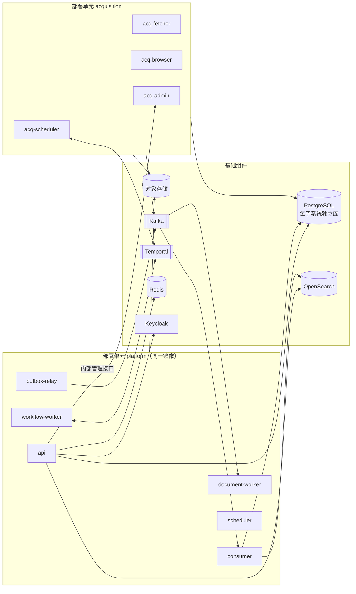

# 部署拓扑

> 状态：评审中 · 版本：1.0 · 更新：2026-10-12 · 负责人：首席架构师、平台工程负责人

## 1. 核心决策

**逻辑架构按终态设计，部署从两个单元开始，演进通过配置完成。**（[ADR-0002](../04-decisions/0002-composable-deployment.md)）

- 18 个子系统的边界、数据所有权、接口与事件契约从第一天按终态实现；
- 基础设施（PostgreSQL、对象存储、Kafka、Temporal、OpenSearch、Redis、Keycloak、可观测性）从第一天按生产级部署，不使用替代方案过渡；
- 应用代码打包为两个部署单元：`acquisition` 与 `platform`；
- 任一子系统可以通过部署配置从 `platform` 中拆出，独立部署，代码与契约不变。

两个单元的划分依据是**故障域、伸缩方式与安全边界的根本差异**，而不是开发便利：

| 维度 | `acquisition` | `platform` |
|---|---|---|
| 网络 | 大量出站访问外部网站，需要出口管理 | 不访问任意外部网站（模型与渠道除外） |
| 负载 | I/O 密集、突发、浏览器渲染消耗大 | 事务、查询、事件处理、工作流 |
| 故障 | 来源变化、反爬、超时频繁 | 需要稳定、低延迟 |
| 安全 | 处理不可信外部内容的第一道边界 | 处理租户数据 |
| 发布节奏 | 来源处理器频繁更新 | 按版本节奏发布 |

## 2. 部署单元

### 2.1 `acquisition` 单元

| 进程角色 | 内容 | 伸缩依据 |
|---|---|---|
| `acq-scheduler` | 采集计划与回填工作流（Temporal worker，任务队列 `acquisition-schedule`） | 固定副本 |
| `acq-fetcher` | HTTP/API 抓取执行器 | 任务队列深度 |
| `acq-browser` | 浏览器渲染池（Playwright） | 渲染任务队列深度、内存 |
| `acq-admin` | 来源注册、权利、健康的内部管理接口（经 `platform` 的 `gateway` 暴露给运营控制台） | 固定副本 |

数据：独立的 PostgreSQL 数据库 `acq`、对象存储原始制品桶、发件箱 → Kafka `public.acquisition`。

网络：独立的出口网关与出口地址池；入站仅允许来自内部网络的管理请求。

### 2.2 `platform` 单元

同一个镜像，以不同进程角色启动；每个进程角色通过配置选择加载哪些子系统：

| 进程角色 | 加载的子系统 | 职责 | 伸缩依据 |
|---|---|---|---|
| `api` | gateway + 全部子系统的接口实现 | 处理同步请求（REST、BFF、MCP） | 请求速率、延迟 |
| `consumer` | 各子系统的事件消费者 | 事件处理、读模型更新、匹配 | 消费延迟（lag） |
| `workflow-worker` | research、learning、customer-context、pursuit、governance 等的 Temporal worker | 研究运行、仿真、回填、删除编排、推进时限 | 工作流任务队列深度 |
| `document-worker` | evidence 的文档处理与解析 | CPU/GPU 密集文档处理 | 文档队列深度 |
| `outbox-relay` | 各子系统发件箱中继 | 发件箱 → Kafka | 发件箱积压 |
| `scheduler` | 周期性任务（摘要、统计、健康检查） | 定时任务 | 固定副本（主备） |

进程角色与子系统的映射在部署清单中声明：

```yaml
# deploy/platform/roles.yaml（示意）
roles:
  api:
    subsystems: [gateway, identity, commerce, governance, customer_context,
                 detection, research, assessment, pursuit, learning, notification,
                 evidence, domain_intelligence, entity_graph, search, ai_platform, operations]
    expose: [http]
  consumer:
    subsystems: [evidence, domain_intelligence, entity_graph, search, detection,
                 assessment, pursuit, learning, notification, commerce, governance]
    consume: all_registered
  workflow-worker:
    task_queues: [research, learning-simulation, detection-backfill,
                  evidence-replay, governance-deletion, pursuit-timers]
  document-worker:
    subsystems: [evidence]
    task_queues: [evidence-documents]
```

### 2.3 基础组件

| 组件 | 部署 | 用途 |
|---|---|---|
| PostgreSQL | 托管高可用集群 + 只读副本；每个子系统独立逻辑数据库与账号 | 权威数据；统计与批量查询走只读副本 |
| 对象存储 | 托管 | 原始制品、文档、知识资产、导出 |
| Kafka | 托管 | 事件总线 |
| Temporal | 自建集群（持久化在 PostgreSQL） | 持久化工作流 |
| OpenSearch | 托管或自建集群 | 检索 |
| Redis | 托管 | 缓存、限流 |
| Keycloak | 自建高可用 | 身份提供者 |
| 模型推理服务 | GPU 节点池（vLLM 等） | 私有模型 |
| 可观测性 | OpenTelemetry Collector + 指标、日志、追踪存储 | 运维 |

## 3. 运行时组装



关键设计：

- **子系统在同一进程中也不共享数据库连接与事务**：每个子系统使用自己的数据库账号与连接池；
- **子系统间同步调用经接口包**：同进程时为本地调用，但仍经过上下文传递、授权检查、超时与可观测埋点（与远程调用行为一致）；
- **事件始终经 Kafka**：即使生产者与消费者在同一进程，也不使用进程内事件总线，保证拆分前后语义一致；
- **Temporal 任务队列按子系统划分**：拆分子系统时只需让新服务监听其任务队列。

## 4. 拆分子系统的流程

拆分是运维操作，不是重构：

1. 在部署清单中为该子系统创建新的部署（复用同一镜像或构建只含该子系统的镜像）；
2. 新部署的 `api` 角色暴露该子系统的远程接口（由契约生成）；
3. 其他进程的接口绑定从本地实现切换为远程客户端（配置项）；
4. 事件消费组与 Temporal 任务队列切换到新部署；
5. 需要独立数据库实例时，通过逻辑复制把该子系统的逻辑数据库迁移到新实例并切换连接；
6. 契约测试与端到端测试验证后，从 `platform` 的角色清单中移除该子系统。

**拆分触发条件**（满足任一即可评估拆分）：

| 触发条件 | 典型候选 |
|---|---|
| 资源特征与其他子系统显著不同，影响共享进程 | `research`（长时、模型密集）、`evidence` 文档处理 |
| 发布节奏需要独立 | `gateway`（外部接口）、信息领域解析器 |
| 安全或合规要求隔离 | `identity`、`governance` |
| 团队边界形成，需要独立交付 | 任何子系统 |
| 单子系统负载需要独立数据库实例 | `domain-intelligence`、`entity-graph`、`detection` |

## 5. 租户单元

```text
                  ┌───────────── 共享 ─────────────┐
                  │ acquisition · 数据供应平面子系统 │
                  │ 平台平面子系统 · gateway          │
                  └──────────────┬──────────────────┘
          ┌──────────────────────┼──────────────────────┐
     Cell-01（共享）        Cell-02（共享）        Cell-E1（专属）
   客户智能平面子系统      客户智能平面子系统      客户智能平面子系统
   租户库 · 租户索引 ·     租户库 · 租户索引 ·     独立实例
   租户主题               租户主题
```

- 首期只部署一个共享单元 `cell-01`，但单元标识、路由与主题命名从第一天存在；
- `gateway` 根据令牌中的租户查找所属单元并路由；
- 新增单元为部署操作：复制客户智能平面的部署清单与数据存储；
- 租户在单元之间迁移通过租户数据导出导入工作流完成。

## 6. 环境

| 环境 | 用途 | 数据 |
|---|---|---|
| `dev` | 开发者本地与共享开发 | 合成数据与公共样本 |
| `ci` | 持续集成临时环境 | 测试夹具 |
| `staging` | 预发布、契约与端到端测试、性能测试 | 公共域数据副本、合成租户 |
| `prod` | 生产 | 真实数据 |
| `private-<customer>` | 私有部署 | 客户环境 |

本地开发通过容器编排一键启动全部基础组件与两个部署单元，保证开发环境与生产拓扑一致。

## 7. 地域与合规

- 生产部署在中国大陆区域，数据境内存储与处理；
- 至少两个可用区，PostgreSQL、Kafka、OpenSearch 跨可用区部署；
- 私有部署包包含客户智能平面与平台平面，公共域数据以授权方式增量同步。

## 8. 发布

- 基于 Kubernetes，声明式部署（Helm + GitOps）；
- 滚动发布；数据库迁移遵循“扩展—迁移—收缩”，保证新旧版本并存；
- 事件与接口契约的不兼容变更必须提供并行版本；
- 功能开关与租户灰度由 `commerce` 权益与配置控制。
