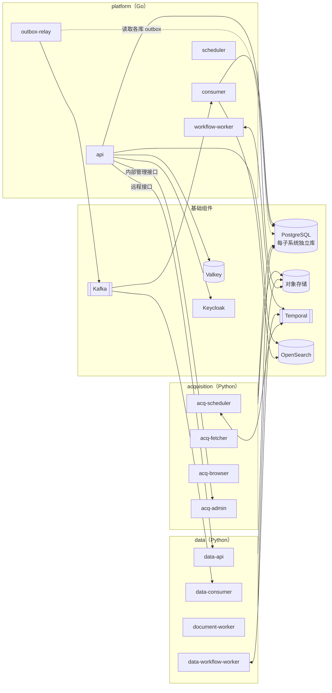

# 部署拓扑

> 状态：评审中 · 版本：3.3 · 更新：2026-10-17 · 负责人：首席架构师、平台工程负责人

## 1. 核心决策

**逻辑架构按终态设计，部署从少量单元开始，演进通过配置完成。**（[ADR-0002](../04-decisions/0002-composable-deployment.md)）

- 18 个子系统的边界、数据所有权、接口与事件契约从第一天按终态实现；
- 基础设施从第一天按生产级自建（组件见 [技术选型](08-technology-stack.md)，原则见 [ADR-0014](../04-decisions/0014-self-hosted-open-source-infrastructure.md)），不使用替代方案过渡；
- 应用代码打包为三个部署单元：`acquisition`、`data`、`platform`；每个子系统属于哪个单元以 [子系统索引](subsystems/README.md) 为准；
- 任一子系统可以通过部署配置从所在单元拆出，独立部署，代码与契约不变。

三个单元的划分依据是**故障域、伸缩方式、安全边界与语言的根本差异**，而不是开发便利：

| 维度 | `acquisition` | `data` | `platform` |
|---|---|---|---|
| 语言 | Python | Python | Go |
| 数据域 | 公共域；启用租户集成后另有随 Cell 的租户集成实例 | 公共文档实例；另有随 Cell 的租户文档实例 | 租户域、平台域；独立的公共 search 实例 |
| 网络 | 大量出站访问外部网站，需要出口管理 | 不访问外部网站（模型 API 除外） | 不访问任意外部网站（模型与渠道除外） |
| 负载 | I/O 密集、突发、浏览器渲染消耗大 | 文档处理、解析、增强、实体解析，CPU 密集、批量 | 事务、查询、匹配、事件处理、工作流 |
| 故障 | 来源变化、反爬、超时频繁 | 解析失败可重放，不影响在线服务 | 需要稳定、低延迟 |
| 安全 | 处理不可信外部内容的第一道边界 | 公共实例不接触租户数据；租户文档实例随 Cell 隔离 | 处理租户数据 |
| 发布节奏 | 来源处理器频繁更新 | 解析器与增强器随领域包更新 | 按版本节奏发布 |

## 2. 部署单元

每个单元一个镜像，以不同进程角色启动；进程角色通过部署清单选择加载哪些子系统。

### 2.1 `acquisition` 单元

| 进程角色 | 内容 | 伸缩依据 |
|---|---|---|
| `acq-scheduler` | 采集计划与回填工作流（Temporal worker，任务队列 `acquisition-schedule`）；消费控制类事件（回填请求、链路探针） | 固定副本 |
| `acq-fetcher` | HTTP/API 抓取执行器 | 任务队列深度 |
| `acq-browser` | 浏览器渲染池（Playwright） | 渲染任务队列深度、内存 |
| `acq-admin` | 来源注册、权利、健康的内部管理接口（经 `gateway` 暴露给运营控制台） | 固定副本 |

网络：独立的出口网关与出口地址池；入站仅允许来自内部网络的管理请求。

以上角色只服务公共数据供应。客户系统集成复用同一镜像与连接器代码，以单元级的租户集成角色随租户单元部署，使用单元级凭证、存储、主题与出口，不与公共实例混用（[acquisition 第 10 节](subsystems/acquisition.md#10-租户集成)）；角色在首个租户集成启用时加入清单。

### 2.2 `data` 单元

| 进程角色 | 加载的子系统 | 职责 | 伸缩依据 |
|---|---|---|---|
| `data-api` | evidence、domain-intelligence、entity-graph | 供上层查询的接口（领域事实、统计、实体、证据解析） | 请求速率、延迟 |
| `data-consumer` | evidence、domain-intelligence、entity-graph | 事件处理：解析修订、领域事实更新、实体解析 | 消费延迟 |
| `document-worker` | evidence | 文档处理、解析、增强（OCR 与版面经模型 API） | 文档队列深度 |
| `data-workflow-worker` | evidence、domain-intelligence、entity-graph | 重放、批量增强、语料快照、回填 | 工作流任务队列深度 |

客户授权文档（租户知识资产）的解析由 `tenant-document-worker` 的**单元级实例**完成：随租户单元部署，使用单元级凭证与存储，不与公共域实例混用。相同 database 代码按实例绑定不同数据库，迁移与备份也按实例执行。角色声明 `data_scopes: {evidence: tenant}` 与 `cell`；当前仅提供隔离组装骨架，租户文档业务处理随对应能力实现，不能启动公共探针消费者。

### 2.3 `platform` 单元

| 进程角色 | 加载的子系统 | 职责 | 伸缩依据 |
|---|---|---|---|
| `api` | gateway + 本单元全部子系统的接口实现 | 处理同步请求（REST、BFF、MCP） | 请求速率、延迟 |
| `consumer` | search、detection、assessment、pursuit、customer-context、learning、channels、commerce、governance 等的事件消费者 | 事件处理、索引投影、读模型更新、匹配 | 消费延迟 |
| `workflow-worker` | research、learning、customer-context、pursuit、governance、search 等的 Temporal worker | 研究运行、仿真、回填、索引构建、删除编排、推进时限 | 工作流任务队列深度 |
| `outbox-relay` | 全部子系统（含 Python 子系统）的发件箱中继 | 发件箱 → Kafka | 发件箱积压 |
| `scheduler` | 周期性任务（摘要、统计、健康检查） | 定时任务 | 固定副本（主备） |

各单元的角色清单为 `deploy/<单元>/roles.yaml`；角色中的子系统必须属于该单元（由子系统索引生成的 `deploy/subsystems.yaml` 校验）。入口：platform 为 `services/cmd/platform -role <角色>`，acquisition 与 data 为 `mq-acquisition` / `mq-data --role <角色>`；配置项见各入口的说明。

### 2.4 基础组件的部署约定

组件选型以 [技术选型](08-technology-stack.md) 为准，本节只规定部署方式：

- PostgreSQL：高可用集群 + 只读副本；每个子系统独立逻辑数据库与账号；统计与批量查询走只读副本；Temporal 使用独立集群；
- Kafka、OpenSearch、PostgreSQL 跨可用区部署（见第 7 节）；
- Keycloak、OpenFGA、Temporal 自建高可用；
- 可观测性：每个节点部署 OpenTelemetry Collector。

## 3. 运行时组装



关键设计：

- **子系统在同一进程中也不共享数据库连接与事务**：每个子系统使用自己的数据库账号与连接池；
- **同语言子系统间同步调用经接口包**：同进程时为本地调用，但仍经过上下文传递、授权检查、超时与可观测埋点（与远程调用行为一致）；**跨语言调用一律为远程调用**；
- **事件始终经 Kafka**：即使生产者与消费者在同一进程，也不使用进程内事件总线，保证拆分前后语义一致；
- **绑定由配置切换**：`MIAOQIA_BINDING_<子系统>=remote` 时调用方经该子系统的远程客户端调用，该子系统不在本进程加载（视为已拆出）；
- **Temporal 任务队列按子系统划分**：拆分子系统时只需让新服务监听其任务队列。

## 4. 拆分子系统的流程

拆分是运维操作，不是重构：

1. 在部署清单中为该子系统创建新的部署（复用同一镜像或构建只含该子系统的镜像）；
2. 新部署的 `api` 角色暴露该子系统的远程接口（由契约生成）；
3. 其他进程的接口绑定从本地实现切换为远程客户端（配置项）；
4. 事件消费组与 Temporal 任务队列切换到新部署；
5. 需要独立数据库实例时，通过逻辑复制把该子系统的逻辑数据库迁移到新实例并切换连接；
6. 契约测试与端到端测试验证后，从原单元的角色清单中移除该子系统。

**拆分触发条件**（满足任一即可评估拆分）：

| 触发条件 | 典型候选 |
|---|---|
| 资源特征与其他子系统显著不同，影响共享进程 | `research`（长时、模型密集）、`evidence` 文档处理 |
| 发布节奏需要独立 | `gateway`（外部接口）、信息领域解析器 |
| 安全或合规要求隔离 | `identity`、`governance` |
| 团队边界形成，需要独立交付 | 任何子系统 |
| 单子系统负载需要独立数据库实例 | `domain-intelligence`、`entity-graph`、`detection` |

## 5. 租户单元

```text
                  ┌───────────── 共享 ─────────────┐
                  │ acquisition · 公共数据供应实例 │
                  │ 平台平面子系统 · gateway          │
                  └──────────────┬──────────────────┘
          ┌──────────────────────┼──────────────────────┐
     Cell-01（共享）        Cell-02（共享）        Cell-E1（专属）
   客户智能平面子系统      客户智能平面子系统      客户智能平面子系统
   租户库 · 租户索引 ·     租户库 · 租户索引 ·     独立实例
   租户主题 · 租户文档     租户主题 · 租户文档
   解析实例               解析实例
```

- 首期只部署一个共享单元 `cell-01`，但单元标识、路由与主题命名从第一天存在；
- `gateway` 根据令牌中的租户查找所属单元并路由；
- 新增单元为部署操作：复制客户智能平面及租户 `evidence`/`search`（启用租户集成后另含 `acquisition` 租户集成实例）的实例清单与数据存储；公共数据供应实例不随 Cell 复制；
- 租户在单元之间迁移通过租户数据导出导入工作流完成，合规审批与协调见 [governance 第 10 节](subsystems/governance.md#10-数据导出与迁移)；目标单元须满足同一驻留策略（第 11 节）。

## 6. 环境

| 环境 | 用途 | 数据 |
|---|---|---|
| `dev` | 开发者本地与共享开发 | 合成数据与公共样本 |
| `ci` | 持续集成临时环境 | 测试夹具 |
| `staging` | 预发布、契约与端到端测试、性能测试 | 公共域数据副本、合成租户 |
| `prod` | 生产 | 真实数据 |
| `private-<customer>` | 私有部署 | 客户环境 |

前期使用不限定厂商的 VPS 作为共享开发环境，开发优先选择中国大陆节点；不满足境内处理条件的节点仅运行合成数据。开发环境不承诺生产 SLA，真实客户持续服务必须先满足相应安全与运行门禁。单机故障可重建，外部备份与数据导出须验证。

本地开发以 `deploy/local/up.sh` 启动全部基础组件（Docker Compose，每子系统独立数据库与账号，主题按契约创建），三个部署单元以进程角色启动；`tests/e2e/m0.py` 在此环境上验证完整探针和当前identity接口的本地/远程切换。它使用显式开发策略；生产HTTP认证策略另由[运行时验收](../05-delivery/05-m0-runtime-acceptance.md)覆盖。整个M0退出还须满足[阶段基线](../05-delivery/06-stage-baseline.md)的其他交付。

## 7. 地域与合规

- 生产部署在中国大陆区域，数据境内存储与处理；
- 生产至少两个可用区，PostgreSQL、Kafka、OpenSearch 跨可用区部署；开发 VPS 不要求复制该拓扑，生产等价预发布环境在迁移与上线演练前建立；
- 私有部署包包含客户智能、平台支撑及租户 evidence/search 实例；授权公共数据在独立公共实例中增量同步，不与租户文档/订阅混存（馈送范围、断网边界与撤权见第 10 节）；
- 驻留范围覆盖数据库、备份、对象、索引、模型端点、日志与运维访问，见第 11 节。

## 8. 发布

- 基于 Kubernetes，声明式部署（Helm + GitOps）；
- 滚动发布；数据库迁移遵循“扩展—迁移—收缩”，保证新旧版本并存；
- 事件与接口契约的不兼容变更必须提供并行版本；
- 功能开关与租户灰度由 `commerce` 权益与配置控制。

## 9. 开发 VPS 与生产云选择

开发阶段采用 VPS，不限定阿里云、AWS 或其他供应商；开发配置、凭证与数据和生产分离。正式运行切换到阿里云或 AWS 中国区，保留相同容器、数据库迁移、事件契约与标准对象访问接口。

截至2026-10-14的官方资料对比：

| 维度 | 阿里云 | AWS 中国区 | 对妙洽的判断 |
|---|---|---|---|
| 境内区域 | 多个大陆地域可选，具体实例/可用区销售情况按API确认 | 北京、宁夏；中国区账号与全球账号独立 | 境内客户与数据供应优先大陆区域；不把AWS全球区作为等价替代 |
| 自建基础设施 | ECS、云盘、VPC、负载均衡 | EC2、EBS、VPC、负载均衡 | 两者都承载自建RKE2与数据库，不依赖托管业务能力 |
| 对象访问 | OSS兼容部分S3 API，但仅支持虚拟主机请求风格，ACL与分片ETag等存在差异 | 原生S3，亦需验证中国区所需能力 | 对象访问定义为受测S3公共子集；内容哈希用SHA-256，不用ETag当内容哈希 |
| 开通与服务 | 大陆地域及账号要求按供应商流程办理 | 单独中国区账号；对外服务相关账户/备案前提按官方流程核验 | 正式运行前登记账号、域名与接入前提，不把开发账号自动用于生产 |
| 总成本 | 同规格实时报价与合同折扣后核算 | 同规格中国区报价，不能套用全球区价格 | 比较计算、云盘IOPS、对象容量/请求/取回、出口、跨区复制、冗余及迁移，不凭单一VM价格决策 |

**当前推荐（工程判断，待生产验收批准）**：阿里云大陆区域为主选，华东2（上海）为初始测试区域；AWS中国区为备选。理由是大陆区域选择更广，便于对客户、采集信源与模型API做同区域延迟实测；这不是价格优势或稳定性优劣的已验证结论。若OSS公共子集测试失败、目标区域实测不达标，或AWS中国区同规格总成本和迁移结果更优，改选AWS中国区并更新本节及ADR。

生产选择不阻塞M0。正式运行前完成两家同规格询价、延迟/吞吐实测和目标区域可用区确认；所需性能基线见[容量规划](12-capacity-plan.md)，正式切换需批准和验收证据。

迁移验收：VPS数据导出与内容哈希校验 → 恢复权威库/对象 → 重建索引 → 发件箱/消费位点与幂等重放验证 → 影子流量和权限验证 → 切换 → 校验与回退演练。迁移中的待执行任务、凭证、DNS与渠道回调逐项交接；保留源环境直至目标验证完成，禁止未经校验销毁源数据。真实租户迁移需要明确写入暂停或增量同步边界。

对象公共子集至少验证：上传/下载/HEAD、分页列举、Range、分片上传/中止、签名URL、私有桶访问、删除；保留/版本保护/跨区域复制通过基础设施配置管理并分别验收，不假定每家都可由同一S3 API配置。

官方依据：[阿里云地域与可用区](https://help.aliyun.com/zh/ecs/user-guide/regions-and-zones)、[OSS与S3差异](https://help.aliyun.com/zh/oss/developer-reference/compatibility-with-amazon-s3)、[AWS中国区账号](https://docs.amazonaws.cn/aws/latest/userguide/accounts-and-credentials.html)、[AWS中国区EC2定价](https://www.amazonaws.cn/ec2/pricing/)。实际报价与性能仍需在生产选型时复验。

### 检索实例与部署角色

`search` 的逻辑平面仍为数据供应，Go 实现仍打包在 `platform` 镜像。公共索引使用 `public-search-api`、`public-search-consumer`、`public-search-workflow-worker`；单元级 `api`、`consumer`、`workflow-worker` 中的 search 只管理该 Cell 的租户知识和订阅投影。公共查询通过公开接口绑定路由到公共实例；订阅反查由 detection 将公共事实提交给本单元 search，不把租户订阅注册到公共实例。

公共与租户实例分别使用索引集群/访问凭证、对象存储权限、主题、缓存、索引别名、构建队列与重放范围。清单中的 scope/cell 是组装输入，不是已实现这些权限的证明；远程绑定、权限负向测试及重建/删除测试必须在业务实现时验收。

### 实例迁移选择

启动和数据库迁移共用角色选择与数据域校验。Python 使用 `mq-data migrate --role tenant-document-worker` 选择租户文档实例；未指定角色的 `mq-data migrate` 默认 data-api，`mq-acquisition migrate` 默认 acq-admin。Go 使用 `platform -role <角色> migrate`，未指定角色默认 api。迁移只处理该角色登记的子系统，使用该实例单独配置的 owner DSN；scope/cell 不自动分配数据库或凭证。本地SQL初始化只创建公共 evidence 与首个 Cell 的基础库，租户 evidence 的独立库仍须按实例配置后再迁移，不能沿用公共 evd 连接。

## 10. 私有部署的公共数据馈送

私有部署客户在自己的环境运行客户智能平面，公共数据由平台以馈送方式交付到客户环境中的独立公共实例（第 7 节）。馈送是公共数据的受控对外交付，不是全量同步接口，也不放宽[公共数据暴露控制](06-security-and-tenancy.md#7-公共数据暴露控制)。私有部署包随路线图 M5 交付，馈送包格式与相关契约届时按追加式规则定义。

**馈送范围。** 一条数据能进入馈送，须同时满足三项：

| 条件 | 判断依据 | 所有者 |
|---|---|---|
| 来源允许再分发，且允许用途包含私有部署交付 | 组合后的权利条目（[数据架构第 12 节](02-data-architecture.md#12-来源权利与数据权益)） | `acquisition` 登记来源权利 |
| 在该客户订阅的信息领域、地域与数据覆盖范围内 | 客户权益 | `commerce` |
| 展示级别允许落地的部分 | 权利条目的展示级别；只允许摘要或引用的来源只馈送对应层级，原始附件不馈送 | 各数据所有者执行 |

不可再分发的数据不进入馈送。客户网络允许访问平台且合同授权时，可以开启在线回查：经公共 `gateway` 按需查询，适用与 SaaS 相同的上限、配额与水印；默认不开启。

**打包与应用。** `evidence`、`domain-intelligence`、`entity-graph` 各自导出本子系统的数据，按统一包格式形成签名的增量包：每个包有客户内的连续序号、内容哈希、所含数据的权利条目版本和数据截至时间。客户环境的公共实例按序号依次应用，重复应用幂等；发现序号缺口先补齐缺口再继续，缺口超出增量保留范围时以快照重建。馈送数据与租户文档、订阅分开存放，不混入租户域。`governance` 登记每个包的交付记录（客户、范围、权利版本、序号）。

**断网可用边界。**

| 断网期间仍可用 | 断网期间不可用 |
|---|---|
| 已收到的公共事实、证据片段与实体的检索和对象页 | 截至时间之后的新公共数据 |
| 基于已收数据的匹配、评估、跟进与关注 | 未馈送的原始附件与不可再分发来源 |
| 租户自身数据的全部功能 | 平台侧托管服务与在线回查 |
| 研究（使用客户配置的自有模型端点，[ADR-0015](../04-decisions/0015-model-inference-via-api.md)） | 新的应用领域包与研究模板版本 |

界面、提醒和研究报告标注所依据公共数据的截至时间；`domain-intelligence` 的覆盖度量包含馈送延迟，延迟超过约定阈值时向客户管理员告警。

**撤权生效。** 权利收紧、撤回或到期以撤权清单交付，撤权清单独立于内容包、优先发送，可以单独下发；客户实例先应用撤权清单再应用后续内容。每份馈送数据带授权租约，租约随正常馈送或单独的续期消息延长；超过租约仍未收到续期的数据在本地转为不可用（检索、对象页与研究不再返回），即断网时按失效处理，而不是继续可用。撤回的数据由客户实例删除，并重算受影响的检索投影与派生取值；客户运维执行后回传删除回执，`governance` 汇总为删除证明。客户长期断网无法回传时记为待确认，按合同义务跟进，不视为已完成。

**恢复。** 权利恢复或断网结束后，平台把受影响范围作为新的增量包重新馈送，不复用已删除的副本；客户实例按序号补齐。订阅降级或到期时馈送范围随权益收缩；已交付但超出新范围的数据，按权利条目是否以订阅为前提处理：以订阅为前提的按撤权处理，否则只停止更新。

## 11. 数据驻留

驻留是对数据和访问实际所在位置的约束，不只是给 Cell 加一个地域字段。每个 Cell 和私有部署引用一份驻留策略：按存储与访问类型列出允许的区域集合。默认策略为全部位于中国大陆区域（第 7 节）。

| 范围 | 驻留要求 | 校验位置 |
|---|---|---|
| 数据库 | 主库、只读副本、Temporal 集群、逻辑复制目标在允许区域内 | 部署清单校验；拆分子系统（第 4 节）的新实例同样校验 |
| 备份与归档 | 持续归档、快照与跨区域复制（含 L0 原始层的异地副本，[数据架构第 11 节](02-data-architecture.md#11-备份与容灾)）的目标在允许区域内；跨区域复制只在允许区域集合内选址 | 基础设施配置校验与恢复演练 |
| 对象存储 | 桶、历史版本与复制目标在允许区域内 | 基础设施配置校验 |
| 索引、缓存与消息 | OpenSearch、Valkey、Kafka 及其镜像或复制在允许区域内 | 部署清单校验 |
| 模型端点 | `ai-platform` 只路由到处理位置在允许区域内的端点；境外调用须另行评估并显式启用（[ai-platform 第 7 节](subsystems/ai-platform.md#7-路由规则示例)） | 路由策略校验与调用记录 |
| 日志与可观测 | 日志、链路与指标的存储位置在允许区域内；不含敏感原文 | 采集器与存储配置校验 |
| 外部渠道 | 短信、邮件、企业消息等渠道服务商的处理位置纳入驻留评估 | 渠道接入评审 |
| 运维访问 | 访问生产数据经区域内堡垒入口，人员访问租户数据只能经内部支持访问或服务委托（[identity 第 7.6 节](subsystems/identity.md#76-妙洽内部角色)），访问记录写审计；从允许区域外直接访问生产数据须单独审批 | 访问网关与审计 |

部署时，清单与基础设施配置中任一存储或复制目标不在驻留策略允许的区域内，校验即失败，不进入发布；自动校验随 M5 的第二个租户单元与专属单元模板实现，此前由部署评审逐项核对。迁移（第 5 节、第 9 节）的目标环境须满足同一驻留策略，跨驻留策略的迁移按 [governance 第 10 节](subsystems/governance.md#10-数据导出与迁移) 审批。私有部署的驻留由客户环境决定，部署包默认不向外连接，只保留客户显式配置的馈送通道与模型端点。
