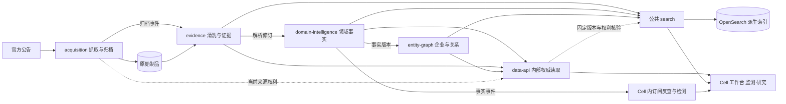

# 数据供应平面端到端设计

> 状态：阶段实施 · 负责人：数据架构负责人

## 1. 交付范围

首条工程验收用安徽工程建设中标公告的固定 mock HTTP 响应，验证从列表、原件、固定事实到 `data-api` 受权读取的全链路。首批实网供数面向[候选清单](../../packs/information_domains/procurement/source-inventory.yaml)的 40 个原站，由妙洽按来源配置并自行采集。采集与解析按来源和公告类型分别验收，受阻来源保留缺口，已通过验收的来源独立运行。试点供数、企业关联、公开检索和研究工具依[阶段基线](../05-delivery/06-stage-baseline.md#3-m1-前置条件与能力交接)交接。

Tender Intel 提供清单和来源访问经验。妙洽通过自己的采集进程长期获取、归档和供给测试文档。客户规则在消费侧使用公共数据。A02 以公开结果研究中标方和供货窗口，本企业的中标状态由客户依招标方通知及自身流程确认。[来源参考边界](10-tender-intel-reference.md) · [A02 业务流程](../02-business/application-domains/tendering/03-business-processes.md#22-pb-tender-a02-进入供货)

依照[数据架构](02-data-architecture.md)的分层与存储类，以及[部署拓扑](07-deployment-topology.md)的角色与驻留规则。`acquisition` 和 `data` 承载公共采集与处理。`search` 的公共角色由 Go `platform` 镜像承载，按公共数据凭证独立运行。租户的订阅、知识、信号和研究留在 Cell 内。工作台和 Agent 通过服务契约读取，凭证与数据所有权保留在各子系统内。

## 2. 抓取与清洗

[抓取与归档设计](subsystems/acquisition.md#13-抓取与归档设计)定义来源启用、持久化扫描记录、详情复查、原件保存、故障恢复和获取事件。采集在正文与部件可追溯之后交接给 `evidence`。`evidence` 从固定来源观察读取并校验原件，决定规范化内容是否产生新快照。

| 处理点 | 设计 | 可核验证据 |
|---|---|---|
| 规范化 | `evidence` 先校验原件哈希，再由包适配器从 HTML 或 JSON 响应提取可读正文。保留表格、分块、关键字段的定位，以及输入和处理版本。导航、机器人挑战、空壳页、缺正文和不支持格式分别记录。附件的缺失有独立状态。 | 用日志中的来源对象追溯到原件字节、规范化快照和字段所在原文片段。 |
| 语义抽取 | 采购解析器负责公告类型、采购方、中标方、金额与单位、时间、项目号、标包和来源字段。缺失保持未知。中标候选人、评标结果与正式中标分开。证据或结构校验失败的修订进入复核，结构或模型增强结果按其已批准的字段门槛进入下游。 | 对关键字段实施人工反查。更正、冲突、多个标包或来源缺字段时，结果与证据一致。 |

## 3. 持久化、纠错与实体关联

- **权威边界。** 原件、规范化内容和增强制品按[数据存储层](02-data-architecture.md#3-公共域的分层持久化)落对象存储。各所有者在自己的 PostgreSQL 登记引用、修订、字段证据、事实与实体关系。先持久化对象并验证哈希，再提交元数据与事务发件箱。事务失败留下的对象按引用、保留期与写入宽限期核查后回收。原件备份保留独立校验链。
- **版本推进。** `domain-intelligence` 以领域契约接受事实版本，按项目与标包语义将招标、结果、更正和撤回关联到正确对象。首批只自动关联有确定来源标识或有证据且无冲突的业务身份。更正目标不明确时进入复核。保留项目引用的公告固定版本、有效时间和记录时间，晚到事件与重放按业务版本核对，避免旧版本回写当前指针。
- **企业关联。** `entity-graph` 以可验证的统一社会信用代码或权威主体标识优先匹配，附公开登记事实和来源证据。同名、分支与冲突只给候选或未知。保留公告披露的中标方文字及其证据。总包身份需要合同、公告或领域规则提供对应角色依据，中标方字段本身只证明公告披露的中标角色。合并与撤销保留历史口径。[实体版本与接口](subsystems/entity-graph.md#5-接口)
- **运行与恢复。** 事件按稳定来源对象或业务标识分区，消费端以事件 ID 去重，并用业务键和版本保护状态推进。处理新增失败按来源、窗口或修订版本隔离。补采用于取回漏抓原件，重放从已有原件或权威版本恢复指定下游。回放与在线增量分开预算，保留检查点、失败原因和受影响范围。恢复先核对原件与 PostgreSQL，再从检查点恢复事件与索引。

## 4. 搜索与权威读取

**公共搜索。** 复用 `public-search-*` 角色。首批索引公告、公告分块、采购事实与已确认主体，支持标识号精确匹配、中文全文和日期、区域、公告类型条件。投影从所有者接口、授权制品和事件增量更新，记录源对象标识与版本。索引搜索只负责发现候选，字段核实、证据定位和历史重建返回权威所有者。重建以确定的快照和消费起点构建影子索引，再接续增量、比对结果并切换别名。归并、撤回与撤权测试同时覆盖增量、切换、回退和重放。[搜索子系统](subsystems/search.md)

**权限与分页。** 搜索服务对客户端隐藏原始索引命中。命中版本、摘要、高亮和分块须按可信来源闭包核验请求主体、租户、Cell、用途与当前展示权利。索引中的可见性字段用于缩小候选范围。最终响应的权限由权威端口确认，权限依赖不可用时失败关闭。分页游标绑定查询与授权上下文、索引版本及有效期，每页重新核验。计数、分面和后续页状态只用允许暴露的数据计算。首批允许省略无法安全计算的全量分面。索引滞后时返回截至时间，已确定版本的对象与证据仍可走 `data-api`。[来源权利与确认边界](subsystems/source-rights-runtime.md#内部协议与确认边界)

| 调用者 | 读取方式 | 关键边界 |
|---|---|---|
| 工作台与对象页 | 浏览器通过 `gateway`。搜索返回候选引用，详情通过 `data-api` 查事实、项目、主体和证据。 | 使用会话派生身份。明确区分空结果、来源覆盖不足、数据滞后和依赖不可用。信号跳转按信号固定的版本展示，当前变化单独标示。 |
| 监测 `detection` 与仿真 `learning` | 领域事件驱动 Cell 内订阅反查，只向候选租户发起受委托读取。仿真按草案租户和指定时点读取。 | 复用 Cell 内的最小反查，搜索投影落后不阻断对已获准事实的监测与仿真。公开索引不接收租户订阅。 |
| 研究 `research` | 由服务端注册全文/事实搜索、主体查询和证据解析的只读工具。工具读取有页数、时长和结果量预算，输出绑定事实版本与证据。 | 研究调用的主体、用途、委托和模型使用权先评审。Agent 以工具结果区分事实、推断和未知，引用校验可复核，预算耗尽时保留已核实部分。 |

`data-api` 的事实、证据与搜索复核读取由所有者 OpenAPI 和生成的 Go 客户端约束。公告分块按当前固定公告版本与全文展示权利返回原文片段。已确认公开组织主体按当前固定实体版本复查登记事实和原文。覆盖与结构化记录证据随各自的所有者接口验收。`search` 通过这些受限接口做权限与版本核验，保有索引和查询所有权。[读取契约](../../contracts/apis/data-api/openapi.yaml)

## 5. 实施与验收顺序

| 实施切片 | 拉通路径 | 现场验收 |
|---|---|---|
| 固定响应贯通 | 使用一份明确标记为测试材料的安徽工程建设中标响应，执行列表、归档、入库、事实和受权读取。 | [固定模拟测试](../../data/subsystems/domain-intelligence/tests/test_mock_anhui_award.py) 分别验证采集和解析，覆盖漏页补扫、HTTP 重试、`A → B → A`、旧事件迟到、重复投递、固定事实和 mTLS 受权证据读取。Kafka 与部署恢复沿持续采集验收。 |
| 持续采集和供数 | 对首批 40 个原站逐项验收，启动默认 30 天回填并保持增量优先。真实原件保存于境内 S3 兼容对象存储。 | 覆盖与阻断状态可查，具备原件与数据库恢复证据。获准的已有原件可供冻结测试批次，字段独立验收。 |
| 搜索和上层读取 | 先完成跨语言读取契约，再落首批索引、受权搜索、工作台与 A02 真实数据路径。 | 一条新事实能触发有权租户的信号并打开证据。索引可重建并回退。跨租户、撤回与撤权、索引滞后和超时验收覆盖所有读取路径。 |
| 最薄研究切片 | 在满足模型与工具准入后，通过同一受权数据访问边界研究中标企业。 | 同一事实版本在报告中可以定位到证据。主体未决、来源范围不足或权利受限时报告相应未知。 |

按[数据质量计划](../05-delivery/04-data-quality-organization.md)独立取参照与检索评估样本，按[质量与验收](../05-delivery/02-quality-and-acceptance.md)分段测量发布至发现、发现至事实、事实至索引及事件至信号，报告分母和不可测样本。当前来源采集节奏以包声明为准，周期与站点限速对时效门槛的影响用实测判断。持续运行前完成 C11 的告警、恢复、失败重放和升级回退演练；验收结论落到对应阶段记录。

## 6. 当前验收范围

- **采集与归档。** 妙洽运行时负责抓取、复查、原件与冻结测试供数。目录收录 40 个来源，调度加载已准入来源。用 `mq-acquisition-fetch --list-sources --packs packs` 查看逐源准入、窗口队列及运行缺口。隔离 PostgreSQL 验证了 40 个合成来源的多连接并发计划、领取和结算。独立 `acq-fetcher` 进程从本地模拟源取得并归档增量和历史原件。隔离组件验收也覆盖返版、附件补采、S3 兼容备份恢复，以及对象故障时按原字节恢复。湖南实网样本验证了同一标段原件支持逐公告归档与授权冻结投影，分组事件另在开发 VPS 验证中继与重放。[部署角色](07-deployment-topology.md#21-acquisition-单元) · [实网探测](../05-delivery/12-public-source-probe.md) · [开发 VPS 验收](../05-delivery/10-vps-public-services.md#合成数据面的兼容存储验证)
- **浏览器采集。** 浏览器执行角色与 HTTP 执行角色按来源声明领取计划，共用站点限频和恢复账本。公共测试 VPS 上的隔离 `acq-browser` 用受监督 Chromium 分别采集列表与正文，核对 30 天到期登记、原件与投影回读及事务内 V4。已验证同次合成捕获的 V4 经 Go 中继、Kafka 和 `data-consumer` 进入待解析队列，再由 Evidence 显式重放并从对象存储回读规范化快照。另有隔离用例覆盖捕获恢复、冻结读取和控制器退出后的出口撤销。常驻接线、完整出口约束、供应商实际到期、发布者依赖和持续覆盖仍逐项验收。[浏览器归档](subsystems/acquisition.md#134-归档范围与字节定义) · [同次捕获交付收据](../../deploy/vps/data-plane/browser/receipt-provider-ingest.jsonl)
- **发布装配。** 境内 VPS 发布包包含采集、数据读取、公共检索、专用只读采集覆盖报告和独立迁移任务。镜像重建、Compose 渲染及五库迁移已通过隔离验证。Go 和 Python 通过真实 Kafka 验证了 TLS 与 SCRAM，覆盖公共主题位点采样、消费、死信投递和位点提交。[发布包验证](../05-delivery/10-vps-public-services.md#公共数据面发布包验证) · [Kafka 连接契约](03-integration-contracts.md#34-发布与消费规则)
- **清洗与读取。** 安徽工程建设 mock 独立核对采集和字段证据，贯通事实及 mTLS data-api 到 A02 研究。既有 A02 冻结官方语料的进程回放核对信号、对象、证据和简报。已通过合成采集观察验证先归档正文和 PDF 并提供冻结批次，再按独立解析准入从同一份归档回放。真实来源解析质量仍按来源和公告类型验收。[解析准入与回放](subsystems/evidence.md#12-实现状况)
- **搜索与研究。** 公共搜索支持采购公告、项目固定事实和可选的公告分块与已确认组织投影。隔离环境以 PostgreSQL、Kafka 和 OpenSearch 核对投影、索引重建和回退，以专用 mTLS 出口核对源级撤权和持久化续页。A02 同步入口核验指定组织单元，可返回获准引文与明确的未知项。真实企业登记覆盖、生产模型与完整工作流按各自门槛交接。[搜索部署](../../deploy/platform/public-search.md) · [研究契约](../../contracts/apis/research/openapi.yaml)

## 7. 上线待验证事项

- **来源与关联。** 数据负责人逐源确认启用栏目、公告组合键、可复查窗口、更正证据及能提供强标识的企业公开来源。未核实的身份、公告类型与覆盖范围应进入首批评估。
- **部署与恢复。** 现有境内开发 VPS 就是共享开发公开数据面的常驻主机。平台工程负责人在该主机验收公共数据面专用 PostgreSQL、S3 兼容服务、公共索引与访问凭证，配置境内异地备份目标并在另一台获准 VPS 验证恢复。实网持续运行以该环境的逐源采集和恢复证据验收。
- **契约与治理。** 现有 `data-api` 承担首条工程验收的内部受权读取。新增读取随所有者契约验收。质量负责人按现行门槛分别记录来源、公告类型、采集覆盖、字段质量与证据覆盖。真实测试样本通过[冻结批次](subsystems/acquisition.md#136-下游契约)供测试服务按权限取用。
