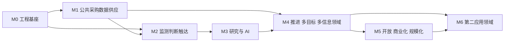

# 建设路线图

> 状态：评审中 · 版本：2.0 · 更新：2026-10-14 · 负责人：产品负责人、首席架构师

## 1. 路线原则

- **架构一次到位，能力分批交付**：子系统边界与基础组件在M0明确，工程横切契约和骨架在M0建成；业务契约按使用阶段冻结，开发VPS与生产高可用按阶段部署；业务能力按依赖关系分里程碑交付；
- **按应用领域发布**：对外发布以应用领域为单位，必须满足 [质量与验收](02-quality-and-acceptance.md) 的发布门槛；
- **公共域先行**：数据供应平面的质量决定一切上层能力，优先建设并持续度量；
- **每个里程碑都有可演示的端到端闭环**，而不是只完成某一层。

M0 的启动条件见 [立项准入清单](00-initiation-readiness.md)。

## 2. 里程碑

周数为规划窗口，按实际能力交付在每个交接节点校准；人员与预算灵活安排。里程碑可以重叠，但依赖的是已验收的能力切片，而不是前一里程碑已经开始。

### M0 工程基座（第 1–8 周）

| 范围 | 交付 |
|---|---|
| 基础设施 | 开发 VPS 与网络，按开发负载运行本地/共享开发组件；生产 RKE2、高可用和正式云迁移在正式运行前验收（ADR-0014）；基础设施配置版本化 |
| 代码库 | monorepo（Go 模块、Python uv 工作区、TypeScript 工作区）、Go 与 Python 的 `kernel`、Python `sdk`、18 个子系统骨架、三个部署单元与进程角色、依赖检查 |
| 契约体系 | `contracts/` 目录结构、Go/Python/TypeScript 代码生成、兼容性检查、跨语言契约测试框架 |
| 平台横切 | 请求上下文、接口绑定（本地/远程）、发件箱与中继、事件消费框架、审计 SDK、授权 SDK、模型网关骨架 |
| 身份 | 租户、成员、角色、登录、令牌、租户单元 `cell-01` 路由 |
| 质量 | CI 流水线、安全负向测试框架、本地一键环境 |

**退出标准**：一个“空业务”的事件在三个部署单元间端到端流转，带追踪、审计和授权；任一子系统可通过配置切换为远程绑定并通过契约测试。

### M1 公共采购数据供应（第 5–16 周）

| 范围 | 交付 |
|---|---|
| `INF-PROC` 信息领域包 | 自主开发来源处理器、解析器、领域 Schema、生命周期与领域事件；P0来源由[候选盘点](../../packs/information_domains/procurement/source-inventory.yaml)分级确认（仅参考定位信息）；全国范围；建立来源参照集与字段标注集 |
| `INF-ORG` 信息领域包 | 企业工商数据接入，作为实体主数据基础 |
| acquisition | 来源注册与权利、调度、HTTP 与浏览器抓取、归档、健康 |
| evidence | 快照、文档处理（HTML/PDF/OCR）、规范化文档与分块（对象存储）、解析修订、字段溯源、质量、重放；增强管线与首批增强器（文档分类、品类分类、业务标签、分块向量）、语料快照 |
| domain-intelligence | `INF-PROC` 领域事实、项目聚合、生命周期、领域事件、覆盖度量 |
| entity-graph | 组织与项目实体、实体解析、核心关系 |
| search | 文档、分块、领域事实索引族；中文检索与混合检索；订阅反查；索引版本化与别名切换；检索相关性评估基线 |
| operations | 解析与实体复核队列、来源健康处理 |
| ai-platform 最小能力 | M1 使用前完成供应商适配、OCR/嵌入/重排与结构化生成路由、数据分级、输出校验、超限停止、调用计量与主备失败处理；不等待 M3 研究能力 |
| governance 最小能力 | 来源权利与个人信息目录、分级配置、来源下线和删除更正处理流程；实际采集前就绪；允许早期由受控操作流程执行并留证 |

**退出标准**：`INF-PROC`、`INF-ORG` 在目标来源集上达到数据层门槛（覆盖、时效、关键字段准确率）的内测值。

### M2 监测、判断与触达闭环（第 13–24 周）

| 范围 | 交付 |
|---|---|
| customer-context | 客户档案、多价值链角色、目标配置、策略 DSL、策略版本与审批；首次激活前提供最小确定性仿真报告 |
| detection | 监测订阅、匹配、处置、信号、回填 |
| assessment | 规则型判断框架、判断记录、决策与审批 |
| channels | 企业微信、飞书、钉钉、邮件；摘要、快捷反馈与站内兜底；M2 只支持结构化查询/动作，对话研究与追问随 M3 research 上线 |
| gateway | REST API、BFF |
| Web | 研究工作台（信号收件箱、证据查看、判断与反馈）、客户能力中心、管理控制台 |
| learning | 反馈采集、评估集、质量报告、首次策略激活所需的固定数据集仿真 |
| 安全与运营 | 客户试用前完成权限、分级、删除更正流程、检索/对象/原文查看限额、客户支持与缺陷反馈；配额用独立配置执行，不等待 M5 套餐账单 |
| 应用领域包 | `APP-TENDER` R1 目标中的 A01 直接投标、A02 进入供货、B03 竞争情报；角色模板与行业包（建材管材、信息化、环保水务），见 [首发范围](../02-business/application-domains/tendering/05-release-plan.md)。M2 只有采购与企业数据：A02、B03 中依赖 `investment.*`、`credit.*` 视图或 `winner.credit_flags` 的规则在三值逻辑下读取为未知，按各规则的 `missing` 处理，不阻断模板上线；这些规则随 M3 的 `INF-INVP`、`INF-CRED` 生效，届时以模板新版本重新仿真后激活 |

**退出标准**：早期使用客户在真实数据上完成“配置目标 → 收到信号 → 查看证据 → 判断 → 反馈”闭环，达到监测层内测门槛。

### M3 研究与 AI（第 21–32 周）

| 范围 | 交付 |
|---|---|
| ai-platform | 扩展 M1 最小网关：研究任务模型目录、提示注册、研究输入护栏、复杂路由与评估；复用已存在的供应商适配和计量 |
| research | Agent 运行时、工具注册、研究模板执行、引用校验、报告 |
| 研究模板 | `RT-TENDER-ELIG`、`BUYER`、`COMPETE`、`PROJECT`、`WINNER`、`RISK`、`ORGTRACK`（`PRICE` 随 R2） |
| assessment | 结合研究的判断框架（`AF-TENDER-BID`、`AF-TENDER-SUPPLY`） |
| customer-context + learning | 自然语言策略调优、扩展 M2 仿真为在线影子/灰度与回滚 |
| channels | 复用已接入渠道，开放模板研究、异步状态和追问；未完成研究能力不展示可执行入口 |
| governance | 研究输出 AI 标识、输入分级和主体权利处理在真实研究前验收 |
| 研究评估 | 研究黄金集与回归流程 |
| 信息领域包 | `INF-INVP` 项目审批、`INF-CRED` 司法信用；接入后补齐 M2 中 A02、B03 依赖它们的规则 |
| 应用领域包 | R1 其余目标：B05 目标企业经营跟踪、C01 交易对手风险评估；研究按需回填（数据获取请求） |

**退出标准**：研究层达到内测门槛（引用覆盖、事实正确率、成本）。

### M4 推进与多目标、多信息领域（第 29–44 周）

| 范围 | 交付 |
|---|---|
| pursuit | 机会路径引擎、阶段、任务、领域事件挂钩、路径衔接、结果与复盘 |
| 信息领域包 | `INF-QUAL` 资质、`INF-FISC` 财政 |
| entity-graph | 图查询读模型（引擎选定）、组织画像 |
| 应用领域包 | R1 完整发布；R2 目标的机会路径与判断框架 |
| Web | 推进工作台、策略实验室、市场与实体视图 |

**退出标准**：`APP-TENDER` R1 满足发布门槛，正式对外发布；R2 进入内测。正式运行前完成生产云选择、VPS迁移、高可用/恢复/升级回退演练、来源权利与主体请求控制、客户支持与培训。M4 先按非收费发布验收；如收费，价格、权益与收费全流程必须一并提前验收。

### M5 开放、商业化与规模化（第 41–52 周）

| 范围 | 交付 |
|---|---|
| gateway | MCP 服务器、Skills、Webhook、公共 API 正式版 |
| commerce | 产品目录、订阅、权益、套餐配额和账单；复用 M1 计量、M2 访问限额，商业化不改变已有安全上限 |
| governance | 将 M1–M4 的保留/删除/更正/AI 标识控制完善为自动编排、证明与合规报表，不将最低控制推迟到本阶段 |
| operations | 托管研究服务工作台、客户成功流程自动化、自动化候选；M2 内测和 M4 发布已有支持责任及操作流程 |
| 部署 | 第二个租户单元、专属单元模板、私有部署包 |
| 集成 | CRM 同步适配器 |
| 应用领域包 | R2 发布；R3 目标（批次划分见 [首发范围](../02-business/application-domains/tendering/05-release-plan.md#2-商业目标分批已决定)） |

**退出标准**：商业化全流程运行；专属单元与私有部署通过演练。

### M6 第二应用领域（第 49 周起）

根据 [应用领域准入标准](../02-business/04-application-domains.md#3-应用领域的准入标准) 与 [扩展策略](../01-product/02-business-model.md#6-应用领域扩展策略) 选定第二应用领域（候选：企业客户开发、金融服务获客），复用已建成的信息领域与平台能力。

## 3. 依赖关系

## 4. 团队组织

责任与决策机制见 [数据、质量与组织](04-data-quality-organization.md)。人员、预算与实施节奏灵活安排；每个交接点明确能力责任与证据。

## 5. 早期使用客户

早期使用客户已由项目负责人确认，覆盖建材供应商与投资决策者；M0 参与概念测试，M2 起按已交付目标参与内测，B05等研究目标在M3验证。其作用是**验证交付质量与可用性**并提供评估样本，不作为是否建设的前置条件。早期客户按协议获得试用权益，并授权以去标识化方式使用其反馈改进其自身配置与应用领域评估集。
