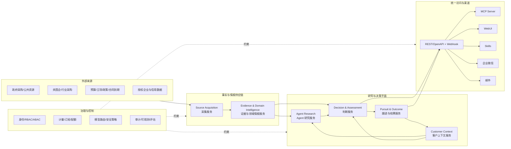

# AI 原生商业机会研究与决策 SaaS：市场、产品与系统蓝图

> 日期：2026-10-12  
> 状态：立项前用户旅程与服务架构设计稿  
> 默认市场：中国大陆  
> 首批客户：参与招投标和政企销售的中小及中型企业  
> 首个领域适配器：招投标、采购意向与项目前置信号  
> 证据说明：公开事实、厂商自述、仓库实证和待验证假设在本文中分开标注。

## 0. 执行摘要

### 0.1 建议做什么

建议把 Tender Intel 从“向客户交付源码的采集与匹配工具”升级为一个**面向企业业务团队的 AI 商业机会研究与决策系统**。它不是招标信息聚合网站，也不是单纯的 AI 写标书工具。招投标是第一个领域适配器，产品价值来自一条完整的用户旅程：

```text
业务建模 → 机会发现 → 背景调查与取证
        → 相关性、可信度与风险评估
        → 决策与资源投入 → 跟进协作 → 结果复盘
```

系统由面向业务能力的服务组成：来源采集、证据与领域情报、客户上下文、Agent 研究、判断与评估、跟进与结果、身份治理以及统一访问网关。Agent 通过受控工具获取买方历史、竞争关系、关联项目、来源质量和客户能力等上下文，输出区分事实、推断、未知项和建议的研究结果，再交由客户批准决策。

后续可以延伸到背景调查、capture plan、投标任务协作和提案辅助，但所有高影响动作均保留人工审批。

### 0.2 为什么现在值得做

- 2024 年全国政府采购规模为 **33,750.43 亿元**，其中授予中小企业合同金额 **24,230.91 亿元，占 71.79%**；这证明首批目标客户所在的交易底盘足够大，但采购金额不能直接当作软件市场规模。[S5]
- 国务院办公厅 2024 年明确要求招标投标与大数据、云计算、人工智能等技术融合，并推动全国统一电子招投标技术标准和数据规范。[S6]
- 国内头部产品已经覆盖早期商机、搜索订阅、客户/竞对分析、规则定制、商机管理和数据接口；国外 GovWin IQ、GovDash 又把产品延伸到了早期情报、capture、定价、提案、合同和交付。[S13][S14][S15][S16]
- 因此，市场机会不在于“公告更多”或“也能 AI 匹配”，而在于形成以下组合优势：**来源证据可信、客户策略可控、Agent 原生、领域协议开放、从发现到决策连续、中文政企场景深入**。

### 0.3 第一阶段必须克制的地方

首个可收费版本只承诺以下用户旅程闭环：

```text
客户业务建模 → 候选信号发现 → Agent 背景调查
       → 可信度/相关性/风险判断 → 人工决策
       → 跟进任务 → 结果反馈
```

第一阶段不做：

- 全自动生成并提交投标文件；
- 替代 CRM、项目管理和完整合同管理系统；
- 同时覆盖所有“商机”类型和所有行业；
- 从个人微信账号进行非官方自动化；
- 抓取或出售来源不明的私人联系方式；
- 输出无法解释的“中标概率”；
- 允许 LLM 直接修改线上规则或对外发送提案。

### 0.4 最重要的五项架构决策

1. **公共事实、研究结果、客户判断和行动状态严格分离**，延续当前仓库的证据边界。[S1][S2]
2. **目标架构采用面向业务能力的微服务**，服务拥有独立数据和故障边界，通过 API 与领域事件协作。
3. **Source Acquisition、Evidence & Domain Intelligence、Agent Research、Decision & Assessment、Pursuit & Outcome、Identity & Governance 分别承担独立职责**，不共享数据库表。
4. **Agent 只能通过受控工具调查和组织结论**，不能直接写入事实、跨租户取数或执行高影响副作用。
5. **REST/OpenAPI 和事件契约是稳定领域边界，MCP、skills、WebUI、企业微信和邮件都是访问适配器**；租户身份来自授权令牌，而不是工具参数。

---

## 1. 任务边界与研究方法

### 1.1 本文要回答的问题

- 这个市场是否存在足够强的客户痛点和付费空间？
- 首批客户和切入口应该是谁、是什么？
- 与现有国内外产品相比，产品应如何定位？
- 用户如何完成从信号发现到研究、判断、行动和复盘的完整旅程？
- 领域事实、研究任务、客户判断和行动状态应如何建模？
- 微服务如何按业务能力划分，Agent 如何通过工具协作？
- WebUI、MCP、skills、企业微信、邮件如何共用一套服务？
- 现有 Tender Intel 哪些部分可以复用，哪些必须重构？
- MVP、商业模式、团队、风险和验证门槛是什么？

### 1.2 证据等级

| 等级 | 含义 | 本文用法 |
|---|---|---|
| A | 法律法规、政府官方统计或平台说明 | 市场底盘、政策方向、合规边界 |
| B | 企业官网自述 | 只用于确认产品定位与宣称的能力，不当作独立效果证明 |
| C | 当前仓库代码、文档和新鲜测试 | 判断现有能力、复用边界和工程起点 |
| H | 尚未完成真实客户验证的假设 | 定价、需求排序、目标指标和市场规模情景 |

### 1.3 研究限制

本文没有冒充真实客户访谈。客户需求部分由交易结构、现有工作流、竞品定位和产品逻辑推导，必须通过后续访谈、历史样本和付费试点验证。本文也不是法律意见；特别是数据采集授权、公开个人信息再利用、模型备案/登记、生成内容标识和跨境模型调用，需要在上线前由专业人员按具体业务形态复核。

---

## 2. 市场判断

### 2.1 交易底盘大，但不能把 GMV 当 TAM

财政部国库司公布的 2024 年数据如下：[S5]

| 指标 | 规模 | 含义 |
|---|---:|---|
| 全国政府采购 | 33,750.43 亿元 | 仅是政府采购，不含全部工程招标、央国企采购和非招标商机 |
| 货物采购 | 7,944.68 亿元 | 适合标准产品供应商切入 |
| 工程采购 | 13,839.64 亿元 | 信息分散、项目链条长、前置信号价值高 |
| 服务采购 | 11,966.12 亿元 | 对方案、资质、业绩和提案协作要求更高 |
| 授予中小企业合同 | 24,230.91 亿元 | 中小企业是有效目标群体，而非边缘群体 |
| 授予小微企业合同 | 15,310.35 亿元 | 客户数量可能大，但支付能力和服务成本差异明显 |

全国公共资源交易平台的官方定位是汇集全国公共资源交易、主体、专家、信用和监管信息，并为市场主体提供信息服务；平台同时说明信息来自各级各类平台，源平台仍是发生不一致时的依据。[S7] 这意味着：

- 市场天然多源、异构、版本易变；
- 官方平台是证据来源，不等于客户决策工具；
- 商业产品的价值在标准化、上下文、及时性、决策和工作流，而不是声称替代官方原文。

### 2.2 结构性变化

1. **信息聚合正在商品化**：搜索、关键词订阅和微信推送已经是行业基础能力。
2. **价值向招标之前移动**：采购意向、预算、立项、审批、专项债、合同到期和项目关系比公告发布后的简单提醒更有价值。
3. **价值向决策之后移动**：客户真正付费是为了减少无效跟进、缩短决策和提案周期、提高可赢机会投入，而不是为了多看公告。
4. **可验证性成为 AI 门槛**：招投标场景不能接受无法追溯的摘要、资格条件或截止日期；原文、字段证据和模型版本必须可查。
5. **交互入口正在解耦**：用户可能在 LLM、企业微信或邮箱中完成大多数日常动作，WebUI 更适合配置、审核、运营和复杂协作。
6. **监管仍在变化**：截至本文日期，政府采购法修订草案已于 2026-06-26 公布并征求意见，产品需把法规、分类和合规模板做成可版本化配置，而不是写死。[S8]

### 2.3 竞争格局

| 类别/代表 | 已公开定位与能力 | 强项 | 留给本项目的空间 |
|---|---|---|---|
| 官方平台：中国政府采购网、全国公共资源交易平台、地方平台 | 法定/权威信息公开与数据服务 | 来源权威、免费、覆盖基础交易信息 | 跨源统一、客户上下文、决策和协作不是其主要目标 |
| 千里马 | 招标、拟在建、企业库、跟踪、数据商城、企业智能商机、标书服务/AI [S14] | 数据规模、品牌、入口和服务广度 | 以开放规则、证据版本、Agent 接入和客户自控形成差异 |
| 剑鱼标讯 | 早期/实时商机、客户与竞对分析、投标决策、规则定制、分配跟进、复盘、数据接口 [S13] | 已接近“商机中台”概念，企业服务较完整 | 不能只做功能追平；必须押注开放协议、可审计策略和 Agent 原生体验 |
| GovWin IQ | 分析师验证的早期政府市场情报、预算信号、竞争与合作伙伴分析、AI 摘要/评分 [S15] | 人工情报与数据质量、早期 capture | 中国本地数据、中文规则、成本结构和渠道适配 |
| GovDash | Discover、Capture、Pricer、Proposal、Contract、Data Library 与 Agents 共用数据层 [S16] | 全生命周期 AI 产品范式最接近本愿景 | 证明方向成立，也提示“一次做全”所需资本和专业深度很高 |
| Loopio / Responsive | RFP/RFI/DDQ 响应、内容库、协作和 AI 自动回答 [S17][S18] | 提案知识复用和响应工作流 | 可作为集成对象；本项目先掌握机会与决策上下文，再谨慎进入提案 |

**结论**：国内市场并非空白。真正可辩护的定位应为：

> 一个以可靠信源和客户上下文为基础，由 AI Agent 完成研究取证、由人批准决策、可持续复盘的商业机会研究与决策系统。

招投标只是第一个领域适配器。产品强调“系统如何围绕一个真实业务问题调用工具、验证证据、解释判断并推动行动”，而不是“公告更多”或“AI 能写几段文字”。

### 2.4 市场规模的正确估算方式

公开政府采购金额不能直接转化为 SaaS 收入。应建立可验证的自下而上模型：

```text
可服务账户数
× 年均账户订阅收入
× 可接受数据覆盖率
× 可触达率
× 付费转化率
= 可服务收入机会
```

规划情景（H，不是市场预测）：

| 情景 | 可服务账户 | 年均订阅 | 理论 ARR |
|---|---:|---:|---:|
| 单行业切入 | 5,000 | 30,000 元 | 1.5 亿元 |
| 多行业中端 | 20,000 | 60,000 元 | 12 亿元 |
| 企业平台化 | 50,000 | 100,000 元 | 50 亿元 |

这些数字只有在以下输入被实证后才有意义：目标行业企业名单、过去 12 个月有效投标次数、现用工具支出、决策团队规模、数据覆盖和付费试点转化率。第一年不应以宏观 TAM 驱动投入，而应以一个垂直行业的付费留存和单位经济驱动。

---

## 3. 客户与需求研究设计

### 3.1 首批 ICP

优先客户：

- 年度参与政企采购/招投标不少于约 10 次；
- 有 2–20 人的销售、商务或投标协作团队；
- 跨地区找项目，且现有关键词订阅噪声较大；
- 单个有效机会价值足以覆盖数万元年费；
- 产品、资质、业绩和禁入条件相对清晰，可被结构化；
- 愿意提供历史“相关/不相关、投/不投、赢/输”样本以调优系统。

首个垂直建议选择**建材/管材及工程配套供应商**：当前已有钟格塑料管客户规则和真实运行经验，能够最快形成案例与评估集。第二垂直再考虑政企信息化/专业服务，但其方案与业绩匹配更复杂，不宜与第一垂直同时开局。

暂缓客户：一年只投少数项目的微型供应商、只购买原始数据/API 的低价客户、要求交付源码的客户、涉及国家秘密或高敏业务资料且当前安全能力无法承接的组织。

### 3.2 角色与待验证 JTBD

| 角色 | 核心任务 | 当前可能痛点（H） | 期望结果 |
|---|---|---|---|
| 总经理/销售负责人 | 决定市场和资源投向 | 商机多但不知道哪些值得投入；无法解释团队漏单 | 可见高价值管道、投入理由和复盘结果 |
| 商务/BD | 尽早发现并跟进机会 | 搜索分散、重复、关键词噪声、提醒太晚 | 每天少量高质量机会，能快速反馈和分派 |
| 投标经理 | 判断资质与组织投标 | 招标文件长、截止日期紧、跨部门材料难收 | 快速形成合规清单、bid/no-bid 和任务计划 |
| 销售/客户经理 | 了解采购方与竞争格局 | 采购历史和关联项目散落 | 获得可引用的账户、竞争和合作伙伴情报 |
| 业务专家/售前 | 形成方案和提案 | 历史材料难复用，AI 输出缺少依据 | 基于已批准知识资产生成带来源的草稿 |
| 管理员/合规/IT | 管人、权限、数据和模型 | 外部 AI、跨租户泄漏和审计不可控 | 统一权限、审计、模型路由、保留和删除策略 |

### 3.3 需求优先级假设

P0（没有这些就不能收费）：

- 关键来源覆盖、及时性和健康度可见；
- 领域对象关联、项目聚合、阶段和截止日期可信；
- 研究结论能定位到字段、原文和工具证据；
- 用户可在企业微信/邮件/MCP 中反馈相关性；
- 管理员可查看规则变更、仿真差异和通知历史；
- 多租户隔离、权限、审计和计量基本可靠。

P1（形成续费和扩展）：

- 采购方、历史中标方、竞争对手和关联项目分析；
- bid/no-bid 模板、审批和任务分派；
- 客户产品、资质、业绩知识库；
- CRM、企业微信、邮箱、API/Webhook 集成；
- 行业模板和托管调优服务。

P2（高价值扩张）：

- capture plan、合作伙伴推荐、定价辅助；
- 合规矩阵、提案内容库、章节草拟和评审 Agent；
- 合同与履约信息回流；
- 自定义模型/算法插件和企业私有部署。

### 3.4 必须开展的真实客户研究

建议在编码 SaaS 主体前完成 20–24 次访谈：

- 5–6 位企业负责人/销售负责人；
- 7–8 位 BD/销售；
- 6–7 位投标经理/售前；
- 2–3 位 IT/合规或数据管理员。

要求客户基于“最近一次真实机会”演示工作，而不是询问抽象愿望。重点问题：

1. 最近一个机会如何发现？从发现到决定投入经过了哪些人和工具？
2. 最近一次漏掉机会或误投入的成本是什么？
3. 哪些字段一旦错误就会让你停止使用？
4. 你如何定义“相关但不值得投”和“必须跟进”？
5. 规则变化来自产品、区域、资质、客户关系还是市场策略？多久变一次？
6. 现有招标网站、微信群、邮件、Excel、CRM 分别承担什么？
7. 哪些企业资料可以进入第三方 AI，哪些绝对不可以？
8. 谁有权修改匹配规则、批准投标、导出或发送提案？
9. 如果系统每周多找到 3 个有效机会/节省 10 小时，谁批准预算，预算来自哪里？

研究产物必须包括：原始笔记、角色/行业标签、当前流程图、痛点频率、替代方案、实际付费、关键证据、反例和失访原因。

### 3.5 最强验证实验：影子试点

对 10–15 家设计伙伴开展 4–8 周试点：

1. 导入客户产品、资质、区域和 50–200 条历史判断；
2. 系统与客户原有渠道并行推送，不立刻替代；
3. 每条机会记录“相关性、是否跟进、原因、是否原渠道已发现、发现时间差”；
4. 每周生成规则差异和错误分析；
5. 试点结束要求付费续签或明确拒绝原因。

最低立项信号（H，需在试点前冻结口径）：

- 标注集上的相关机会召回率 ≥ 85%；
- 每周 Top 10 推送准确率 ≥ 70%；
- 相比原渠道产生可验证的新增有效机会或显著提前量；
- 60% 以上目标用户每周至少一次处理机会；
- 至少 5 家愿意为下一阶段付费，而不只是签无约束意向书。

---

## 4. 产品设计

### 4.1 产品北极星

北极星指标不是“抓取公告数”或“AI 调用次数”，而是：

> 每个活跃客户每周完成的、有证据支撑的有效商业机会判断数。

配套领先指标：从发现到研究完成的时间、证据引用覆盖、研究任务成功率、可信度判断准确性、用户决策采纳率、从判断到行动的时间、结果反馈覆盖和每个客户每周完成的有效研究任务。中标率是重要滞后指标，但受价格、关系、交付能力等大量外部因素影响，不应被产品独占归因。

### 4.2 用户旅程与决策产物

```text
业务建模
  → 机会发现
  → 背景调查与取证
  → 相关性、可信度与风险评估
  → 决策与资源投入
  → 跟进协作
  → 结果复盘与策略学习
```

| 阶段 | 用户问题 | Agent/系统动作 | 决策产物 |
|---|---|---|---|
| 业务建模 | 我们能做什么、不能做什么？ | 读取客户能力、资质、业绩、区域和风险偏好 | `CustomerContext` |
| 机会发现 | 外部发生了什么变化？ | 采集、解析、去重、实体关联和变化检测 | `SourceObservation`、`DomainFact`、`DomainEvent` |
| 背景调查 | 这件事真实发生了吗，谁参与了？ | 调用买方历史、竞争关系、关联项目、来源质量工具 | `ResearchCase`、`EvidenceBundle` |
| 机会评估 | 与我们是否相关、可信、可赢？ | 结合客户上下文执行硬门槛、检索、模型和 Agent 归纳 | `Assessment` |
| 决策与行动 | 是否投入资源，下一步做什么？ | 生成人工可审查的决策草案并创建任务 | `Decision`、`Pursuit`、`Task` |
| 复盘 | 判断哪里正确、哪里错误？ | 记录结果、误判原因、策略变化和评估样本 | `Outcome`、`PolicyVersion` |

### 4.3 领域生命周期

```text
signal（政策/预算/立项/合同到期）
  → planned（采购意向/招标计划）
  → announced（公告）
  → amended（更正/澄清）
  → open（可投标）
  → closed（截止/开标）
  → awarded（中标/成交）
  → contracted（合同）
  → executing（履约）
  → completed / cancelled
```

多个公告可能属于同一领域项目或事件链，也可能无法可靠合并。系统必须保留领域对象之间的关联置信度和合并历史，宁可显示“可能相关”也不能悄悄错误合并。用户界面可以把相关事实聚合成“商机”视图，但 `Opportunity` 不是跨领域的核心实体。

### 4.4 用户可见产品面

#### 研究收件箱

- 候选信号、待调查、待复核和已决策分层；
- 显示“发生了什么、证据在哪里、还缺什么”；
- 显示原始来源、更新时间、变更摘要和证据定位；
- 快捷动作：发起调查、补充问题、复核证据、分派、创建 pursuit、记录结论。

#### 客户能力中心

- 产品/服务族、规格标准、应用场景、区域和采购语境；
- 资质、证书、人员、业绩、合作伙伴、禁入项；
- 数据敏感级别、可用于哪些模型和工作流；
- 每项能力的证据文件、有效期和负责人。

#### 策略实验室

- 自然语言描述期望变化；
- 生成结构化规则差异；
- 用历史数据展示新增、移除、分类变化和代表样本；
- 指标按来源、行业、地区、机会阶段分层；
- 审批、灰度、激活、回滚和变更原因。

#### Pursuit 工作台

- bid/no-bid 评分卡（资格硬门槛与商业判断分开）；
- 采购方、竞争对手、历史项目和风险背景；
- 决策记录、负责人、任务、截止日期和材料清单；
- 后续可扩展 capture plan、合规矩阵和提案项目。

#### 运营与控制台

- 租户、用户、角色、订阅、配额和使用量；
- 来源健康、字段质量、时延、重复和解析异常；
- 模型、提示、知识库、策略版本和评估；
- 审计、导出、删除、保留、支持访问和安全事件。

### 4.5 渠道原则

| 渠道 | 最适合的任务 | 不适合承担的任务 |
|---|---|---|
| WebUI | 配置、批量审查、策略仿真、复杂协作、审计 | 强迫每位业务用户每天登录 |
| MCP | LLM 中搜索、解释、比较、创建分析任务和记录反馈 | 绕过授权或直接执行高风险外部动作 |
| skills | 固化“每日商机、背景调查、bid/no-bid”等复合流程 | 保存密钥或复制后端业务规则 |
| 企业微信 | 通知、快速反馈、分派、审批提醒 | 编辑复杂规则和大篇幅提案 |
| 邮件 | 定时摘要、外部协作者、归档和回复式反馈 | 直接批准敏感策略或自动提交投标 |
| REST/Webhook | CRM、BI、客户自有系统和伙伴生态 | 暴露内部表结构或非版本化接口 |

“用户不登录网站”不等于没有身份认证。MCP/API 客户端通过 OAuth 授权，skills 只编排这些已授权工具；企业微信账号与租户身份绑定，邮件通过已验证地址和签名链接完成低风险动作。管理员和复杂工作仍需要 Web 控制台。

---

## 5. 领域对象、研究与判断规范

### 5.1 数据与决策边界

系统必须把以下对象分开，不能用一个“商机”对象承载整个流程：

1. `source_observation`：来源发布或系统观察到的内容。
2. `evidence`：可定位、不可变、可复核的原始证据及其版本。
3. `domain_fact` / `domain_event`：从证据解析出的领域事实、事件、实体和关系。
4. `customer_context`：客户产品、能力、资质、业绩、区域和经营策略。
5. `research_case`：用户或 Agent 围绕某个问题发起的调查、工具调用和证据集合。
6. `assessment`：某个客户对研究结果的相关性、可信度、优先级、风险和建议。
7. `decision` / `pursuit`：客户批准的决策、跟进、任务、负责人和协作状态。
8. `outcome`：实际结果、误判原因和复盘依据。

“商机”是面向用户的业务统称或聚合视图，不是跨领域的核心实体。招投标领域可以有 `TenderNotice`、`ProcurementPlan` 和 `AwardRecord`，其他领域保留自己的对象、字段和生命周期。这正是当前仓库“公共网站发布了什么”与“对客户意味着什么”分离原则在 SaaS 中的延续。[S1][S2]

### 5.2 核心实体

| 共享域 | 关键实体 | 说明 |
|---|---|---|
| 来源 | `Source`, `FetchAttempt`, `RawArtifact`, `SourceSnapshot` | 来源契约、访问方式、原始 Blob、不可变版本 |
| 解析 | `ExtractionRevision`, `FieldEvidence`, `QualityAssessment` | 同一来源版本可有多次解析，不伪装成公告更新 |
| 招投标领域 | `TenderNotice`, `ProcurementPlan`, `AwardRecord`, `Lot`, `Item`, `Deadline` | 表达招投标领域的公告、计划、结果和生命周期 |
| 主数据 | `Organization`, `Project`, `Category`, `Location`, `ContactPoint` | 采购方、代理、供应商、项目与行业标准化 |
| 关系 | `Relationship`, `IdentityCandidate` | 项目—组织—公告—合同关系及候选合并 |

| 租户域 | 关键实体 | 说明 |
|---|---|---|
| 客户上下文 | `Tenant`, `Offering`, `Capability`, `Qualification`, `PastPerformance` | 客户是谁、能做什么、凭什么做 |
| 策略 | `Policy`, `PolicyVersion`, `FeatureDefinition`, `EvaluationRun` | 结构化规则、算法和仿真证据 |
| 研究与判断 | `ResearchCase`, `EvidenceBundle`, `Assessment`, `FeedbackLabel`, `Decision` | 某客户围绕领域对象形成的版本化研究与判断 |
| 业务流 | `Pursuit`, `Assignment`, `Task`, `Notification`, `Outcome` | 跟进、协作、结果和复盘状态 |
| 知识与提案 | `KnowledgeAsset`, `ComplianceRequirement`, `ProposalProject` | 后续阶段启用，保留来源和审批状态 |

所有长期对象至少包含：稳定 ID、`schema_version`、创建/观察/生效时间、可见性、来源引用、质量状态和变更原因。租户对象必须包含不可由客户端覆盖的 `tenant_id`。

对 MCP/API、队列、模型和分析系统之间的出入站契约采用严格字段白名单（JSON Schema 默认 `additionalProperties: false`）；需要扩展时只能进入版本化、命名空间化的 `extensions`，并为每个下游单独净化，禁止任意元数据透传。

### 5.3 招投标领域对象与研究输入示例

```json
{
  "schema_version": "tender-notice.v1",
  "tender_notice_id": "tender_...",
  "domain": "public_procurement",
  "stage": "announced",
  "title": "...",
  "buyer": {"organization_id": "org_...", "name": "..."},
  "project": {"project_id": "prj_...", "code": "..."},
  "lots": [
    {
      "lot_id": "lot_...",
      "items": [
        {"category": "...", "name": "...", "specification": "...", "quantity": 0, "unit": "..."}
      ]
    }
  ],
  "money": {"budget": 0, "ceiling": 0, "currency": "CNY"},
  "deadlines": [
    {"kind": "submission", "at": "...", "precision": "minute", "timezone": "Asia/Shanghai"}
  ],
  "eligibility": [{"requirement": "...", "structured_codes": [], "evidence_ref": "ev_..."}],
  "source_refs": [
    {"source_id": "...", "source_snapshot_id": "...", "url": "...", "observed_at": "..."}
  ],
  "field_provenance": {
    "money.budget": {"evidence_ref": "ev_...", "method": "source_rule", "confidence": 0.98}
  },
  "quality": {"completeness": 0.0, "follow_up_readiness": "review", "warnings": []}
}
```

金额、截止日期、联系人和资格要求不能只返回一个值；必须带精度、时区、币种、证据和置信/质量状态。这个领域对象可以被用户界面聚合为“商机”视图，但不能被当作所有领域的通用对象。联系人的电话、邮箱属于公开来源也不等于可以无限制营销，需独立标注个人信息处理目的与访问权限。

### 5.4 Research Case 与 Assessment 标准

```json
{
  "schema_version": "assessment.v1",
  "tenant_id": "derived-from-auth",
  "subject_ref": {"type": "tender_notice", "id": "tender_..."},
  "research_case_id": "research_...",
  "policy_version_id": "polv_...",
  "feature_snapshot_id": "feat_...",
  "disposition": "pursue_candidate",
  "trust_assessment": {"level": "review", "reasons": []},
  "rank_score": 0.0,
  "hard_gates": [{"name": "deadline_open", "result": "pass", "evidence_refs": ["ev_..."]}],
  "positive_factors": [],
  "risk_factors": [],
  "missing_information": [],
  "recommended_actions": [],
  "facts": [],
  "inferences": [],
  "model_versions": [],
  "created_at": "..."
}
```

`rank_score` 只用于同一策略下排序，不代表事实正确率、中标概率或可信度。事实、推断、未知项、可信度、硬门槛、可解释规则、语义召回、学习排序和 LLM 判断必须分别记录，避免合成一个不可审计的魔法分数。

### 5.5 规则与算法规范

策略 DSL 至少支持：

- `require`：必须满足，例如公告仍开放、地区可服务、必要资质具备；
- `exclude`：明确排除，例如已中标、纯监理、材质不兼容；
- `boost`：提升排序，例如重点采购方、战略区域、核心产品；
- `penalize`：降低排序，例如信息不完整、混合材料、交付周期风险；
- `watch`：只有前置信号，进入观察而非直接投标；
- `evidence_policy`：哪些字段/证据类型才允许触发某条规则；
- `missing_policy`：字段缺失时是拒绝、降级还是人工复核。

推荐的混合匹配流水线：

```text
高召回候选检索
  → 确定性硬门槛
  → 产品/场景/组织/地域特征
  → 语义与图关系特征
  → 可选学习排序
  → LLM 证据归纳与缺口说明
  → 业务处置分类
```

现有 `pursue_candidate / review_candidate / watch_signal / excluded / no_signal` 处置模型应保留并推广，因为它比预先发明一个绝对分数更适合冷启动。[S3]

### 5.6 自然语言调优的安全闭环

用户说“不要再给我推送纯设计、监理项目，但 EPC 中包含管材供货的仍然保留”时，系统必须：

1. 生成结构化策略差异，而不是直接写数据库；
2. 校验字段、运算符、作用域和权限；
3. 对历史标注集和近期全量候选做离线仿真；
4. 展示新增、移除、分类变化、代表样本和指标分层；
5. 由有权限的人批准；
6. 先影子运行或小比例灰度；
7. 监控错误和反馈漂移；
8. 一键回滚到上一策略版本。

研究和判断插件统一通过领域 API 获取 `DomainFact/DomainEvent + CustomerContext + ResearchCase`，输出 `Assessment` 或研究产物。插件不得读其他租户数据，不得自行发送通知或修改 pursuit；所有副作用由领域服务执行。

---

## 6. SaaS 系统实现方案

### 6.1 面向业务能力的微服务架构



### 6.2 建议的服务边界

目标架构按业务能力拆分服务，每个服务拥有自己的数据存储和写入权限，服务之间不共享数据库表：

- `source_acquisition`：来源目录、访问契约、采集计划、抓取尝试和来源健康；
- `evidence_domain_intelligence`：原始证据、解析修订、领域事实、领域事件、实体、关系和质量；
- `customer_context`：产品、能力、资质、业绩、知识资产和策略版本；
- `agent_research`：研究计划、工具调用、证据集合、模型运行和研究报告；
- `decision_assessment`：相关性、可信度、风险、竞争判断、优先级和决策草案；
- `pursuit_outcome`：审批、跟进、分派、任务、通知、结果和复盘；
- `identity_governance`：租户、成员、授权、审计、计量、数据分类和模型策略；
- `access_channel_gateway`：REST/OpenAPI、Webhook、WebUI、MCP、Skills、企业微信和邮件适配。

同步 API 适合用户查询、审批和命令，异步领域事件适合采集完成、证据更新、研究请求、评估完成、决策批准和结果反馈。可以在同一代码库中先行开发多个服务，但必须从第一天保持服务契约、数据所有权和独立故障边界。

### 6.3 数据与基础设施

推荐起步组合：

- **PostgreSQL**：各业务服务的事务数据和查询索引；按服务或逻辑数据库隔离所有权，租户服务启用行级安全并进行应用层双重校验；
- **S3 兼容对象存储**：原始响应、附件、解析产物、客户文档；对象键和加密上下文都包含租户/公共域；
- **PostgreSQL 全文 + pgvector**：MVP 搜索和语义检索；规模或查询复杂度证明需要后再引入 OpenSearch；
- **Redis**：短期缓存、限流和幂等辅助，不能成为事实来源；
- **托管队列 + Outbox**：采集、解析、研究、评估和通知事件；业务事务与 outbox 同提交；
- **工作流引擎**：Agent 研究、规则仿真和提案等长流程可采用 Temporal；MVP 也可先用显式任务状态机，不能依赖单个 HTTP 请求持续运行；
- **OIDC/OAuth 2.1 身份服务**：用户、服务账号和 MCP 客户端；
- **KMS/Secrets Manager**：租户密钥、外部数据和模型凭据；
- **OpenTelemetry**：trace、metric、log 与业务运行 ID 贯通。

中国大陆客户数据默认在境内区域处理。调用境外模型前需执行数据分类、去标识/脱敏、合同和跨境合规判断；不能把“用户选择某模型”当作自动获得全部数据出境授权。

### 6.4 一致性、版本和幂等

- 原始证据按内容哈希不可变存储；
- 来源版本与解析修订分离，沿用当前双版本设计；
- 领域对象和事件关联产生独立版本，不覆盖证据历史；
- Research Case 固定引用领域对象版本、工具版本、客户上下文和证据集合；
- Assessment 固定引用研究结果、策略版本、特征快照和模型版本；
- 通知有 `delivery_id + channel + recipient` 幂等键；
- MCP/API 写操作要求 `Idempotency-Key`；
- 长任务返回 `job_id`，支持查询、取消（如果安全）和重放；
- 所有状态变化写结构化审计事件，避免只在日志里留痕。

### 6.5 MCP 与 skills 设计

MCP 规范把受保护 MCP Server 定义为 OAuth 资源服务器，客户端代表资源所有者持访问令牌；实现还需遵守资源指示等安全要求。[S19] 建议工具按读写和风险拆分：

| MCP 工具 | 作用 | 最小 scope | 风险控制 |
|---|---|---|---|
| `search_domain_subjects` | 搜索租户可见的领域对象和相关视图 | `subjects:read` | 服务端从 token 派生租户 |
| `get_subject` | 查看领域事实、版本与证据 | `subjects:read` | 联系方式按权限脱敏 |
| `start_research` | 发起背景调查和证据研究 | `research:write` | 异步任务、预算、允许工具集 |
| `get_research_case` | 查看研究计划、工具调用和证据集合 | `research:read` | 区分事实、推断和未知项 |
| `assess_subject` | 生成相关性、可信度、风险和优先级判断 | `assessments:write` | 只创建草案，保留引用和版本 |
| `record_feedback` | 记录判断、决策和结果反馈 | `feedback:write` | 幂等、审计、有限枚举 |
| `propose_policy_change` | 生成策略差异 | `policies:propose` | 只创建草案 |
| `simulate_policy` | 历史仿真 | `policies:simulate` | 异步任务、配额限制 |
| `request_policy_activation` | 提交激活审批 | `policies:activate:request` | 只创建审批请求，不直接切换生产版本 |
| `create_pursuit` | 创建跟进项目 | `pursuits:write` | 重复检测 |
| `run_due_diligence` | 发起背景调查 | `reports:run` | 数据源与成本披露 |
| `draft_bid_decision` | 生成 bid/no-bid 草案 | `decisions:draft` | 不自动批准 |
| `draft_proposal_outline` | 生成提案大纲 | `proposal:draft` | 只使用已批准知识资产 |

MCP Resources 可提供 `subject://{type}/{id}`、`research://{id}`、`assessment://{id}`、`pursuit://{id}`、`job://{id}`。返回既有结构化 JSON，也有人类可读摘要和可点击证据链接。

Skill 是组合工具的工作流说明，例如“每日商机评审”“规则调优”“投标决策”“背景调查”。Skill 中不保存租户密钥、不复制匹配算法、不绕过后端权限；其版本要与 MCP 能力清单兼容。

### 6.6 企业微信与邮件

- B2B 默认采用企业微信应用/机器人等官方能力，不依赖个人号自动化；
- 通知卡片只显示低敏摘要，详细内容通过短时授权链接或 MCP/API 获取；
- 快捷反馈使用一次性 action token，绑定租户、用户、领域对象或研究任务、动作和过期时间；
- 邮件回复只允许白名单低风险指令，如“相关/不相关/转给某人”；策略激活、批量导出和对外发送提案必须回到强认证流程；
- 每个订阅都有频率、安静时段、合并规则、退订和告警降级；
- 通知失败、重复、延迟和渠道退订是产品指标，不只是基础设施日志。

### 6.7 AI Gateway 与 Agent 工作流

AI Gateway 必须负责：

- 按数据级别、租户政策、模型备案/登记情况、地域、成本和质量路由；
- 提示、工具、模型、温度和输出 Schema 版本化；
- 对客户文档做分类、脱敏和最小化传输；
- 记录 token、延迟、成本、拒绝、引用覆盖和评估结果；
- 支持客户禁用某供应商、使用私有模型或自带模型端点；
- 禁止模型供应商默认使用客户数据训练，合同和技术配置均需确认。

外部公告、附件、网页和客户上传文档都视为不可信输入。解析内容中的提示不能改变系统指令、调用工具或扩大权限。Agent 使用显式状态机：

```text
计划 → 获取证据 → 生成草案 → 校验引用/规则 → 人工审批 → 执行副作用
```

对外发送、策略激活、批量导出、联系人营销、提案定稿和任何自动提交均是审批点。每个 Agent 运行有预算、超时、最大工具调用、允许工具和可恢复 checkpoint。

### 6.8 多租户、安全与隐私

关键控制：

- 公共证据仓库与租户私有域分离；客户文档绝不进入共享训练或共享检索；
- 租户上下文从已验证身份注入，不接受请求体中的任意 `tenant_id`；
- PostgreSQL RLS + 应用层鉴权 + 对象存储前缀/加密上下文 + 搜索过滤四层隔离；
- 缓存键、队列消息、向量命名空间、导出文件和日志都必须带并验证租户范围；
- RBAC 管角色，ABAC 管数据级别、项目、地域和动作；
- 支持访问采用短时、审批、只读优先、全审计的 break-glass；
- 联系人字段单独分级，限制批量导出和营销用途；
- 数据保留、客户删除、备份过期和模型日志删除形成一致流程；
- 机密和高敏内容默认不进入普通日志、追踪或 analytics label。

个人信息保护法要求目的明确、最小必要、公开透明，并对自动化决策、委托处理、跨境提供等活动提出额外义务；自动化推送还需提供拒绝方式。[S9] 《网络数据安全管理条例》自 2025-01-01 施行，进一步规定网络数据处理责任。[S10] 本系统应在产品设计阶段完成数据清单、处理目的、法律基础、保留期限、供应商/受托方和个人信息保护影响评估，而不是上线前补文档。

对于安全边界测试，不能只测“必填字段缺失”。即使所有合法字段都有效，也要加入额外不安全元数据做负向控制，包括：

- 顶层与嵌套未知键；
- provider、analytics、customer 等标签；
- secret/token/password 形态的值；
- 邮箱形态、`.env` 路径、原始对象引用；
- provider 原始 payload 标签或未脱敏请求；
- 把其他租户 ID 藏在嵌套对象、缓存键、回调和导出元数据中。

这些输入必须被拒绝或净化，并证明不会出现在 MCP 输出、日志、分析事件、模型请求和跨租户搜索结果中。

### 6.9 生成式 AI 合规设计

《生成式人工智能服务管理暂行办法》适用于向中国境内公众提供生成式 AI 服务的情形，并存在模型备案/登记、内容和服务规范等要求；国家网信办后续公告也专门提及通过 API 调用已备案模型的应用/功能登记与信息公示。[S11] 《人工智能生成合成内容标识办法》及配套标准已于 2025-09-01 施行。[S12]

产品落地前需由法律和合规人员根据以下实际形态判断：是否面向公众、是自研模型还是 API 调用、输出是否属于需显式/隐式标识的生成合成内容、是否具有舆论属性或社会动员能力、数据是否跨境。工程上先预留：模型备案信息展示、AI 内容标签、生成元数据、模型版本、用户申诉、内容安全和证据链字段。

### 6.10 可观测与服务目标

建议按业务链路定义 SLO，而非只看服务器可用率：

- 来源发现至入库 P95 延迟；
- 关键字段解析成功率与证据覆盖率；
- 公告变更到客户重新评估/通知的 P95 延迟；
- 通知重复率、失败率和错租户率（后者目标必须为零）；
- MCP/API 成功率、P95 延迟、异步任务完成率；
- 每租户模型成本、引用覆盖、格式失败和人工否决率；
- 备份恢复点、恢复时间和定期恢复演练结果。

---

## 7. 从现有 Tender Intel 迁移

### 7.1 当前基线（需在立项前重新验证）

- 40 个来源定义，37 个启用、3 个禁用；39 个公开来源、1 个需授权来源；
- 共享仓库 Schema v3、客户库 Schema v1；
- 已实现来源目录自动发现、请求资源状态、原始 Blob、公告稳定身份、来源版本、解析修订、字段 provenance、联系人/链接/采购项；
- 已实现客户规则版本、增量/回填匹配、双版本固定、反馈和原子增量交付；
- `uv run --project tender-intel/warehouse_engine pytest -q`：**216 passed in 2.78s**；
- 当前是 Python CLI + SQLite + 本地文件体系，没有云端租户/用户/API/MCP/计费/队列/运营控制面。[S1][S2][S3][S4]

### 7.2 复用与重构判断

| 现有能力 | 判断 | SaaS 处理方式 |
|---|---|---|
| 来源目录与每源 handler | 高复用 | 作为采集 worker 插件，增加来源授权、SLA、成本和合规元数据 |
| 请求指纹、Blob、稳定公告身份 | 高复用 | 保留概念和测试，存储适配到对象存储/PostgreSQL |
| 来源版本/解析修订/字段证据 | 核心资产 | 提升为平台强契约，不得被“AI 简化”破坏 |
| 提取器与质量评估 | 高复用 | 变为可重放任务，增加队列、版本注册和质量看板 |
| 现有规则与处置分类 | 冷启动资产 | 抽成纯领域包，扩展策略 DSL、特征快照和仿真 |
| 客户独立 SQLite | 原型正确、生产不适合 | 映射到 PostgreSQL 租户域；隔离原则保留，物理实现变化 |
| CLI/Skill 工作流 | 可复用为运维/本地入口 | 后端 API 化，Skill 改为调用 MCP/API，不直接操作客户数据库 |
| Excel/CSV/JSON 导出 | 保留 | 变为异步导出服务，带权限、过期、审计和水印 |
| “当前模式重建、无迁移” | 不适合 SaaS | 生产必须有向前迁移、回滚、备份恢复和兼容窗口 |

### 7.3 建议迁移路径

#### 阶段 A：保留采集资产，先建立服务契约

- 定义领域对象、`ResearchCase`、`Assessment` 和事件契约；
- 现有引擎继续采集，将标准化结果通过 outbox/批量导入送入 SaaS；
- 建立租户、身份、领域 API、Agent 工具和只读 Web/MCP；
- 用适配层避免一开始重写全部 crawler。

#### 阶段 B：拆出独立业务服务

- 将采集、证据与领域情报、客户上下文、Agent 研究和判断逻辑抽为独立服务；
- 为服务之间建立版本化 API、事件和工具契约；
- 以现有测试为回归底盘，新增服务契约、跨租户和 Agent 工具安全测试。

#### 阶段 C：云端服务成为主记录

- PostgreSQL/对象存储成为各服务的事实库，服务之间不共享数据库表；
- 采集 worker 幂等写入证据服务，SQLite 只作本地处理、缓存或离线运行；
- 迁移客户上下文、研究记录、判断和反馈，验证版本固定与导出一致性。

#### 阶段 D：扩展决策与智能工作流

- 引入规则实验室、背景调查、可信度分析、bid/no-bid 和 Pursuit；
- 有客户证据后再建设提案内容库和更复杂的 Agent 工作流；
- 每次扩展保持共享事实与租户判断边界。

---

## 8. 商业模式与进入市场

### 8.1 收费结构

不建议纯按 seat 或纯按 AI token 收费。推荐：

```text
平台订阅（组织/能力/基础用量）
+ 数据覆盖包（区域/行业/授权数据）
+ 工作流包（分析、pursuit、proposal）
+ 超量使用（模型、报告、存储、导出）
+ 托管专业服务（独立毛利核算）
```

价格假设（H，必须通过付费试点验证）：

| 套餐 | 目标 | 年价假设 | 主要边界 |
|---|---|---:|---|
| 付费试点 | 单一能力/区域，4–8 周 | 2–5 万元 | 费用可部分抵扣年费，明确成功指标 |
| Discover | 小团队找商机 | 3–6 万元 | 商机、解释、订阅、基础 MCP/企业微信 |
| Team | 正式 BD/投标协作 | 8–18 万元 | 策略实验、pursuit、分析、集成和团队权限 |
| Enterprise | 多事业部/高合规 | 30 万元起 | SSO、审计、配额、私有模型/部署、SLA |
| 托管服务 | 背调、调优、提案支持 | 按项目/包 | 与软件收入和交付毛利分开 |

首年不建议以中标成功费为核心：归因困难、回款周期长、利益冲突和合规边界复杂。可以对专业服务采用里程碑收费。

### 8.2 获客路径

1. 用现有管材客户模板建立可验证案例：抓取覆盖、规则差异、有效机会、提前量和节省时间；
2. 招募同一垂直 10–15 家付费设计伙伴，形成行业词典、资格模板和基准数据；
3. 通过招标咨询、产业协会、CRM/企业服务伙伴获客，但平台保留客户数据和决策中立性；
4. 先销售“每周完成的高价值研究与决策服务”，再扩展分析和投标协作；
5. MCP/skills 作为产品差异和生态入口，而不是单独免费噱头。

### 8.3 服务与软件边界

早期需要“软件 + 人工情报/调优”以弥补冷启动，但必须产品化记录每次人工操作：规则改了什么、证据是什么、耗时多少、能否自动化。否则 SaaS 会退化成隐性咨询外包。

建议分别核算：

- 软件毛利：云资源、数据许可、模型、通知、支持；
- 数据运营毛利：来源维护、解析和质量审核；
- 专业服务毛利：背调、投标策略、提案支持；
- 客户成功成本：配置、培训、规则复盘。

---

## 9. MVP 与路线图

### 9.1 阶段 0：验证与契约（0–4 周）

交付：

- 20–24 次访谈和 10–15 家试点池；
- 单一垂直的真实用户旅程、研究问题、历史判断集和基线指标；
- 领域对象、ResearchCase、Assessment、Decision、Pursuit 和 Policy v1 契约；
- Agent 工具目录、工具权限、研究产物和审批边界；
- 数据来源权利、个人信息、模型调用和 AI 标识初步合规评估；
- 付费试点方案与成功标准。

继续门：至少 5 家愿意付费试点，且能提供历史样本；否则先调整 ICP/价值主张，不进入大规模开发。

### 9.2 阶段 1：可收费研究与判断闭环（第 5–12 周）

必须有：

- 多租户、成员、角色、审计和基础配额；
- 现有采集引擎接入证据与领域情报服务；
- 一个招投标领域对象、来源、实体、历史和证据查询闭环；
- 客户上下文、研究任务、Agent 工具和结构化研究报告；
- Web 研究收件箱、证据查看和人工判断；
- MCP：搜索领域对象、发起研究、查看研究、生成判断草案、记录反馈；
- 一个低风险通知和快捷反馈渠道；
- 来源健康、研究耗时、证据覆盖和模型成本看板。

暂不做：学习排序、自动提案、复杂 CRM、所有来源迁移、所有行业模板和多种渠道同时上线。

### 9.3 阶段 2：决策与调优（第 4–6 月）

- Agent 多工具研究、来源交叉验证和可信度分析；
- 自然语言策略建议、历史仿真、审批、灰度和回滚；
- 采购方/历史中标/竞争对手轻量分析；
- bid/no-bid、分派、任务和决策记录；
- CRM/Webhook 和企业 SSO；
- 反馈训练集、离线评估、分行业/来源质量报告；
- 托管规则调优与背景调查服务。

### 9.4 阶段 3：Capture 与提案（第 7–12 月）

- 客户资质、业绩和批准内容知识库；
- 合规矩阵、材料缺口和任务编排；
- capture plan、合作伙伴与竞争策略；
- 带引用的提案大纲/章节草稿、人工评审和导出；
- 企业级模型/数据策略和可选私有部署；
- 有充分数据后才试验学习排序和 outcome 模型。

### 9.5 建议团队

最小核心团队约 6–8 人：

- 1 产品负责人/政企销售领域负责人；
- 2 后端/数据工程师；
- 1 前端工程师；
- 1 AI/检索/评估工程师；
- 0.5–1 平台安全/运维；
- 1 数据运营/客户成功；
- 0.5 投标/采购领域专家，可先兼职或顾问。

来源维护和专业服务需求增长时再独立扩充，不应让全部工程师长期手工救火来源。

---

## 10. 指标与验收体系

### 10.1 数据层

- 启用来源成功/部分成功/失败分布；
- 从源发布时间到标准化可用的 P50/P95；
- 标题、采购方、预算、截止日期、资格、品目证据覆盖率；
- 重复率、错误聚合率、来源变更检测率；
- 关键来源连续缺口和恢复时间。

### 10.2 研究与判断层

- 分租户、来源、领域、阶段的候选召回率和 Precision@K；
- 事实抽取、可信度判断和关键研究问题的准确率；
- `pursue/review/watch/excluded` 混淆矩阵；
- 研究前后新增、移除、分类变化和人工否决；
- 事实、推断、未知项和建议的引用覆盖率；
- 研究工具成功率、反馈陈旧度、数据漂移和模型回退率。

### 10.3 产品层

- 每周有效处理机会数；
- 首次处理时间、从发现到 bid/no-bid 时间；
- 推送打开、反馈、分派、创建 pursuit 转化；
- MCP/企业微信/邮件/WebUI 各渠道任务完成率；
- 用户自行完成一次规则调优的比例；
- 通知疲劳、退订和静默率。

### 10.4 商业层

- 试点转年费、毛利、净收入留存、扩展收入；
- 每账户数据/模型/支持/人工成本；
- 试点到价值时间、实施时长；
- 软件收入与专业服务收入/毛利分开；
- 流失原因是否来自数据、匹配、流程、价格或组织变化。

### 10.5 安全与 AI

- 跨租户数据暴露事件：0；
- 高风险动作未经批准执行：0；
- 含敏感内容的日志/analytics/model 请求负向测试通过率：100%；
- 生成结论引用覆盖和人工否决率；
- 数据删除 SLA、备份恢复演练和模型供应商策略符合率；
- 提示注入测试、工具越权测试和混淆租户测试。

---

## 11. 主要风险与应对

| 风险 | 表现 | 应对 |
|---|---|---|
| 来源权利与稳定性 | 页面反爬、条款变化、接口下线、重复与缺口 | 来源契约、官方/授权优先、限速、健康 SLO、替代来源、法律复核 |
| 国内产品已很完整 | 功能列表容易同质化 | 聚焦证据、可控调优、Agent 原生、开放协议和垂直深度 |
| 范围爆炸 | 同时做搜索、CRM、背调、写标、合同 | 以发现→反馈→调优→决策为第一闭环，阶段门控制扩张 |
| 冷启动准确率低 | 客户没有标注、规则不完整 | 行业模板 + 人工调优 + 影子运行 + 处置分层，不伪造高分 |
| AI 幻觉/注入 | 错截止日期、错资质、恶意文档触发工具 | 事实解析与 LLM 分层、引用、Schema、工具白名单、审批 |
| 多租户泄漏 | 搜索、向量、缓存、日志或导出串租户 | token 派生租户、RLS、隔离命名空间、负向控制、全链路审计 |
| 外部模型与跨境 | 客户资料被第三方留存或出境 | 数据分类、境内默认、供应商合同、脱敏、租户模型策略 |
| 专业服务吞噬毛利 | 每个客户都靠人工维护 | 服务动作结构化、行业模板、单独报价和毛利、自动化优先级 |
| 中标率归因错误 | 客户认为系统承诺中标 | 合同和产品明确只改善发现/决策/效率，指标分层 |
| 制度变化 | 政府采购法和 AI 规则持续调整 | 法规/模板版本化、定期合规复核、避免硬编码 |

---

## 12. 需要管理层锁定的决策

1. 是否接受“招投标作为首个领域适配器”，而不是产品边界？
2. 首批用户要完成的最小研究与决策旅程是什么，最终决策产物是什么？
3. 哪些服务拥有独立数据和故障边界，哪些领域事件是跨服务契约？
4. 哪些来源具备商业 SaaS 使用权，哪些只适合客户自用或需授权？
5. 第一批客户允许哪些资料进入第三方模型？是否要求全境内模型？
6. Agent 可以调用哪些工具，哪些研究结论和副作用必须人工审批？
7. 付费试点的最低价格和不可让步的成功指标是什么？
8. 企业客户何时需要专属库、专属 VPC 或独立模型路由？
9. 谁拥有行业适配器、研究模板、判断审批和数据质量最终责任？
10. 是否愿意用 4 周客户验证换取更小但更完整的用户旅程？

---

## 13. 建议的下一步（未来两周）

1. 选定管材/建材 ICP，整理 50 家候选客户名单和 10 家访谈优先级；
2. 以“是否值得跟进”和“是否存在定向倾向”等真实问题，整理 395+ 历史公告与后续数据的研究评估集，逐条补事实、证据、推断、错误类型和决策结果；
3. 形成一页付费试点方案：输入、周期、输出、双方责任、成功指标、价格和数据边界；
4. 冻结领域对象、`ResearchCase v1`、`Assessment v1`、`Decision v1`、`Pursuit v1` 和 `Policy v1` 的 JSON Schema；
5. 做一次数据来源与个人信息处理清单，列明来源、用途、保留、授权、联系人字段和模型流向；
6. 画出用户旅程服务蓝图、微服务数据所有权图和事件/API 契约，不立即重写采集引擎；
7. 制作一个低保真“研究收件箱 + 证据调查 + 判断草案 + 行动任务”原型，用真实公告做访谈演示；
8. 在收到至少 5 个付费试点信号并能证明完整旅程价值后，进入第 5–12 周实现阶段。

## 14. 关闭判断

**结论：方向可行，但不应以“大而全商机中台”直接开工。** 交易底盘、政策趋势和国内外产品演进都支持从外部信号研究延伸到决策与行动；同时，竞品已经证明普通搜索订阅和功能堆叠不足以形成壁垒。

最有价值、也最符合当前代码资产的路径是：

> 保留证据与解释分层 → 以招投标作为首个领域适配器 → 围绕真实用户问题发起 Agent 研究 → 输出可引用的事实、推断、未知项和判断 → 由人批准行动并记录结果 → 再扩展其他领域和复杂工作流。

当前蓝图足以支持用户旅程设计、服务边界讨论和下一阶段客户验证，但**不声称已证明付费需求、市场份额或生产就绪**。这些结论必须由真实访谈、付费试点、研究评估集、安全评估和分阶段工程验证补齐。

---

## 15. 来源与核验记录

来源访问日期保留原核验记录（2026-07-26）；本文于 2026-10-12 更新了用户旅程、领域对象和服务架构，外部市场与法规事实在正式立项前仍需重新核验。

- **S1（C）**：[原 Tender Intel 仓库 README](https://github.com/lansespirit/tender-intel/blob/main/README.md) 与 [Tender Intel Skill](https://github.com/lansespirit/tender-intel/blob/main/tender-intel/SKILL.md)。
- **S2（C）**：[Warehouse Architecture](https://github.com/lansespirit/tender-intel/blob/main/docs/WAREHOUSE_ARCHITECTURE.md) 与 [字段架构](https://github.com/lansespirit/tender-intel/blob/main/docs/tender-intel-field-architecture.md)。
- **S3（C）**：`tender-intel/warehouse_engine/tender_warehouse/storage/schema.py`、`storage/customer_database.py`、`matching.py`、`models.py`。
- **S4（C）**：本机运行 `list-sources` 得 40 个来源/37 个启用；`pytest -q` 得 216 passed in 2.78s。
- **S5（A）**：[中国政府采购网：2024 年全国政府采购简要情况](https://www.ccgp.gov.cn/news/202511/t20251113_25686333.htm)。
- **S6（A）**：[国务院办公厅关于创新完善体制机制推动招标投标市场规范健康发展的意见（国办发〔2024〕21号）](https://www.gov.cn/zhengce/content/202405/content_6949845.htm)。
- **S7（A）**：[全国公共资源交易平台：平台介绍](https://www.ggzy.gov.cn/platform/platform.html) 与 [网站声明](https://www.ggzy.gov.cn/home/webStated.html)。
- **S8（A）**：[中国政府采购网：《政府采购法》修订草案公布](https://www.ccgp.gov.cn/news/202606/t20260626_26825551.htm)。
- **S9（A）**：[中国人大网：中华人民共和国个人信息保护法](http://www.npc.gov.cn/npc/c2/c30834/202108/t20210820_313088.html)。
- **S10（A）**：[中国政府网：网络数据安全管理条例](https://www.gov.cn/zhengce/zhengceku/202409/content_6977767.htm)。
- **S11（A）**：[国家网信办：生成式人工智能服务管理暂行办法](https://www.cac.gov.cn/2023-07/13/c_1690898327029107.htm)；[2024 年生成式人工智能服务备案信息公告](https://www.cac.gov.cn/2025-01/08/c_1738034725920930.htm)。
- **S12（A）**：[国家网信办：人工智能生成合成内容标识办法](https://www.cac.gov.cn/2025-03/14/c_1743654684782215.htm)。
- **S13（B）**：[剑鱼标讯官网](https://www.jianyu360.cn/)（厂商自述）。
- **S14（B）**：[千里马招标网](https://www.qianlima.com/)（厂商自述）。
- **S15（B）**：[Deltek GovWin IQ](https://www.deltek.com/products/govwin/)（厂商自述）。
- **S16（B）**：[GovDash Platform](https://www.govdash.com/platform)（厂商自述）。
- **S17（B）**：[Loopio](https://loopio.com/)（厂商自述）。
- **S18（B）**：[Responsive](https://www.responsive.io/)（厂商自述）。
- **S19（A/标准）**：[Model Context Protocol Authorization](https://modelcontextprotocol.io/specification/draft/basic/authorization) 与 [安全注意事项](https://modelcontextprotocol.io/specification/draft/basic/authorization/security-considerations)。
