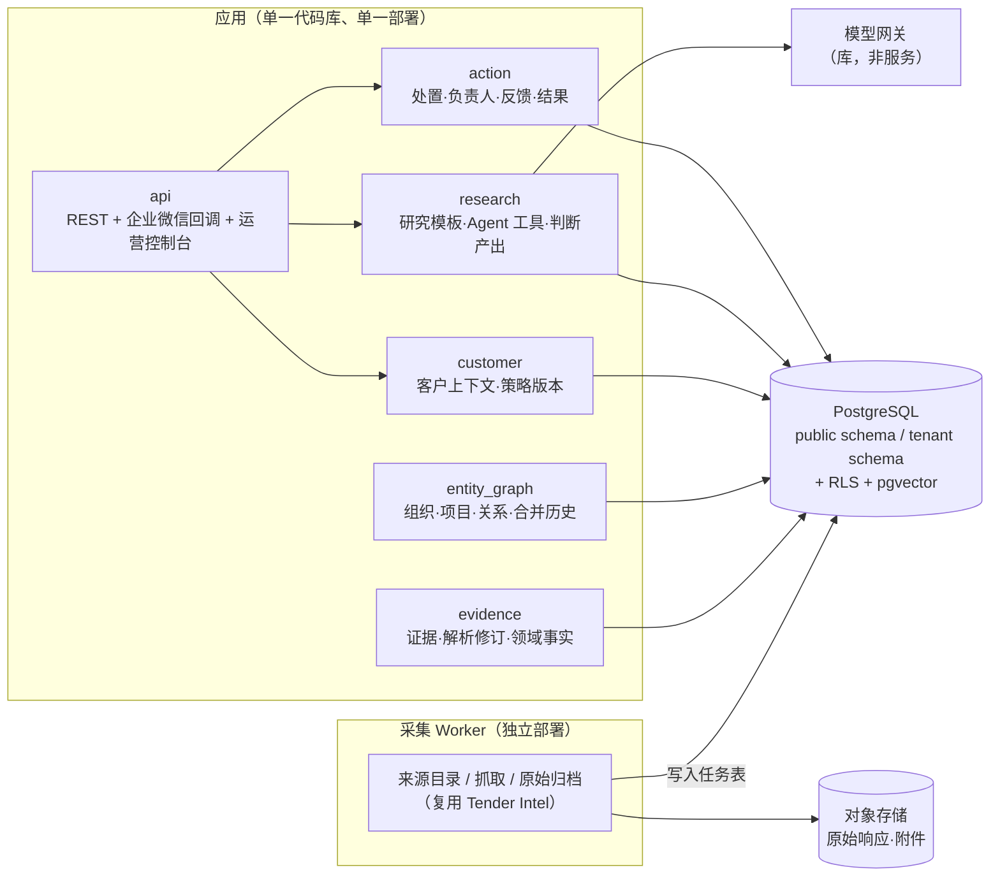

# 妙洽立项评审：项目定位、商业基础与架构策略

> 日期：2026-10-12
> 评审对象：`README.md`、`docs/analysis/AI_NATIVE_OPPORTUNITY_INTELLIGENCE_SAAS_BLUEPRINT_2026-07-26.md`
> 性质：对现有立项材料的批判性评审，不是对蓝图的复述。标注 **H** 的是尚未验证的假设，标注 **待核验** 的是需要外部数据确认的事实。

## 0. 一页结论

现有材料在**数据与证据边界、版本原则、AI 安全边界**上已经很扎实，这是 Tender Intel 实战沉淀下来的真实资产，应当保留。

但作为立项材料，它存在三个结构性问题：

1. **定位描述的是系统，而不是客户愿意付钱的结果。** “懂你业务、会取证、能推理、可协作的 AI 商业机会研究与决策系统”是四个能力形容词加一个品类名，客户听完不知道它替自己解决了哪件具体的事。“行业无关”在立项阶段是负担，不是卖点。
2. **首个垂直场景（管材/建材供应商）与核心用户旅程（bid/no-bid 决策）可能错配。** 材料供应商大多不是招标的直接投标人，而是向中标总包供货。他们真正的旅程很可能是“发现项目 → 找到总包和采购负责人 → 进入供应名录”，而不是“判断要不要投标”。这一点不先验证，整个产品形态都可能做偏。
3. **架构按终局设计，而不是按阶段设计。** 在零付费客户、团队规模未知的情况下规划 8 个独立微服务、Temporal、MCP 全套工具和 ABAC，会把有限的工程资源耗在基础设施上，而立项的真正瓶颈是**付费验证和数据覆盖**。

建议的修正方向：

| 维度 | 现状 | 建议 |
|---|---|---|
| 定位 | 行业无关的 AI 研究与决策系统 | 对外：一个垂直场景里的具体结果承诺；对内：保留通用架构作为长期愿景 |
| 首个场景 | 管材/建材，bid/no-bid 旅程 | 先拆成“直接投标人”和“项目供货商”两类，用访谈确定哪一类付费意愿强 |
| 差异化 | 证据、可控策略、Agent 原生、开放协议 | 证据和可控性是**信任条件**，不是购买理由；购买理由必须是“少漏单、少白跟、早知道” |
| 数据 | 自建 40 个来源 | 覆盖率是 P0 且必输于头部厂商；评估“授权数据 + 垂直补充采集”的组合 |
| MVP | 第 5–12 周建多租户 SaaS 闭环 | 先做 4–8 周**人工辅助的付费简报服务**，验证后再软件化 |
| 架构 | 8 个微服务 | 模块化单体 + 独立采集 Worker，模块边界按蓝图划分，部署单元从 2 个开始 |
| 渠道 | WebUI、MCP、Skills、企业微信、邮件、API | 企业微信 + 一个轻量证据页起步；MCP 作为第二阶段差异化 |

---

## 1. 定位评审

### 1.1 现有定位的问题

**品类名太大。** “商业机会研究与决策系统”可以覆盖招投标、投资尽调、销售线索、竞争情报和政策研究。在立项阶段，一个无法被客户归类的产品，会被归入他已知的最近品类——“又一个招标信息网站”，然后用千里马、剑鱼的价格来比较。

**“行业无关”是架构主张，不是市场主张。** README 已经正确地说“行业无关不等于同时覆盖所有行业”，但品牌和定位仍以通用系统作为第一印象。建议明确分开两层：

- **对外市场定位（未来 12–18 个月）：** 只讲一个垂直场景里的结果。例如（H，待访谈修正）：
  > 妙洽帮管材和水务设备供应商每周找出值得跟进的工程项目，告诉你项目到哪一步、总包是谁、为什么值得跟、还缺什么信息——每一条都能点回原文。
- **对内产品愿景（写进架构文档，不写进销售材料）：** 跨领域的证据化商业研究平台。

**差异化主张错位。** 蓝图列出的组合优势是“来源证据可信、客户策略可控、Agent 原生、领域协议开放、从发现到决策连续、中文政企场景深入”。其中：

| 主张 | 对客户的意义 | 评估 |
|---|---|---|
| 来源证据可信 | 不会因为错的截止日期或资质条件吃亏 | **信任门槛**：必须有，但客户不会因为它付溢价 |
| 客户策略可控 | 不再被关键词噪声淹没 | **可以成为购买理由**，前提是能证明噪声显著下降 |
| Agent 原生 | 对中小供应商销售团队几乎无感知 | 实现手段，不是卖点 |
| 领域协议开放（MCP/API） | 对极少数有 IT 能力的客户有意义 | 2026 年中小建材企业几乎不使用 MCP 客户端，**不应作为首期差异** |
| 发现到决策连续 | 减少在网站、微信群、Excel 之间切换 | 有价值，但剑鱼已宣称覆盖类似链路 [蓝图 S13] |
| 中文政企场景深入 | 理解当地采购语境 | 头部厂商同样具备，需靠**垂直深度**体现 |

真正可以打动客户的只有三类结果：**少漏单、少白跟、早知道**。所有技术主张都应翻译成这三类结果之一，并给出可量化的试点指标。

### 1.2 建议的定位表达

```text
一句话：  [目标客户] 用妙洽 [在某个工作环节] 获得 [可验证结果]，
          因为它 [理解你的产品与资质] 并且 [每个判断都能回到原文证据]。

示例（H）：管材供应商的销售团队用妙洽每周筛出 5–10 个值得跟进的工程项目，
          比原来的订阅渠道少看 80% 的无关公告、提前发现前置信号，
          每条推荐都附带匹配理由、风险和原文定位。
```

品牌主张“懂你业务、会取证、能推理、可协作”可以保留为产品原则，但建议从首页和销售材料中降级。

---

## 2. 商业基础评审

### 2.1 最大的未验证风险：首个场景的用户旅程

蓝图默认的核心旅程是：发现公告 → 研究取证 → 相关性/可信度/风险判断 → **bid/no-bid** → 跟进 → 复盘。它对**直接投标人**成立，但对首选 ICP“建材/管材及工程配套供应商”未必成立。

| 客户子类 | 典型交易方式 | 他们真正关心的问题 | 适配的产品形态 |
|---|---|---|---|
| A. 直接投标人（如水务公司直接采购管材、市政物资集采） | 自己投标 | 是否满足资质、竞争对手是谁、要不要投 | 研究 + bid/no-bid 决策 |
| B. 项目供货商（向中标总包、施工单位供货） | 不参与招标，事后向总包销售 | 哪些项目会用到我的产品、谁中标了、总包的采购负责人是谁、什么时候进场 | **项目线索 + 中标方追踪 + 账户情报** |
| C. 品牌入围型（进入设计院、业主的品牌库/短名单） | 前期影响设计和选型 | 哪些项目在设计/立项阶段、设计院是谁 | **前置信号 + 关系图谱** |

如果钟格这类客户主要属于 B 或 C，那么：

- 最有价值的数据不是招标公告，而是**中标结果、总包身份、项目阶段和前置信号**；
- 最有价值的 Agent 研究不是“要不要投”和“是否存在定向倾向”，而是“这个项目谁中标了、他们历史上从谁那里采购、什么时候需要材料”；
- 决策产物不是 bid/no-bid，而是**“跟进/观察/放弃 + 接触对象 + 时间窗口”**。

**建议：** 把 A/B/C 分类作为访谈的第一个筛选问题，在立项前确定首期服务哪一类。这个决定会改变数据优先级、领域对象和 UI 结构。

另外，“是否存在定向招标倾向”作为示范研究问题需谨慎：输出带有指控性质，误判会带来法律和商誉风险，也不是大多数供应商的高频问题。建议改用“竞争格局”“资质匹配”“项目真实阶段”等高频、低争议的问题作为首批研究模板。

### 2.2 价格与支付意愿

蓝图的价格假设：Discover 3–6 万元/年，Team 8–18 万元/年。需要直面两个事实：

1. 目标客户当前已经在为招标信息付费，现有支出量级需通过访谈核实（**待核验**：头部信息平台的中小企业会员价通常显著低于上述区间）。妙洽的定价需要与“现有订阅 + 内部人工筛选成本”比较，而不是与 GovWin 等海外产品比较。
2. 溢价必须由可量化的结果支撑。建议在试点中计算：

```text
客户可感知价值 / 年 =
    新增有效机会数 × 有效机会转化率 × 平均毛利
  + 节省的筛选与调研工时 × 人力成本
  + 避免的无效跟进次数 × 单次跟进成本
```

只有当这个值稳定在报价的 5–10 倍以上，中小企业才会在没有强关系销售的情况下续费。

**建议：** 试点定价从“能覆盖人工服务成本、且足以筛掉非认真客户”出发（例如万元级，H），重点验证续费意愿，而不是一开始锚定 3–18 万元的 SaaS 套餐。

### 2.3 数据覆盖：最容易被低估的 P0

蓝图把“关键来源覆盖、及时性和健康度可见”列为 P0，这是对的；但当前 40 个来源与头部厂商的覆盖面不在一个量级（**待核验**具体差距）。客户第一次试用时只要发现“我在别处看到的项目这里没有”，信任就会崩塌，后续的证据和推理都无从谈起。

可选的数据策略：

| 策略 | 优点 | 风险 |
|---|---|---|
| 全量自建采集 | 完全可控、证据链完整 | 维护成本高，覆盖追平需要长期投入；爬取商业使用存在法律风险 |
| 采购授权数据（包括竞品的数据 API）+ 垂直补充采集 | 快速达到可用覆盖，团队聚焦决策层 | 依赖供应商，授权条款可能限制再加工和证据展示；成本进入毛利 |
| 垂直窄覆盖 + 明确承诺范围 | 成本低，可在小范围做到最好 | 只适用于来源集中的细分市场 |

**建议：** 立项前先完成一次覆盖率基线测试——取试点客户过去 3 个月实际跟进的 30–50 个项目，看当前来源能命中多少，并评估至少一家授权数据供应商的价格与条款。这个数字决定了自建与采购的比例。

同时，Tender Intel 是否可以合法用于商业 SaaS（来源条款、爬取方式、此前是否以源码形式交付给客户及其知识产权归属）需要在立项前书面确认。

### 2.4 服务先行，而不是 SaaS 先行

蓝图已经意识到“软件 + 人工情报/调优”的必要性，但仍把第 5–12 周规划为构建多租户 SaaS。更稳妥的顺序是：

```text
阶段 0  人工辅助的付费研究简报（4–8 周，5–10 家）
        现有 Tender Intel + LLM 脚本 + 人工复核 → 每周企业微信/邮件简报
        → 验证：新增有效机会、提前量、节省工时、续费意愿

阶段 1  把人工动作中重复度最高的部分软件化
        → 内部运营控制台优先，客户界面最小化

阶段 2  客户自助：策略调优、反馈、研究发起；多租户加固

阶段 3  MCP/API 开放、第二垂直、Pursuit 协作
```

阶段 0 的每一次人工操作都应结构化记录（做了什么研究、用了哪些数据、耗时多少、客户是否采纳），这些记录同时就是第一版评估集和软件需求清单。

### 2.5 单位经济需要尽早算

需要在试点期间测量，而不是事后补算：

- 每个研究任务的模型成本、数据成本和人工复核时间；
- 每个客户每周的有效研究任务数；
- 每个客户的配置与调优人工投入（首月 vs 稳定期）；
- 来源维护成本（按来源数量和故障频率）。

如果稳定期每个客户仍需每周数小时人工，那么产品本质上是“技术加持的情报服务”，定价和融资叙事都要相应调整。这不是坏事，但必须是有意识的选择。

### 2.6 团队与资源

蓝图建议 6–8 人核心团队。立项材料应明确**当前实际可投入的人力和资金**，并按此反推范围。如果当前只有 1–3 人，阶段 0 和阶段 1 的范围需要再压缩一半以上；第 3 节的架构建议正是基于“小团队可执行”这一前提。

### 2.7 建议的立项门槛（替换现有表述的可执行版本）

现有 README 的立项条件方向正确但不可度量。建议改为带截止日期的继续/终止门：

| 门 | 指标 | 截止 | 未达成时 |
|---|---|---|---|
| G1 客户与旅程 | 完成 ≥ 15 次基于真实项目的访谈；确定 A/B/C 中的首期客户类型；写出一条可验收的旅程 | 第 4 周 | 更换垂直或客户类型 |
| G2 数据可行 | 试点客户近期实际项目的覆盖率 ≥ 80%（或有明确的授权补齐方案） | 第 4 周 | 先解决数据来源，暂停产品开发 |
| G3 付费验证 | ≥ 5 家签署**付费**试点（非意向书） | 第 6 周 | 调整价值主张或价格 |
| G4 价值证明 | 试点期每家每周 ≥ 2 条客户确认的新增有效机会或显著提前量；周活 ≥ 60% | 第 12–14 周 | 不进入 SaaS 建设 |
| G5 续费 | ≥ 3 家转为年费 | 第 14–16 周 | 重新评估方向 |

---

## 3. 软件架构评审

### 3.1 应当保留的设计（核心资产）

以下原则正确且来自实战，应作为不可妥协的架构约束：

- 来源观察、证据、领域事实、客户判断、决策、结果分层，“商机”只是聚合视图；
- 证据不可变，来源版本与解析版本分离，研究与判断固定引用版本；
- 公共数据域与租户私有域隔离，租户身份从认证上下文派生；
- Agent 只能通过受控工具访问数据，高影响动作需人工审批；
- 事实、推断、未知项、建议分开记录，不合成单一魔法分数；
- 处置分层（pursue / review / watch / excluded / no_signal）用于冷启动；
- 渠道不复制业务逻辑。

### 3.2 主要问题：服务拆分早于业务验证

蓝图要求“从第一天保持服务契约、数据所有权和独立故障边界”，规划 8 个服务、托管队列、Outbox、Temporal、Redis、OpenSearch 预留和 OIDC 服务。对一个尚无付费客户、团队规模未定的项目，这会带来：

- 每个功能都要跨 3–4 个服务修改契约，迭代速度显著下降；
- 分布式事务、事件重放、服务间鉴权和多套部署占用大量工程时间；
- 边界在业务理解尚浅时划定，后续很可能需要重新拆分，而跨服务的重构代价远高于模块内重构。

**微服务的价值是独立扩展和独立团队交付，这两个条件目前都不存在。** 数据所有权和清晰边界可以用模块化单体以更低成本获得。

### 3.3 对服务边界本身的意见

即使将来拆分，部分边界也值得调整：

| 蓝图中的服务 | 意见 |
|---|---|
| Source Acquisition | **唯一建议从第一天独立部署的单元。** 它的扩展方式（并发、出口 IP、限速）、故障模式（来源变更、反爬）和发布节奏都与业务系统不同 |
| Evidence & Domain Intelligence | 合理。但其中的**实体解析与关系图谱**（采购方、项目、中标方、总包的跨公告关联）被低估了——它是买方历史、竞争格局和项目聚合的共同基础，也是最难被复制的数据资产，应作为独立模块重点投入 |
| Customer Context | 合理，且应与 Policy（策略/规则版本）放在一起 |
| Agent Research 与 Decision & Assessment | **建议合并为一个“研究与判断”模块。** Assessment 是研究的类型化产出，二者共享客户上下文、证据集合和版本固定逻辑；拆开会形成高频同步调用和重复的版本管理 |
| Pursuit & Outcome | 首期只需要“处置 + 负责人 + 反馈 + 结果”几张表；完整任务协作应通过企业微信/CRM 集成解决，而不是自建 |
| Identity & Governance | 范围过大（身份、权限、计量、审计、合规、模型策略）。身份用成熟方案；审计做成横切库 + 表；计量在有付费套餐后再做；合规是流程与配置，不是一个服务 |
| Access & Channel Gateway | 首期是 API 层的一部分，不是独立服务 |

### 3.4 建议的分阶段架构

**阶段 0–1：模块化单体 + 采集 Worker**



关键约束（用代码而不是文档来保证）：

- 模块按蓝图边界划分，每个模块拥有自己的数据库 schema，**禁止跨模块直接读写表**，只能通过模块的公开接口或领域事件；用 import 规则检查（如 `import-linter`）在 CI 中强制执行；
- 公共数据与租户数据在 PostgreSQL 中分 schema，租户表启用 RLS，租户 ID 只从认证上下文注入；
- 异步任务先用 PostgreSQL 实现（outbox 表 + 任务表，或成熟的 Postgres 队列库），**不引入独立消息队列、Redis 和 Temporal**；
- Agent 研究以**有限的研究模板**实现：每个模板是固定的工具集、步骤上限、预算和输出 Schema，配合黄金评估集回归；不做开放式自主 Agent；
- 模型网关先做成库：统一记录模型、提示版本、token、成本、引用覆盖；数据分级和路由策略作为配置；
- 继续使用 Python，最大化复用 Tender Intel 的提取器、领域模型和 216 个测试。

**阶段 2：按实际压力拆分**

只有出现以下信号时才拆出独立服务：

- 研究任务的资源消耗或延迟影响在线请求 → 拆出研究 Worker；
- 实体图谱查询复杂度超过 PostgreSQL 能力 → 引入图存储或搜索引擎；
- 出现第二个领域且由不同人员维护 → 领域适配器独立；
- 企业客户要求专属部署 → 租户域可独立部署。

因为模块边界和数据所有权从一开始就成立，这些拆分是“搬家”而不是“重构”。

### 3.5 首期领域模型要回答的关键问题

在冻结 `ResearchCase v1`、`Assessment v1` 之前，先用 30–50 个真实项目手工走一遍旅程，确认：

1. 客户判断的最小单位是**一条公告**、**一个项目**还是**一个项目里的一个标包**？（这决定 `subject_ref` 的设计）
2. 跨公告的项目合并准确率能做到多少？不确定时如何展示？
3. 对 B 类客户，“中标结果 → 总包 → 联系人”链路中哪些数据可合法获取和展示？
4. 每个研究模板需要哪些工具，每个工具的数据是否已有？
5. 客户反馈的标签体系（相关/不相关的原因枚举）是什么？它决定了策略调优和评估集能否闭环。

### 3.6 渠道优先级

| 优先级 | 渠道 | 理由 |
|---|---|---|
| 1 | 企业微信（应用消息 + 卡片快捷反馈） | 目标用户日常所在，反馈成本最低 |
| 1 | 轻量 Web 证据页（免安装，短时授权链接打开） | 查看原文、证据定位和研究报告 |
| 1 | 内部运营控制台 | 阶段 0–1 的大部分工作由团队完成 |
| 2 | 客户 Web 工作台（策略调优、批量审查） | 有自助需求后 |
| 2 | 邮件摘要 | 管理层周报 |
| 3 | REST/Webhook、MCP、Skills | 有 IT 能力的客户或生态合作出现后；MCP 的设计原则（OAuth、token 派生租户、读写拆分）现在就可以作为 API 设计约束 |

### 3.7 安全与合规：按阶段承担

蓝图中的安全要求全部正确，但不必在阶段 1 全部实现。建议：

- **阶段 0–1 必须：** 租户隔离（RLS + 应用层校验 + 负向测试）、token 派生租户、审计日志、联系人字段分级、模型调用不出境或经客户书面同意、数据来源清单与个人信息处理清单；
- **阶段 2：** RBAC 细化、导出水印、删除 SLA、break-glass 流程、生成内容标识；
- **阶段 3：** ABAC、私有部署、客户自带模型、完整计量计费。

生成式 AI 备案/登记与内容标识要求需在**面向公众或客户自助使用前**由合规人员确认；阶段 0 的人工复核简报形态可以降低这一时点的不确定性，但不能替代评估。

---

## 4. 现有材料的具体修订建议

1. **README 定位章节**：增加一个面向客户的一句话结果承诺，将“行业无关”移到“长期愿景”小节。
2. **README 架构章节**：注明 8 个服务是**目标逻辑边界**，首期实现形态为模块化单体 + 独立采集 Worker；合并 Agent Research 与 Decision & Assessment 的讨论结论需记录在案。
3. **蓝图 3.1 ICP**：按 A/B/C 三类拆分建材/管材客户，并把“你是否直接参与投标”作为访谈筛选题。
4. **蓝图 4.2 示例**：用“竞争格局 / 资质匹配 / 项目阶段与总包识别”替换“定向招标倾向”作为示范研究问题。
5. **蓝图 6.3 基础设施**：删除首期的托管队列、Redis、Temporal，改为 PostgreSQL 任务表与 outbox。
6. **蓝图 8.1 定价**：试点价格与年费锚点改为在访谈得到现有支出后再定。
7. **蓝图 9 路线图**：在阶段 0 与阶段 1 之间插入“人工辅助付费简报”阶段，并采用 2.7 节的继续/终止门。
8. **新增**：Tender Intel 的知识产权与商业使用授权确认；数据覆盖率基线测试；当前团队与预算说明。
9. **文档一致性**：蓝图文件名日期为 2026-07-26，正文日期为 2026-10-12，外部来源核验日期为 2026-07-26；Tender Intel 基线数据（40 个来源、216 个测试）需在立项前重新运行确认。

---

## 5. 未来两周的优先行动

按依赖关系排序：

1. **确认资源与权利**：团队人数、预算周期；Tender Intel 代码与数据的商业使用权。
2. **覆盖率基线**：请钟格等现有客户提供近 3 个月实际跟进的项目清单，测当前来源命中率；同时询价至少一家授权数据供应商。
3. **访谈筛选**：用 A/B/C 分类筛选 15 家目标企业，优先访谈最近一个真实项目的发现、判断和成交过程，并询问现有工具支出。
4. **手工旅程演练**：选 30 个真实项目，用现有引擎 + 人工研究产出简报，记录每一步耗时、数据缺口和判断依据。
5. **付费简报方案**：一页纸说明交付物、周期、价格、成功指标和数据边界，向访谈中意愿最强的客户提出。
6. **架构决策记录（ADR）**：记录“模块化单体 + 采集 Worker”“研究与判断合并为一个模块”“PostgreSQL 承担队列”三项决定及其拆分触发条件。

在 G1–G3 通过之前，不建议开始多租户 SaaS 的工程建设。
